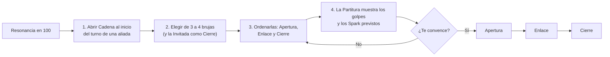

# SAL Y ALMAS — La Odisea del Fresno

Documento de Diseño de Juego (GDD) · título de trabajo · Nov 4, 2026 · @Adass

## 1. Resumen ejecutivo

**Sal y Almas (en inglés, Salt & Souls)** es un RPG gacha por turnos para móvil ambientado en un isekai medieval de brujas furras. Las brujas comen sal para lanzar magia y proyectan a su **Ascendente**, un espíritu astral que pelea detrás de ellas (nuestra versión original de los *stands*). El juego tiene tres capas: una travesía alrededor del mundo, no lineal y con sistema LitRPG (historia); combate táctico por turnos con cadenas de combos (núcleo); y un roguelike que consiste en escalar **el Fresno**, el árbol gigante adonde van todas las almas (endgame).

Esta es la versión final del concepto. Integra lo mejor de *Astral Salt* y *Sal y Almas* (sección 4) y suma una capa de horror cósmico (sección 6.5).

**Pitch de una línea:** brujas furras que comen sal y pelean con su Ascendente cruzan el mundo para escalar el árbol donde terminan todas las almas.

| Campo | Definición |
| --- | --- |
| Género | RPG gacha por turnos + roguelike + LitRPG no lineal |
| Plataforma | iOS y Android, orientación horizontal; PC como puerto posterior |
| Motor | Unity 6 LTS con URP |
| Modelo de negocio | Free-to-play. Ingresos por cosméticos, pase de temporada, tarjeta mensual y tiradas. Sin duplicados |
| Rarezas | 3★ Aprendiza, 4★ Oficiala, 5★ Regente |
| Sesión típica | 3 a 5 min (misión diaria), 15 a 25 min (un anillo del Fresno) |
| Público objetivo | Jugadores de gacha de 18 a 34 años, fandom furry y anime, fans de roguelikes |
| Clasificación objetivo | 17+ (ver sección 5); todo el elenco es adulto |
| Título | De trabajo |

**Los cinco ganchos que nos diferencian:**

1. **La sal es el maná.** La bruja se la come en pantalla. Entre más pura su sal, más poder tiene, más se especializa su elemento y más espectacular se ve.
2. **Ascendentes.** Cada bruja tiene un espíritu nacido de su carta natal. Lo usa para atacar y también para hechizarse a sí misma, a cambio de un costo.
3. **Cero duplicados.** Cada bruja se obtiene una sola vez. Los rangos se ganan jugando, con pruebas que cada vez cuestan más.
4. **El Fresno.** Un roguelike vertical donde las almas que sueltas al morir se quedan en el árbol hasta que regresas por ellas, como en Dark Souls.
5. **Crafting tipo Terraria.** Más de 120 armas al lanzamiento, con recetas, estaciones de trabajo y fusiones legendarias.

Además, las tiradas ocurren en unas termas místicas de donde emerge la bruja, y debajo de la fantasía hay un horror cósmico que el jugador decide cuánto mirar.

## 2. Qué hace determinante a un gacha

Un gacha no gana por descargas sino por retención. Para retener necesita tres cosas: personajes que el jugador desee, una progresión que no se acabe y un combate que valga la pena repetir. Todo lo demás (pity, eventos, colaboraciones) amplifica esas tres bases o compensa su ausencia.

### Mercado 2026 en cifras

- El gasto global en gachas móviles fue de unos **561 millones de dólares en junio de 2026** ([FoxData](https://foxdata.com/en/blogs/gacha-revenue-june-2026-honor-of-kings-retakes-1/)). Honor of Kings, que monetiza sobre todo con apariencias, volvió al primer lugar.
- La retención cae en toda la industria. El D1 del mejor cuartil ronda **26–27 %**, el D7 mediano **3.4–3.9 %**, y el 75 % de los títulos queda por debajo del **3 % al D28** (GameAnalytics 2026, citado en [este análisis](https://m-pest.pages.dev/en/layers/product-craft)).
- Adquirir un jugador cuesta en promedio **4.22 USD en iOS y 2.97 USD en Android**, y cerca del **62 %** de los 100 juegos con más ingresos ya vende por tienda web directa ([misma fuente](https://m-pest.pages.dev/en/layers/product-craft)).

### Los ocho factores y cómo los aplicamos

| Factor | Evidencia | Decisión en Sal y Almas |
| --- | --- | --- |
| Deseo por el personaje | El apego a diseño, voz e historia es lo que hace tirar ([esports.gg](https://esports.gg/opinion/gaming/why-gacha-games-successful/)) | Cada bruja tiene silueta, voz, ritual de sal y transformación visual propios |
| Profundidad, amplitud y deseo | La profundidad del gacha decide la retención a largo plazo y el gasto máximo ([WN Hub](https://wnhub.io/news/other/item-13225)) | Profundidad: rangos de Destilación, Ascendente y armas. Amplitud: elenco y más de 120 armas |
| Combate como razón de existir | Chaos Zero Nightmare se sostiene por su combate aunque fuera de él se vea barato ([Game8](https://game8.co/articles/reviews/8744)) | El presupuesto de arte va primero a combate y ultimates |
| Modos de habilidad, no de dinero | GachaCon 2026 propone modos que dependan de la maestría para romper la rutina de contenido ([DiGRA](https://dl.digra.org/index.php/dl/article/download/2744/2730/2790)) | El Fresno es un roguelike con reglas rotativas donde la composición pesa más que el gasto |
| Pity y transparencia | El pity ya es estándar de la industria ([GameRefinery](https://gameindustrylibrary.com/documents/innovative-monetization-features-snapshot-report-2022/read)) | Pity duro, probabilidades visibles y contador que pasa entre banners |
| Aniversarios y actualizaciones grandes | La actualización de 1.5 años de Nikke disparó sus ingresos cerca de 217 % en dos días ([PocketGamer.biz](https://www.pocketgamer.biz/goddess-of-victory-nikke-celebrates-second-anniversary-and-nearly-900m-on-mobile)) | Calendario con picos planeados (sección 22) |
| Japón como mercado central | Japón aportó el 58.4 % de los ingresos móviles de Nikke en dos años ([PocketGamer.biz](https://www.pocketgamer.biz/goddess-of-victory-nikke-celebrates-second-anniversary-and-nearly-900m-on-mobile)) | Voces en japonés desde el lanzamiento; textos en español, inglés y japonés |
| Espectáculo que tapa la simpleza | Nikke esconde una mecánica central poco profunda detrás de un juego vistoso y rápido ([Naavik](https://naavik.co/deep-dives/nikke-goddess-of-victory-deconstruction/)) | Nosotros queremos ambas cosas: espectáculo y profundidad real en la cadena de combos |

### Reglas que el diseño debe cumplir desde el día uno

- **Corea del Sur** obliga por ley a publicar probabilidades desde marzo de 2024 ([PMC](https://pmc.ncbi.nlm.nih.gov/articles/PMC12583229)) y discute multas de hasta 3 % de las ventas ([Outlook Respawn](https://respawn.outlookindia.com/gaming/gaming-news/south-korea-proposes-revenue-based-fines-for-loot-box-violations)).
- **Japón** declaró ilegal el *kompu gacha* (juntar piezas de varias tiradas para un premio) en 2012 ([DiGRA](https://dl.digra.org/index.php/dl/article/download/2749/2735/2795)). Ningún sistema nuestro puede pedir completar sets obtenidos por tiradas.
- **Bélgica** prohibió en la práctica las cajas de botín pagadas en 2018, y China exige publicar probabilidades ([mwm.ai](https://mwm.ai/glossary/gacha)). Plan: versión sin gacha pagado para Bélgica (banners solo con moneda ganada jugando).

**Conclusión para el diseño:** con retención D7 de un dígito como norma, las primeras sesiones deciden todo. La primera cadena de combo debe ocurrir antes del minuto 3, y la primera bruja 5★ debe estar garantizada antes del día 2.

## 3. Referencias: qué tomamos y qué evitamos

De cada referencia tomamos una mecánica concreta y evitamos su punto débil conocido. Nada se copia tal cual: nombres, símbolos y sistemas se rehacen con identidad propia.

| Referencia | Qué tomamos | Qué evitamos |
| --- | --- | --- |
| [Honkai: Star Rail](https://www.icy-veins.com/honkai-star-rail/combat-basics) | Orden de turnos por Action Value y Velocidad, barra de Firmeza con debilidades, puntos de habilidad compartidos, ultimates que interrumpen el turno | Copias (Eidolons) que abren brechas de poder; el peor caso de 180 tiradas para el personaje destacado |
| Genshin / Hoyoverse | Reacciones entre elementos, producción cinemática, versiones cada seis semanas | Sequías de contenido entre parches |
| [Eminence in Shadow: Master of Garden](https://apps.apple.com/us/app/the-eminence-in-shadow-rpg/id1644170422?mt=8) | Medidor de combo que dispara Strike Combos generados por el orden de acción del equipo; charla diaria con tu personaje favorito en la pantalla de inicio | Depender de una licencia; reseñas mixtas en Steam |
| [Brave Frontier](https://bravefrontierglobal.fandom.com/wiki/Wicked_Warrior_Shura) | **Spark**: daño extra cuando golpes de dos unidades coinciden en los mismos frames; Brave Burst en tres niveles (BB, SBB, UBB); habilidad de líder; unidad amiga | El power creep de sus evoluciones; el grind de unidades sacrificables |
| [Nikke](https://automaton-media.com/en/?p=24443) | Diseño de personaje como motor de ventas, historia oscura que retiene, eventos de aniversario | Una mecánica central con poca agencia del jugador |
| [Chaos Zero Nightmare](https://blog.prydwen.gg/?p=12320) | Runs roguelike con mapa de nodos, estrés individual que provoca colapso, **Save Data** para guardar la build de una run | Interfaz y arte fuera de combate baratos; gacha exigente para F2P |
| [Secrets of the Silent Witch](https://www.primevideo.com/detail/0LUOBVGVL9MDRCWMUAKWBLZMSE) | Magia que normalmente exige cantar, y una bruja única capaz de lanzarla en silencio; un consejo de siete sabios | Copiar nombres o el reino de Ridill |
| JoJo: Stardust Crusaders | Viaje por carretera con un rival nuevo en cada parada; espíritus que pelean junto a su dueño | La palabra *Stand*, espíritus con nombres de cartas del tarot y la iconografía propia de JoJo |
| La Odisea | Viaje de regreso a casa por islas, cada una con su prueba | Linealidad estricta |
| [NieR Replicant](https://blog.playstation.com/?p=345019) | Música melancólica con voces en un idioma inventado (el *Chaos Language* de Emi Evans), destinos trágicos | Imitar melodías concretas |
| Terraria | Estaciones de trabajo, árbol de recetas, fusionar armas en una legendaria, prefijos aleatorios al reforjar | Recetas que exigen una wiki para entenderse |
| Dark Souls | Las almas sirven como experiencia y dinero; al morir se quedan donde caes y tienes un intento para recuperarlas | La pérdida total, que en móvil frustra demasiado |
| [Tokyo Afterschool Summoners](https://en.wikipedia.org/wiki/Tokyo_Afterschool_Summoners) y Live A Hero | Prueba de que el fandom furry juega gachas: un lobo grande y fornido atrajo a ese fandom a Housamo ([TV Tropes](https://tvtropes.org/pmwiki/pmwiki.php/YMMV/TokyoAfterschoolSummoners)) | Quedarse en un nicho: Live A Hero sigue sin traducción oficial años después ([encuesta](https://housamo-skill.netlify.app/blog/2024/community-survey-2024)) |

**Hueco de mercado:** los gachas furros que existen están centrados en personajes masculinos y en el mercado japonés. No hay un gacha grande de brujas antropomórficas femeninas con producción tipo Hoyoverse. Es una oportunidad sin competencia directa, pero también sin prueba de que el mercado sea grande (ver riesgos, sección 24).

## 4. Auditoría de los conceptos previos: Astral Salt y Sal y Almas

Los dos conceptos coinciden con este documento en lo esencial: la sal como maná, el refinamiento que cambia el cuerpo, cero duplicados y un roguelike en el árbol. **Astral Salt aporta la mejor mecánica de combate; Sal y Almas, la mejor estructura de progresión.** Ninguno resuelve economía, tecnología, regulación ni propiedad intelectual. El concepto final (secciones 5 a 24) toma lo mejor de los tres y corrige sus contradicciones.

### 4.1 Astral Salt

**Fortalezas**

- La mejor idea de combate: la misma bruja hace algo distinto según su lugar en la cadena. Coincide con lo que promete Master of Garden, combos generados por el orden de acción del equipo.
- Spark con tiempos por golpe, y armas que mueven esos tiempos. Así el crafting afecta directamente al combate.
- Un Autohechizo con vocabulario visual concreto: agujas astrales, sellos ardientes, hilos de luz, el espíritu que se funde con la espalda.
- Un lore que une todo: la sal es residuo de almas cristalizadas. La magia turbia lo es porque literalmente carga restos de muertos.
- Brujas "kk" memorables: la zarigüeya que finge morir y la cabra que se intoxica con sal.

**Debilidades**

- Demasiados sistemas al mismo tiempo: cinco brujas, cadena de cinco, Spark, tres barras de Burst, salinidad, pociones y medidor de Strike. En la pantalla de un teléfono eso no se lee.
- Se contradice con los duplicados. Una "Esencia Astral Universal" que da progreso es un duplicado con otro nombre.
- Ata la fase visual a la rareza (3★ contenida, 5★ voluptuosa). Confunde rareza con progreso.
- Una ventana de Spark de 30 ms en tiempo real no funciona por turnos: el jugador no controla el tiempo, así que el Spark sería azar.
- Afirma sin fuente que cero duplicados "genera lealtad masiva" y que el Strike Combo es una cadena de cinco.
- Sus prompts piden todo "sin placeholders" en un solo artefacto web. Eso no cabe en un one-shot y no lleva a un producto móvil.

### 4.2 Sal y Almas

**Fortalezas**

- La filosofía correcta: juego primero, gacha después.
- Una gramática de combo fácil de leer: Preparación, Potenciación, Ejecución.
- El Ritual de Pureza: subir de rango peleando contra tu propio espíritu. Es la mejor respuesta al pedido de que cada rango cueste más.
- El Eco para guardar la build de una run, y maldiciones opcionales a cambio de más almas.
- La Echización como vistazo temporal a la forma refinada. Le muestra al jugador lo que gana si refina.
- Fases con criterios de éxito medibles, y el principio de que el jugador nunca ve todos los sistemas a la vez.

**Debilidades**

- Casi no tiene astrología, aunque era un pedido explícito.
- Las almas no se pierden al morir: falta la parte Dark Souls.
- Su economía se contradice. La moneda de pago solo sirve para cosméticos, pero el juego es un gacha. El "80 % de ingresos por cosméticos" no tiene fuente.
- Los Stands como unidades aparte (cuatro brujas, cuatro Stands, tres activos) complican el equipo sin aportar.
- La Energía de Ascenso corta las runs a la mitad.
- Solo cinco tipos de arma, lejos de la variedad de Terraria.
- Cita *Ascenders: Beyond the Peak* sin explicar qué toma. No pude verificar esa referencia.
- Sus "fases one-shot" son hitos de tres meses, no prompts para Claude.

### 4.3 Huecos que ninguno cubre

- Tasas, pity, ingresos F2P y curva de costos (secciones 12 y 16).
- Fórmulas de daño y de velocidad (sección 9).
- Propiedad intelectual: *Stand* es término de JoJo y *Yggdrasil* está muy usado (secciones 8 y 24).
- Regulación de probabilidades y clasificación por edad (secciones 2, 5 y 24).
- Presupuestos técnicos para móvil: polígonos, pelaje, físicas (sección 21).
- LitRPG concreto: ventanas de estado, clases y títulos (sección 13).
- Live ops, KPIs y calendario (sección 22).

### 4.4 Tabla de decisiones

AS = Astral Salt. SyA = Sal y Almas. La columna Decisión es editable.

| Idea | Origen | Decisión | Cómo queda en el concepto final |
| --- | --- | --- | --- |
| Cadena por posición: la misma bruja actúa distinto según su lugar | AS | Adaptar | Tres variantes por bruja (Apertura, Enlace, Cierre) en lugar de cinco; cadena de 3 o 4 brujas, y la Invitada puede cerrar |
| Gramática Preparación, Potenciación, Ejecución | SyA | Adaptar | El lugar define el papel, así que no hay orden "incorrecto"; los Aspectos entre vecinas premian la mejor combinación |
| Spark con tiempos por golpe | AS | Adaptar | Frames fijos a 60 fps, ventana de 2 frames, +50 % a ese golpe; la Partitura muestra los Spark antes de confirmar |
| Armas que mueven los frames de golpe | AS | Adoptar | Conecta crafting y combate (sección 15) |
| Tres barras: BB, SBB y UBB | AS | Adaptar | Una sola barra de Ánima con tres niveles de Ascensión |
| Equipo de cinco brujas | AS | Rechazar | Cuatro brujas más una Invitada; cinco activas saturan la pantalla |
| Stands como unidades aparte | SyA | Rechazar | El Ascendente es parte de la bruja y no ocupa lugar en el equipo |
| Salinidad individual con Cristalización Turbia | AS | Adoptar | Medidor de 0 a 150 con cinco bandas (sección 7.4) |
| Sobresalación con fallos de hechizo | SyA | Rechazar | Fallar al azar frustra en un juego por turnos; la banda alta baja la defensa |
| Autohechizo: agujas, sellos, hilos, fusión | AS | Adoptar | Vocabulario visual oficial (sección 8) |
| Echización: fusión temporal con la forma refinada | SyA | Adaptar | Se llama Vislumbre: dos turnos con el aspecto del siguiente grado; cuesta Sal Negra, no almas |
| Auto-Echización con Sal Negra (+100 % daño, −50 % defensa) | SyA | Adaptar | Una de las tres formas del Autohechizo |
| Ocho elementos en cuatro pares opuestos | SyA | Adaptar | Siete sales planetarias; las oposiciones salen de la astrología clásica |
| Mezclar opuestos crea un híbrido (Vapor, Tempestad) | SyA | Adaptar | El híbrido es una reacción dentro de la cadena, no la identidad de la bruja |
| Escalera de pureza con nombres (Ceniza Salobre, Fuego Pálido, Corona Solar) | AS | Adoptar | Cada planeta tiene su escalera de tres nombres |
| Fase visual ligada a la rareza | AS | Rechazar | La fase depende del grado de Destilación; una 3★ también llega a su forma final |
| Rango D a S con un ritual cada vez más difícil | SyA | Adaptar | Grados D, C, B, A, S y SS; cada subida exige un Juicio de Pureza |
| Pelear contra tu propio espíritu para subir | SyA | Adoptar | Es el Juicio de cada grado, con una condición LitRPG tomada de AS |
| Duplicados convertidos en moneda universal | AS | Rechazar | Sería un duplicado disfrazado. Usamos exclusión: una bruja que ya tienes no puede salir |
| Polvo Astral para cosméticos | SyA | Adaptar | Solo sale cuando ya tienes a todas las brujas de ese banner |
| Pity de 70 que pasa entre banners | SyA | Adoptar | Pity duro en 70, destacada 75/25 con garantía, contador compartido |
| Moneda de pago solo para cosméticos | SyA | Rechazar | Sin ingresos por tiradas el modelo no se sostiene. Sí vendemos tiradas; nunca materiales de progreso |
| "80 % de ingresos por cosméticos" | SyA | Rechazar | Cifra sin fuente; queda como hipótesis a validar (sección 16) |
| Eco: guardar la build de una run | SyA | Adoptar | Basado en el Save Data de Chaos Zero Nightmare (sección 10) |
| Mutaciones del Árbol y maldiciones opcionales | AS y SyA | Adoptar | Capa de riesgo y recompensa del Fresno |
| Éxtasis Abisal: el espíritu toma el control | AS | Adoptar | Ocurre al llegar a 150 de Salinidad |
| Zonas Raíces, Tronco, Ramas y Copa | AS | Adoptar | Las cuatro zonas del Fresno |
| Árbol que crece con almas ofrendadas | SyA | Adoptar | Ofrenda al Fresno: progreso de cuenta y sumidero de almas |
| Almas que se pierden al morir y se recuperan | AS | Adaptar | Tienes un intento; si fallas, el Fresno te devuelve el 30 % como Savia |
| Reloj de eclipses con plazo | AS | Adaptar | Solo narrativo: cambia qué regiones se corrompen, nunca bloquea al jugador |
| Protagonista transferida con interfaz de cálculo silencioso | AS | Adoptar | Ella dirige la Cadena; su poder es calcular el orden |
| Cámara de cuatro cortes en cada turno | AS | Adaptar | Solo en Ascensiones y Cierres; completa la primera vez, corta y saltable después |
| Transformación tipo *mahou shoujo* al subir de grado | SyA | Adoptar | Una vez por grado, con opción de compartir |
| Leitmotiv con instrumento solista por bruja | SyA | Adoptar | Sección 20 |
| Cinemáticas de 8 a 10 segundos | SyA | Rechazar | Máximo 6 a 8 s la primera vez y 2 a 3 s después |
| React y Canvas como base | AS | Adaptar | Sirve solo para maquetas rápidas; el prototipo y la producción usan un núcleo de C# en Unity 6 |
| Fases con criterios de éxito medibles | SyA | Adoptar | Cada prompt trae criterios de aceptación y prueba con jugadores |
| Brujas "kk": topo, zarigüeya, cabra | AS y SyA | Adoptar | Entran al elenco (sección 18) |
| Estaciones Caldero, Yunque Astral, Altar del Árbol | SyA | Adoptar | Se suman estaciones regionales (sección 15) |
| Solo cinco tipos de arma | SyA | Rechazar | Doce familias de armas |
| Atuendos translúcidos y venas en el escote | AS | Adaptar | Se mantiene el atractivo con reglas de vestuario y cámara (sección 19) |
| Los nombres *Stand* y *Yggdrasil* | AS y SyA | Rechazar | Ascendentes y el Fresno |

## 5. Pilares, público y clasificación

Seis pilares deciden cada disputa de diseño: si una idea no sirve a uno de ellos, no entra.

1. **Toda magia tiene precio.** Cada hechizo cuesta sal, sube la Salinidad o arriesga almas. El poder sin costo no existe.
2. **El orden es poder.** La habilidad del jugador está en decidir quién actúa y en qué lugar de la Cadena, no en reflejos.
3. **Refinar es transformarse.** Cada grado de Destilación cambia cómo pelea la bruja y cómo se ve. El progreso mecánico y el visual son el mismo progreso.
4. **Todo vuelve al Fresno.** Nada se desperdicia: las almas perdidas regresan en parte, los duplicados no existen y cada run deja algo.
5. **Gratis y justo.** Sin duplicados, sin venta de materiales de progreso, probabilidades visibles y pity que no se pierde.
6. **Melancolía hermosa.** Un mundo que se está salando hasta morir, con humor entre brujas que se quieren. El tono es NieR, no comedia genérica.

### Público

| Segmento | Quiénes son | Qué los atrae |
| --- | --- | --- |
| Primario | Jugadores de gacha de 18 a 34 años que ya juegan HSR, Nikke o Genshin, en Japón, EE. UU., Corea y Latinoamérica | Producción alta, combate táctico, personajes deseables |
| Secundario | Fandom furry adulto, hoy con pocos gachas de calidad y casi ninguno con protagonistas femeninas | Brujas antropomórficas con diseño de primer nivel |
| Terciario | Fans de roguelikes como Chaos Zero Nightmare o Slay the Spire | El Fresno, builds y rejugabilidad |

El público no es solo masculino: cerca del 40 % de los jugadores de Nikke en Corea son mujeres ([Automaton](https://automaton-media.com/en/?p=24443)). Por eso la moda, la historia y el protagonista personalizable pesan tanto como el fanservice.

### Clasificación y reglas de contenido

Objetivo: 17+ en App Store y su equivalente en Google Play. Las reglas no se negocian:

- Todo el elenco es adulto en el lore y **se ve adulto**. Ninguna bruja con rasgos infantiles recibe diseño sugerente.
- Sin desnudos ni actos sexuales. Las prendas pueden ser ajustadas, escotadas o con aberturas, pero nunca transparentes en zonas íntimas.
- La cámara puede encuadrar la silueta, pero no se detiene en primeros planos de zonas íntimas.
- Variedad de cuerpos y especies: no todas las brujas son voluptuosas; la transformación escala la presencia de cada una según su diseño.
- Opción de modo recatado en ajustes, para mercados con normas más estrictas y para jugadores que lo prefieran.

## 6. Mundo, historia y travesía

El mundo de **Halia** es un anillo de doce regiones alrededor de un mar interior. En el centro del mar crece **el Fresno**, el árbol adonde van todas las almas. La historia es un viaje de regreso a casa al estilo de La Odisea: dar la vuelta al anillo y llegar al Fresno, que es el hogar de todas las almas.

### Cosmología

- **Todo tiene alma.** Personas, bestias, plantas, herramientas y piedras. Al morir, el alma viaja por los Ríos Lácteos hasta el Fresno, que la recicla.
- **El Fresno está enfermo.** Ya no absorbe las almas. Antes de llegar, se cristalizan en el camino y se vuelven **sal**. Halia se está cubriendo de Sal Blanca: campos, ríos y ciudades.
- **Las brujas comen esa sal.** Al digerirla usan la fuerza y los recuerdos del alma cristalizada. Por eso su magia es *turbia*: carga restos de muertos ajenos.
- **Refinar libera.** Purificar la sal separa al alma de sus impurezas y la deja volver al Fresno. Entre más refinada la magia de una bruja, más almas libera y más se parece a su verdadero ser astral.
- **Los Ascendentes** nacen del signo que subía en el horizonte cuando nació la bruja. Se alimentan de *almitas*, los restos de alma que todavía no se cristalizaron.

**El giro de la historia** (estilo NieR): el Fresno enferma precisamente porque las brujas llevan siglos comiendo sal turbia sin refinarla. Las heroínas son parte del problema. Los finales dependen de cuánto refinó el jugador y de sus decisiones en cada región.

### Protagonista: la o el Calculista

Una persona de nuestro mundo cuya alma se cayó del Río Lácteo y despertó en Halia (isekai). Como su alma no está registrada, puede leer el **Libro Mayor del Fresno**: las ventanas de estado del sistema LitRPG. No puede lanzar magia, pero calcula en silencio, como la bruja silente de *Silent Witch*. **Su poder es dirigir la Cadena:** decide en qué orden actúan las brujas. Es personalizable (especie, cuerpo, voz y pronombres), y el jugador elige su signo ascendente, que define la región donde empieza.

### La caravana y las Termas

El equipo viaja sobre **la Tortuga de las Termas**, una tortuga gigante con un manantial termal en el caparazón. Es la base del juego: ahí las brujas descansan, el jugador conversa con ellas (como en la pantalla de inicio de Master of Garden) y ocurren las tiradas del gacha (sección 16). Es el coche de Stardust Crusaders y el barco de Ulises a la vez.

### Las doce regiones

Cada región es un capítulo con una **Casa** enemiga, un aquelarre regido por su signo y con un Ascendente corrupto (el rival nuevo en cada parada, como en Stardust Crusaders). Cada capítulo hace eco de un episodio de La Odisea. Sobre las Casas están las **Siete Sabias**, una por planeta, que mantienen el orden de la sal; su papel es ambiguo.

| Signo | Región | Inspiración cultural | Eco de La Odisea | Conflicto |
| --- | --- | --- | --- | --- |
| Aries | Montes de Hierro Rojo | Iberia medieval, fortalezas | Los cícones | Una Casa guerrera saquea las minas de sal |
| Tauro | Llanuras de Cobre | Países Bajos, molinos | Los lotófagos | Un pueblo come una sal dulce que borra recuerdos |
| Géminis | Ciudad Espejo | Venecia, canales | El odre de Eolo | Dos hermanas mensajeras y un viento embotellado |
| Cáncer | Costa de las Conchas | Bretaña, mareas | Los lestrigones | Cangrejos gigantes hunden los barcos salineros |
| Leo | Desierto Áureo | Al-Ándalus y Magreb | El ganado del Sol | Tocar los rebaños solares trae castigo |
| Virgo | Abadía de las Herbolarias | Monasterios centroeuropeos | Circe | Una bruja convierte a los visitantes en bestias sin alma |
| Libra | Ducado de las Balanzas | Ciudades-Estado italianas, banca | Los feacios | Todo se paga con almas |
| Escorpio | Pantanos de Azufre | Folclor de Europa del Este | El descenso al Hades | Hay que bajar al Río Lácteo |
| Sagitario | Estepas del Centauro | Nómadas de la estepa | El cíclope | Un gigante de un ojo custodia el paso |
| Capricornio | Salinas de Obsidiana | Mesoamérica: salinas de Zapotitlán y Cuyutlán, obsidiana, cacao | Escila y Caribdis | Remolinos de sal se tragan las caravanas |
| Acuario | Archipiélago de Hielo | Escandinavia e Islandia | Las sirenas | Cantos que atraen hacia el agua helada |
| Piscis | Isla de la Ninfa | Bizancio y Grecia | Calipso | Una isla donde quedarse para siempre |

**Estructura no lineal:** el jugador empieza en la región de su signo y avanza en el sentido que quiera. Cada dos regiones hay un **eclipse**. Las regiones no visitadas se corrompen un poco más: cambian sus eventos, sus enemigos y algunos finales locales. El reloj de eclipses nunca bloquea al jugador ni le hace perder progreso.

### 6.5 Horror cósmico: lo que mira desde fuera del cielo

Sobre la copa del Fresno está el **Firmamento Exterior**, y algunas estrellas no son luces. Son **los Huéspedes**: entidades inmensas que llegaron como "estrellas nuevas" que ningún astrólogo había registrado. No son malvadas. Son indiferentes, enormes e incomprensibles, y Halia les importa como un huerto le importa a quien lo cosecha.

**Tres capas de revelación**

1. **Superficie (regiones 1 a 4).** El Fresno está enfermo y las brujas comen sal. Parece un drama de fantasía.
2. **Grieta (regiones 5 a 8).** Hay estrellas sin nombre en el cielo. Los Ascendentes no nacen de los signos: son fragmentos de los Huéspedes que miran Halia a través de la carta natal de cada bruja. Cada Ascendente es una ventana.
3. **Abismo (regiones 9 a 12 y la Copa Astral).** El Fresno no recicla almas: es la raíz de algo que crece del otro lado del cielo. Las hojas son almas maduras, y la Jardinera las poda para los Huéspedes. La crisis de la sal es temporada de cosecha. Las brujas que comen sal turbia, sin saberlo, le están robando la cosecha a algo que no deberían provocar.

Esto convierte el giro de la sección anterior en un dilema sin respuesta limpia. Refinar todo devuelve las almas al Fresno y alimenta a los Huéspedes. Seguir con la magia turbia mata al árbol y deja a Halia sin reencarnación. Un final secreto depende de la Calculista, la única alma que no está escrita en el Libro Mayor.

**Paralaje: el costo de ver**

El **Paralaje** es un medidor de cuenta que sube al presenciar lo cósmico: pelear contra Huéspedes, leer saber prohibido o entrar en Éxtasis Abisal.

| Paralaje | Qué cambia |
| --- | --- |
| Bajo | Nada; el jugador casual nunca es castigado |
| Medio | Aparecen debilidades ocultas en los enemigos; las constelaciones de los menús se redibujan; los Ascendentes susurran líneas nuevas |
| Alto | Las ventanas de estado fallan: números sustituidos por glifos y textos en Salmódico. En el Fresno, los enemigos se vuelven aberrantes y las recompensas suben |
| Máximo | Se abren diálogos y finales secretos. Los Ascendentes en Caída muestran por un instante su forma verdadera |

Bañarse en las Termas baja el Paralaje: el agua hace olvidar. Así el jugador decide cuánto quiere ver.

**Enemigos y escenas**

- **Huéspedes:** geometría imposible, ojos dispuestos como constelaciones, metal líquido que se pliega en ángulos que no deberían existir.
- **Cristalizados:** personas a medio convertir en sal, estatuas que todavía susurran. Horror corporal contenido, sin sangre.
- **Los Sin Carta:** seres sin carta natal. Los Aspectos no les afectan, así que obligan a pelear distinto.
- **El cielo demasiado cerca:** constelaciones que se mueven cuando la cámara deja de mirarlas.

**Reglas de tono:** pavor antes que gore, nada de sustos repentinos y las Termas siempre son zona segura. El horror sirve a la melancolía de NieR y no rompe la clasificación del juego.

## 7. Sistema de magia: sal, Destilación y Salinidad

La magia descansa en tres cosas: la **sal** que la bruja come (el recurso), la **pureza** de esa sal (el progreso) y la **Salinidad** que se acumula en su cuerpo (el riesgo). Las siete sales vienen de los siete planetas clásicos de la astrología y la alquimia, cada uno con su metal.

### 7.1 Las siete sales planetarias

| Planeta | Metal | Sal | Papel en combate | Escalera de pureza: Turbia, Destilada, Quintaesencia | Secta |
| --- | --- | --- | --- | --- | --- |
| Sol | Oro | Sal Áurea | Daño en área, quemadura | Ceniza Salobre, Fuego Pálido, Corona Solar | Diurna |
| Luna | Plata | Sal Argenta | Escudos, ilusión, control | Bruma Salina, Marea de Plata, Espejo Lunar | Nocturna |
| Marte | Hierro | Sal Férrea | Daño a un objetivo, sangrado | Herrumbre, Sangre Férrea, Acero Carmesí | Nocturna |
| Mercurio | Azogue | Sal de Azogue | Velocidad, veneno, manipular turnos | Humo Ácido, Azogue Vivo, Mente Relámpago | Variable |
| Venus | Cobre | Sal Cúprica | Curación, encanto, regeneración | Cardenillo, Savia de Cobre, Jardín Esmeralda | Nocturna |
| Júpiter | Estaño | Sal Estánnea | Trueno, órdenes, potenciar al equipo | Estática Gris, Trueno de Estaño, Ley Tonante | Diurna |
| Saturno | Plomo | Sal Plúmbea | Gravedad, tiempo, retrasar, muerte | Ceniza Gris, Plomo Lento, Hora Final | Diurna |

**Sal Negra** no es un elemento. Es sal de almas podridas: da mucho poder, sube mucho la Salinidad y alimenta el Autohechizo y el Vislumbre (sección 8).

### 7.2 Mezcla, purificación y especialización

Toda bruja empieza con una **mezcla turbia** de dos planetas: uno principal y uno secundario, en proporción 70/30. La mezcla tiene nombre propio; por ejemplo Marte con Saturno es *Escarcha Sangrienta*, Sol con Mercurio es *Fango Sulfúrico* y Saturno con Luna es *Humo Óseo*. Una bruja turbia golpea dos debilidades a la vez pero con poca fuerza: es versátil y débil.

Cada grado de Destilación (sección 12) sube la pureza: D 70 %, C 78 %, B 85 %, A 92 %, S 97 % y SS 99.9 %. En el grado B el jugador elige la ruta: **Vía Mayor** (purificar hacia el planeta principal) o **Vía Menor** (hacia el secundario). La ruta cambia el elemento final y una pasiva; se puede cambiar una vez gratis y después con un costo en almitas. Así se cumple el principio de que la magia se especializa entre más fuerte es.

El daño de cada golpe se reparte entre los dos planetas según la pureza *p*, y el planeta dominante recibe un multiplicador:

```latex
D_{dom} = D \cdot p \cdot \left(1 + 0.8\,(p - 0.7)\right) \qquad D_{sec} = D \cdot (1 - p)
```

Con *p* = 0.7 el multiplicador vale 1.0; con *p* = 0.999 vale 1.24. El salto de poder viene sobre todo de lo que desbloquea cada grado en el kit, no de este multiplicador.

### 7.3 Aspectos: las reacciones entre planetas

Cuando dos brujas actúan seguidas dentro de una Cadena, o lanzan Ascensiones seguidas en la misma ronda, sus planetas forman un **Aspecto**. Es el equivalente de las reacciones elementales de Genshin, con reglas de la astrología helenística. Si se cumplen varias condiciones, gana la de arriba.

| Aspecto | Cuándo ocurre | Efecto |
| --- | --- | --- |
| Conjunción | Mismo planeta | +25 % de daño al siguiente eslabón |
| Oposición | Planetas regentes opuestos: Sol o Luna con Saturno, Marte con Venus, Mercurio con Júpiter | Dispara una Reacción Híbrida; +20 de Salinidad a las dos brujas |
| Sextil | Una de las dos es Mercurio | Adelanta 15 % la siguiente acción de la segunda bruja |
| Trígono | Misma secta (diurna con diurna o nocturna con nocturna) | +1 Grano de Sal y curación del 5 % de vida máxima |
| Cuadratura | Sectas distintas | +40 % de daño a la Firmeza; +10 de Salinidad a quien lo provoca |

**Reacciones Híbridas** (la idea de mezclar opuestos de Sal y Almas, convertida en reacción):

- **Eclipse** (Sol con Saturno): quita dos mejoras al enemigo y retrasa su acción 30 %.
- **Helada Negra** (Luna con Saturno): el enemigo pierde su siguiente turno; los jefes pierden 50 % de Velocidad por un turno.
- **Espinas Rojas** (Marte con Venus): sangrado que cura al equipo con el 30 % del daño que causa.
- **Tempestad** (Mercurio con Júpiter): rayo en cadena a todos los enemigos con dos golpes extra, lo que facilita el Spark.

### 7.4 Salinidad: el riesgo en el cuerpo

Cada bruja tiene su propio medidor de Salinidad, de 0 a 150. Sube +10 con cada Hechizo, +25 con un Autohechizo, +40 si usa Sal Negra y +30 con el Vislumbre. Baja −5 con cada ataque básico, −10 en cada turno sin lanzar magia y con pociones.

| Banda | Salinidad | Efecto |
| --- | --- | --- |
| Estable | 0 a 39 | Ninguno |
| Salobre | 40 a 69 | +10 % de probabilidad de crítico |
| Sobresalada | 70 a 99 | +20 % de daño, −15 % de defensa |
| Cristalización Turbia | 100 a 149 | +40 % de daño del Ascendente; pierde 5 % de vida máxima por turno |
| Éxtasis Abisal | 150 | El Ascendente toma el control dos turnos con una versión descontrolada de su kit (daño ×2). Después la Salinidad baja a 60 y la bruja queda Desalada un turno |

El Éxtasis nunca daña a las aliadas. Es un estado peligroso pero emocionante, no un castigo injusto.

### 7.5 Magia cantada y magia silente

En Halia la magia normal se canta. Las **Ascensiones** (ultimates) son cantadas: cinemáticas con voz en *Salmódico*, el idioma inventado del juego (sección 20). La **Cadena** es magia silente: la Calculista hace el cálculo y las brujas lanzan sin cantar, por eso sus animaciones son rápidas. Es nuestro homenaje a *Silent Witch*, y además resuelve el ritmo en pantalla.

### 7.6 El ritual de sal

Cada bruja come sal a su manera, y ese gesto aparece en cada Hechizo. Es parte de su personalidad y de su atractivo. Ejemplos:

- Lamer sal del dorso de la pata.
- Morder un cristal de sal de roca como si fuera caramelo.
- Sacarla de un salero de plata con modales de corte.
- Ponerla en un gajo de limón con chile.
- Disolverla en té negro y beberla de un trago.
- Dejar que su Ascendente se la ponga en la lengua.

### 7.7 Astrología en el juego diario

- **Carta natal.** Cada bruja tiene Sol (el planeta de su sal), Ascendente (su espíritu, uno de los doce signos) y Luna (su temperamento, una pasiva pequeña de equipo).
- **Día planetario.** Cada día real lo rige su planeta, igual que los nombres de los días en español: lunes Luna, martes Marte, miércoles Mercurio, jueves Júpiter, viernes Venus, sábado Saturno y domingo Sol. Ese día, las brujas de ese planeta hacen +15 % de daño y se abre su mazmorra de sal.
- **Fase lunar real.** En luna llena caen más almitas; en luna nueva aparecen eventos de Sal Negra.
- **Tránsitos semanales.** Reglas que rotan en el Fresno y favorecen a ciertos planetas (sección 17).

## 8. Ascendentes: los espíritus astrales

Cada bruja tiene un **Ascendente**, un espíritu nacido del signo que subía en el horizonte cuando ella nació. Pelea a su lado, la hechiza a ella misma y crece comiendo almitas. Cumple el papel de los *stands*, pero con nombre, forma y reglas propias.

### 8.1 Anatomía: doce arquetipos

Hay doce formas base, una por signo. Cada Ascendente combina su arquetipo, el metal del planeta de su bruja y un motivo personal (una flor, una herramienta, un animal). Producción: doce rigs base reutilizables, con cabeza, accesorios y materiales únicos por bruja.

| Signo | Forma base | Estilo de combate |
| --- | --- | --- |
| Aries | Carnero acorazado | Embestidas, rompe Firmeza |
| Tauro | Toro de piedra y cobre | Guardián, provoca y aguanta |
| Géminis | Dos figuras en espejo | Golpes dobles, copia efectos |
| Cáncer | Caparazón con tenazas | Escudos y contraataques |
| Leo | León con corona solar | Rugidos en área |
| Virgo | Doncella de espigas | Precisión y curación |
| Libra | Balanza viviente | Iguala vida y daño entre objetivos |
| Escorpio | Aguijón de obsidiana | Veneno y ejecuciones |
| Sagitario | Arquero centauro | Muchos golpes a distancia (ideal para Spark) |
| Capricornio | Cabra con cola de pez | Gravedad, cambia el terreno |
| Acuario | Portadora del cántaro | Limpia estados y salinidad |
| Piscis | Dos peces de luz | Ilusión y sueño |

**Estilo visual:** geometría astral (anillos de astrolabio, líneas de constelación), el metal de su planeta y contornos de tinta gruesos. Sin la iconografía de JoJo.

**Dignidad:** el Ascendente sube de nivel comiendo almitas. Sus niveles usan las dignidades de la astrología clásica: Peregrina, Término, Triplicidad, Exaltación y Domicilio. Durante el Éxtasis Abisal se muestra *en Caída*, una versión corrupta y agrietada.

### 8.2 Las cuatro acciones del Ascendente

1. **Golpe Astral.** En cada Hechizo, la bruja come sal y canaliza; el Ascendente ejecuta el ataque.
2. **Autohechizo.** El Ascendente hechiza a su propia bruja. Cada bruja tiene una sola forma, definida por su kit:
   - **Aguja y Sello:** le clava agujas de luz o le marca un sello ardiente en la piel. +30 % de ataque durante dos turnos. Cuesta 2 Granos y +25 de Salinidad.
   - **Hilos:** la mueve como marioneta con hilos de luz. Actúa de nuevo de inmediato, a cambio del 10 % de su vida.
   - **Frenesí de Sal Negra:** se funde con su espalda tras tragar Sal Negra. +100 % de daño y −50 % de defensa por un turno, +40 de Salinidad.
3. **Vislumbre.** La bruja se fusiona con su Ascendente y toma por dos turnos la forma y las estadísticas de su siguiente grado de Destilación. Una vez por combate; cuesta una Sal Negra y +30 de Salinidad. Le muestra al jugador lo que gana si refina. En el grado máximo se convierte en **Apoteosis**, un aura alternativa.
4. **Ascensión.** El ultimate: el Ascendente se manifiesta completo en una cinemática cantada (sección 9).

### 8.3 Límites de propiedad intelectual

- Nunca usar la palabra *Stand* en el juego, la tienda ni el marketing.
- No nombrar Ascendentes con cartas del tarot, que es justo lo que hizo Stardust Crusaders.
- Sin onomatopeyas amenazantes en katakana, poses copiadas ni ráfagas de puñetazos con grito.
- Nuestro lenguaje visual es astrológico: glifos planetarios, astrolabios, cartas natales.

## 9. Combate: turnos, Cadena y Spark

El combate une cuatro piezas: el orden de turnos por velocidad de HSR, la **Cadena** de Master of Garden (el orden de acción genera el combo), el **Spark** de Brave Frontier (golpes que coinciden en el mismo frame) y una barra de ultimate con tres niveles, también de Brave Frontier. La habilidad del jugador está en el orden, no en los reflejos.

### 9.1 Equipo y pantalla

- **Cuatro brujas y una Invitada.** La Invitada es la bruja de un amigo o de un NPC. Aporta su **Regencia** (habilidad de líder al estilo Brave Frontier) durante todo el combate y puede cerrar una Cadena por combate.
- **Pantalla horizontal.** Arriba a la izquierda, la línea de turnos. Abajo, los retratos con el anillo de Ánima y la barra de Salinidad. A la derecha, los Granos de Sal. Al centro, el medidor de Resonancia.

### 9.2 Orden de turnos

Cada unidad actúa cuando su Action Value (AV) llega a cero. Avanzar o retrasar una acción mueve un porcentaje de 10 000 AV. El primer ciclo dura 150 AV y los siguientes 100, como en HSR.

```latex
AV = \frac{10\,000}{\text{Velocidad}}
```

### 9.3 Acciones en el turno de una bruja

| Acción | Costo | Efecto principal |
| --- | --- | --- |
| Ataque básico | Ninguno | +1 Grano de Sal, −5 Salinidad, +20 Ánima |
| Hechizo | 1 Grano | Ritual de sal y Golpe Astral; +10 Salinidad, +30 Ánima |
| Autohechizo | Según su forma (sección 8) | Acción libre, una vez por turno; no termina el turno |
| Poción | Una carga del cinturón | Acción libre, una por turno; cinturón de tres ranuras |
| Vislumbre | Una Sal Negra | Acción libre, una vez por combate |
| Abrir Cadena | 100 de Resonancia | Reemplaza la acción del turno |
| Ascensión | 100, 200 o 300 de Ánima | Se lanza en cualquier momento e interrumpe el orden |

Los Granos de Sal se comparten: máximo 5, se empieza con 3.

### 9.4 Firmeza y debilidades

Cada enemigo tiene vida, una barra de **Firmeza** y de dos a tres planetas débiles. Los golpes de esos planetas bajan la Firmeza; las brujas turbias también la bajan con su planeta secundario, y esa es su ventaja. Al llegar a cero ocurre un **Quiebre**: el enemigo se retrasa 25 %, recibe +10 % de daño y sufre el efecto de ese planeta.

| Planeta | Efecto de Quiebre |
| --- | --- |
| Sol | Quemadura que daña cada turno |
| Luna | Encierro: retraso extra y −10 % de Velocidad |
| Marte | Sangrado fuerte |
| Mercurio | Veneno y retraso |
| Venus | Encanto: el siguiente ataque del enemigo pierde fuerza |
| Júpiter | Electrocución que salta a enemigos cercanos |
| Saturno | Gravedad: el retraso más fuerte |

### 9.5 La Cadena

La Resonancia es un medidor de equipo de 0 a 100. Sube +4 por ataque básico, +8 por Hechizo, +15 por Quiebre y +10 por Spark. Al llegar a 100, la Calculista puede abrir una Cadena al inicio del turno de cualquier aliada.

1. **Elegir de tres a cuatro brujas y su orden.** El lugar define el papel: **Apertura** (primera), **Enlace** (las de en medio) y **Cierre** (la última). Cada bruja tiene un movimiento distinto para cada papel. Por ejemplo, su Apertura marca o genera Granos, su Enlace aplica su planeta o potencia, y su Cierre es un golpe grande con su Ascendente.
2. **La Invitada puede ser el Cierre** una vez por combate. Con ella, la Cadena llega a cinco eslabones.
3. **Aspectos.** Cada par de eslabones seguidos forma un Aspecto (sección 7.3).
4. **La Partitura.** Antes de confirmar, la pantalla muestra los golpes de cada eslabón como notas en un pentagrama, con los Spark previstos en dorado. El jugador puede reordenar hasta que le guste. Cada eslabón empieza 24 frames después del anterior.
5. **Ejecución silente.** Cada eslabón dura de 1.2 a 1.8 s; la Cadena completa, máximo 6 s. No gasta Granos; cada eslabón suma +5 de Salinidad a su bruja.

El jugador puede guardar sus órdenes favoritas como **Partituras guardadas**, y el modo automático las usa.



El jugador puede volver a ordenar las veces que quiera; la ejecución solo empieza cuando la Partitura le convence.

### 9.6 Spark

Hay **Spark** cuando golpes de dos brujas distintas caen dentro de una ventana de 2 frames a 60 fps (unos 33 ms). Ese golpe hace +50 % de daño, cada bruja recibe +2 de Ánima y el enemigo suelta una almita extra. La Resonancia ganada por Spark tiene tope de +20 por Cadena para evitar ciclos infinitos.

Como los frames de cada movimiento son fijos y la Partitura los muestra, el Spark no es azar: es un acertijo de orden. Las armas mueven esos frames (sección 15), así que el crafting cambia qué combinaciones producen Spark. También hay Spark cuando dos Ascensiones se lanzan al mismo tiempo y se reproducen encimadas.

### 9.7 Ascensión: un ultimate de tres niveles

Cada bruja tiene una barra de **Ánima** de 0 a 300 que se llena al actuar, al recibir daño y con el Spark. El jugador elige el nivel al lanzar:

| Nivel | Ánima | Efecto | Cinemática |
| --- | --- | --- | --- |
| Ascensión I | 100 | Técnica del Ascendente | 1.5 s |
| Ascensión II | 200 | Técnica mayor más un efecto de equipo | 3 s |
| Ascensión III | 300, requiere grado S | Manifestación completa del Ascendente | 6 a 8 s la primera vez por combate, después 2 a 3 s; siempre saltable |

### 9.8 Fórmula de daño

```latex
Daño = ATQ \cdot M_{hab} \cdot (1 + \textstyle\sum B) \cdot M_{p} \cdot C \cdot F_{DEF} \cdot F_{RES} \cdot V \cdot S \cdot A
```

```latex
F_{DEF} = \frac{N_a + 20}{(N_e + 20)(1 - R_{DEF}) + N_a + 20} \qquad F_{RES} = 1 - (RES_e - PEN)
```

Donde M\_hab es el multiplicador de la habilidad, ΣB la suma de bonos de daño, M\_p el multiplicador de pureza (sección 7.2), C el crítico, N\_a y N\_e los niveles de atacante y enemigo, R\_DEF la reducción de defensa, V la vulnerabilidad por Quiebre, S el Spark (1.5 o 1) y A el bono de Aspecto.

### 9.9 Ritmo

- Velocidad ×2 y combate automático desde el principio.
- Un combate normal dura de 60 a 90 s; un jefe, de 3 a 5 minutos.
- El jugador nunca ve todos los sistemas a la vez: la Cadena se desbloquea en el minuto 3, la Salinidad en la primera hora, el Vislumbre y la Ascensión III más adelante.

## 10. El Fresno: el roguelike de escalar el árbol

El endgame es escalar el Fresno en runs. Cada run cruza cuatro zonas de diez nodos, desde las raíces hasta la copa. Las almitas que no guardaste se quedan donde caes, y tienes un intento para recuperarlas. La estructura toma el mapa de nodos y el Save Data de Chaos Zero Nightmare, y la pérdida de almas de Dark Souls en versión amable.

### 10.1 Zonas

| Zona | Nodos | Tema | Jefe de zona |
| --- | --- | --- | --- |
| Raíces Putrefactas | 10 | Almas que no llegaron, podredumbre, Sal Negra | La Madre Raíz |
| Tronco de Ceniza | 10 | Corteza, savia, recuerdos atrapados | El Leñador Hueco |
| Ramas del Eclipse | 10 | Viento, aves, eclipses | La Corneja del Eclipse |
| Copa Astral | 10 | Hojas que son almas, constelaciones | La Jardinera, que poda almas (cambia cada temporada) |

Una run completa dura de 60 a 80 minutos y se puede pausar en cualquier nodo. El **Ascenso corto** recorre una sola zona en 15 a 20 minutos, pensado para el día a día.

### 10.2 Tipos de nodo

| Nodo | Qué pasa |
| --- | --- |
| Combate | Pelea normal; al ganar eliges un Injerto entre tres |
| Élite | Pelea difícil; ofrece una Mutación del Árbol |
| Evento LitRPG | Decisión con chequeo de estadísticas o títulos (sección 13) |
| Santuario de Sal | Guardas tus almitas. Eliges entre descansar (−40 de Salinidad y +30 % de vida a todas) o entrenar (mejora un movimiento de Cadena hasta el final de la run) |
| Caldero | Preparas pociones con ingredientes de la run (sección 14) |
| Mercader de Almas | Gastas almitas sueltas en objetos, pociones o Injertos |
| Nido de Almas | Cofre de almitas y materiales |
| Mancha de Sal | Tus almitas perdidas en la run anterior, si moriste aquí |
| Jefe | Cierra la zona |

### 10.3 Injertos, Mutaciones y maldiciones

- **Injertos.** Bendiciones de la run, organizadas en siete Ramas, una por planeta (como los Caminos del Universo Simulado de HSR). Cada Rama tiene 15 Injertos. Al juntar tres de la misma Rama se activa su **Fruto**, un efecto grande. Ejemplo de la Rama de Saturno: cada retraso que causas hace daño igual al 20 % de tu ataque.
- **Mutaciones del Árbol.** Bendición y maldición a la vez. Ejemplo: *Savia Negra*, +30 % de daño pero −30 % de curación.
- **Maldiciones opcionales.** Al entrar a cada zona puedes aceptar hasta cinco maldiciones; cada una multiplica las almitas por 1.25.
- **Bendición del Paria.** Por cada bruja 3★ en el equipo, ves una opción extra al elegir Injerto y ganas +10 % de almitas. Por cada 4★, +5 %. Así las brujas modestas tienen un lugar fijo en el endgame (sección 17).

### 10.4 Muerte y recuperación de almas

1. Las almitas que ganas en la run son **sueltas** hasta que llegas a un Santuario de Sal, donde quedan guardadas. Esto crea la tensión de Dark Souls: seguir avanzando o desviarte para guardar.
2. Si cae todo el equipo, la run termina y tus almitas sueltas quedan como una **Mancha de Sal** en ese nodo.
3. En la siguiente run, si llegas a ese nodo, recuperas todo.
4. Si mueres antes de llegar, el Fresno absorbe la Mancha y te devuelve el 30 % como **Savia**. Nunca pierdes todo.

No hay energía que corte las runs. Lo que se limita es la recompensa semanal: pasado el tope, las almitas se convierten en Savia a una tasa menor.

### 10.5 Eco: guardar la build

Al terminar una run, ganes o pierdas, puedes guardar un **Eco**: tres Injertos y un movimiento entrenado. La siguiente run puede empezar con ese Eco. Hay tres ranuras de Eco que se ganan jugando y nunca se venden. La idea viene del Save Data de Chaos Zero Nightmare, que permite reutilizar cartas y equipo de una misión en las siguientes ([Prydwen](https://blog.prydwen.gg/?p=12320)).

### 10.6 Progreso permanente: Savia y Ofrenda

- **Savia.** Moneda permanente del Fresno. Compra **Raíces**, talentos de cuenta con tope (por ejemplo, una ranura más de poción en el Fresno o empezar cada combate con un Grano extra).
- **Ofrenda al Fresno.** Entregas almitas para que el árbol crezca. Sube el nivel de cuenta y desbloquea Ramas nuevas, fragmentos de historia y decoraciones para las Termas. Sus bonos de poder son pequeños y tienen tope.

### 10.7 Temporadas y Tránsitos

Cada seis semanas cambian la Jardinera y las reglas del **Tránsito** de temporada. Ejemplos: *Saturno en Domicilio* (los retrasos duplican su efecto) o *Marte retrógrado* (el sangrado cura a quien lo sufre, pero tu daño directo sube 40 %). Las recompensas son Sales de Baño, materiales, cosméticos y títulos.

## 11. Almas y economía

Las almitas son a la vez experiencia y dinero, como en Dark Souls. Cada recurso tiene una fuente clara y un sumidero claro. Ninguno de los que dan poder se vende por dinero real.

### 11.1 Recursos

| Recurso | Cómo se obtiene | En qué se gasta | ¿Se vende? |
| --- | --- | --- | --- |
| Almitas | Todo lo que se rompe, se caza o se cosecha; el Fresno; misiones diarias | Nivel de bruja, Dignidad del Ascendente, Destilación, crafting, Ofrenda | No |
| Sal Cruda, una por planeta | Salinas, exploración, mazmorra del día planetario | Refinarla en el Altar; pociones | No |
| Sal Destilada y Quintaesencia | Se refinan en el Altar del Árbol con Sal Cruda y almitas | Grados de Destilación; armas de nivel alto | No |
| Sal Negra | Fresno, élites, eventos de luna nueva | Vislumbre, Frenesí, recetas malditas | No |
| Savia | Runs del Fresno y Manchas perdidas | Raíces (talentos de cuenta) | No |
| Sales de Baño | Historia, logros, eventos, diarias, Fresno, pase gratuito; o convirtiendo Perlas | Tiradas: 160 por tirada | Indirectamente |
| Perlas del Manantial | Solo con dinero real | Cosméticos o conversión 1:1 a Sales de Baño | Sí |
| Polvo Astral | Tiradas cuando ya tienes a todas las brujas del banner; hitos de Ofrenda | Tienda cosmética rotativa | No |
| Materiales regionales | Enemigos y jefes de cada región | Armas y recetas | No |

### 11.2 Todo tiene un alma

- **Las almitas se ven.** Son lucecitas que salen de todo lo que muere o se rompe: enemigos, barriles, hierba cortada, vetas de sal. Siempre flotan hacia el Fresno, así que además sirven de brújula.
- **Almitas con nombre.** Algunas cargan un recuerdo. Al juntarlas se desbloquean fragmentos de historia, al estilo de las descripciones de objetos de Dark Souls.
- **Se pierden y se recuperan** solo dentro del Fresno (sección 10.4). En la historia nunca se pierden.

### 11.3 Curva de nivel

Las brujas suben del nivel 1 al 80. El costo en almitas de cada nivel *n* es:

```latex
Costo(n) = 100 \cdot n^{1.5}
```

Meta de diseño: una bruja nueva llega al nivel 70 en siete días de juego diario sin pagar. Los últimos diez niveles son el sumidero de largo plazo.

### 11.4 Sumideros e inflación

- **Sumideros:** niveles, Dignidad, Destilación, crafting, reforja y Ofrenda.
- **La Ofrenda nunca se llena:** absorbe el excedente de jugadores veteranos, y sus bonos de poder tienen tope.
- **Tope semanal del Fresno:** limita el farmeo extremo sin cortar las partidas.

## 12. Progresión de personajes: rarezas y grados sin duplicados

La rareza se fija al obtener a la bruja (3★ a 5★). Su poder crece con los **grados de Destilación**, de D a SS, que se ganan jugando: cada subida exige vencer a su propio Ascendente en un Juicio y cuesta 1.8 veces la anterior. No existen los duplicados.

### 12.1 Rarezas

| Rareza | Nombre | Kit | Grado máximo | Papel |
| --- | --- | --- | --- | --- |
| 3★ | Aprendiza | Simple, con una pasiva rara o un truco sucio | SS | Nicho; potencia el Fresno con la Bendición del Paria |
| 4★ | Oficiala | Completo, con Autohechizo | SS | Columna de los equipos |
| 5★ | Regente | Completo, con mecánicas más complejas y Ascensión III de firma | SS | Estrella del banner |

Todas las rarezas llegan a SS. En grado máximo, una 5★ tiene cerca de 12 % más estadísticas que una 4★. Las 3★ compensan con pasivas que escalan más fuerte con cada grado.

### 12.2 Cero duplicados

- Una bruja que ya tienes **no puede volver a salir**: queda fuera del pool del banner.
- Si ya tienes a todas las brujas posibles de un banner, ese resultado se convierte en **Polvo Astral** para cosméticos.
- Si ya tienes todas las 3★, ese resultado da recetas de armas y Sal Cruda. Nada de lo que sale del gacha sube grados. Los grados solo se ganan jugando.

### 12.3 Grados de Destilación

| Grado | Pureza | Fase visual | Desbloquea | Juicio requerido |
| --- | --- | --- | --- | --- |
| D | 70 % | Turbia | Kit base | Ninguno |
| C | 78 % | Turbia | Pasiva menor; mejora la Apertura de Cadena | Juicio I: Ascendente nivel 40 |
| B | 85 % | Destilada | Elegir Vía Mayor o Vía Menor; nuevo efecto de Hechizo | Juicio II: nivel 50 con una condición |
| A | 92 % | Destilada | Mejora el Enlace, el Cierre y el Autohechizo | Juicio III: nivel 60 con una condición |
| S | 97 % | Quintaesencia | Ascensión III | Juicio IV: nivel 70 con una condición |
| SS | 99.9 % | Quintaesencia con Apoteosis | Pasiva de firma y aura | Juicio V: nivel 80 con dos condiciones |

Cada subida pide almitas, sal refinada de su planeta, un nivel mínimo de la bruja y su Juicio.

Valores de diseño propuestos: costo base de 20 000 almitas con factor 1.8 por grado. La sal refinada y el nivel mínimo de cada subida están en la tabla de arriba o por definir.

| Subida | Almitas | Parte del total |
| --- | --- | --- |
| D a C | 20 000 | 4 % |
| C a B | 36 000 | 8 % |
| B a A | 64 800 | 14 % |
| A a S | 116 640 | 26 % |
| S a SS | 209 952 | 47 % |
| **Total** | **447 392** | **100 %** |

El último grado concentra casi la mitad del costo total; así SS se vuelve una meta de largo plazo sin bloquear el uso diario de la bruja.

### 12.4 Juicio de Pureza

- La bruja y hasta tres aliadas pelean contra **su propio Ascendente**, que usa el kit de ella en su contra.
- Desde el Juicio II se suma una **condición LitRPG**. Ejemplos: ganar con la Salinidad de la bruja arriba de 80, sin usar Ascensiones, solo con brujas 3★ o en seis turnos.
- Intentos ilimitados y sin costo si pierdes.
- Cada Juicio revela un recuerdo de la bruja: es su historia personal contada por capítulos.

### 12.5 Las tres fases visuales

| Fase | Grados | Cómo se ve |
| --- | --- | --- |
| Turbia | D y C | Ropa pesada o gastada, pelaje opaco con cristales de sal, efectos de sal gruesa, postura contenida |
| Destilada | B y A | Atuendo alquímico ajustado, silueta más marcada, pelaje con brillo, tatuajes astrales |
| Quintaesencia | S y SS | Su forma de máxima presencia: proporciones más voluptuosas según su diseño, pelaje con constelaciones luminosas, seda astral y aura |

- Al llegar a B y a S se reproduce una **transformación** tipo *mahou shoujo* de 8 a 10 s, una sola vez y con opción de compartir.
- El jugador puede mostrar cualquier fase ya desbloqueada. Quien prefiera la Turbia la conserva.

### 12.6 Otras líneas de progreso

- **Nivel** de 1 a 80 (sección 11.3).
- **Dignidad** del Ascendente en cinco niveles (sección 8.1).
- **Talentos de Cadena:** los tres movimientos de Cadena suben del 1 al 10 con almitas y materiales.
- **Arma** fabricada (sección 15).

## 13. LitRPG no lineal: el Libro Mayor

La capa LitRPG existe dentro del mundo: la Calculista lee el **Libro Mayor del Fresno**, donde está anotada cada alma. De ahí salen las ventanas de estado, los títulos, las clases y los chequeos que deciden la historia.

### 13.1 Ventanas de estado

Aparecen como hojas de un libro contable con glifos en Salmódico. Ejemplo:

```
╔═ LIBRO MAYOR · FOLIO 0417 ═╗
Nombre:      Marisal Hojadelobo
Especie:     Loba de las cumbres
Carta:       Sol en Marte · Asc. Aries · Luna en Piscis
Grado:       B (85 %) · Vía Mayor
Nivel:       52
ATQ 1 840 · DEF 610 · VIDA 9 300 · VEL 112
Mezcla:      Escarcha Sangrienta (Marte 85 / Saturno 15)
Salinidad:   34 / 150 (Estable)
Almas digeridas: 2 117
Títulos:     [La que Mordió el Hierro] [Dos Veces Muerta en la Raíz]
╚════════════════════════════╝
```

**Almas digeridas** cuenta cuántas almas ha comido la bruja. Es una cifra moral: cambia diálogos, reacciones de NPCs y finales. Con Paralaje alto, estas ventanas fallan (sección 6.5).

### 13.2 Estadísticas de la Calculista

| Estadística | Para qué sirve |
| --- | --- |
| Cálculo | Leer trampas, descifrar el Libro Mayor, chequeos de lógica |
| Temple | Resistir eventos de horror, negociar con las Casas |
| Encanto | Convencer, reclutar brujas por la historia |
| Oficio | Recetas secretas de crafting y alquimia |

Los chequeos usan umbrales fijos, sin dados: el jugador ve el número que necesita. Llevar a cierta bruja en el equipo suma su rasgo al chequeo (por ejemplo, una zorra suma Encanto).

### 13.3 Senderos: las clases de la Calculista

| Sendero | Efecto en combate |
| --- | --- |
| Astróloga | Los Aspectos son 50 % más fuertes |
| Alquimista | Cinturón de cuatro ranuras; dos pociones por turno |
| Contadora de Almas | +15 % de almitas; el Spark da más Resonancia |
| Directora de Coro | En la Partitura puede mover un eslabón hasta 6 frames para afinar el Spark |

Se cambia gratis fuera de combate. Cada Sendero sube de nivel con el uso.

### 13.4 Títulos y maestrías

- **Títulos** por hazañas: dan una pasiva pequeña, una etiqueta visible y a veces abren opciones de diálogo. Ejemplos: *Salada de Nacimiento*, *La que Bajó al Hades*, *Contadora sin Alma*.
- **Maestría por uso:** cada movimiento de Cadena gana maestría al usarlo, como en las novelas LitRPG. La maestría desbloquea variantes visuales y efectos menores.

### 13.5 Historia no lineal

- El orden de las regiones es libre (sección 6). Cada región tiene de dos a tres decisiones grandes con chequeos de estadísticas o títulos.
- Las decisiones se guardan como **marcas de Destino**. Una Casa a la que perdonaste puede volver como aliada en otra región.
- **Brujas reclutables por historia:** todas las 3★ y algunas 4★ se pueden ganar con decisiones, gratis.
- **Tres finales principales** (Cosecha, Ceniza y Libro en Blanco) y finales locales por región.
- **Relectura:** al terminar el juego se pueden repetir capítulos con otras decisiones, como las rutas B y C de NieR.

## 14. Pociones y alquimia: las Salmueras

Las pociones de Halia son **Salmueras**: sal disuelta con un reactivo y almitas, preparada en el Caldero. Se llevan en un cinturón de tres ranuras y se usan como acción libre, una por turno.

### 14.1 Cómo se preparan

- **Receta = base + sal + reactivo + almitas.** Bases: agua termal, vinagre o leche lunar. La sal define el planeta y el reactivo, el efecto.
- **La pureza de la sal fija la potencia.** Con Sal Cruda la Salmuera es básica; con Destilada, mejorada; con Quintaesencia, maestra.
- **Se descubren experimentando.** Cada receta nueva se anota en el Recetario. Una mezcla fallida da una *Salmuera Turbia* con un efecto aleatorio y a veces gracioso.
- **Dónde:** en el Caldero de las Termas y en los nodos de Caldero del Fresno.

### 14.2 Catálogo inicial

| Salmuera | Ingredientes clave | Efecto |
| --- | --- | --- |
| Salmuera Áurea | Sal Áurea y agua termal | +1 Grano de Sal y +10 % de ataque por dos turnos |
| Destilado de Rocío del Árbol | Savia y Sal Argenta | −40 de Salinidad y adelanta 30 % la acción |
| Elixir de Sal Negra | Sal Negra y vinagre | El siguiente Golpe Astral hace el doble de daño, pero las curaciones se invierten un turno |
| Esencia de Alma | Almitas concentradas | +30 de Ánima a una bruja |
| Filtro de Pureza | Sal Destilada y flor de sal | Permite un Vislumbre sin gastar Sal Negra |
| Leche de Luna | Sal Argenta y leche lunar | Escudo del 20 % de la vida máxima a todas |
| Vinagre de Marte | Sal Férrea y vinagre | El siguiente golpe quita +50 % de Firmeza |
| Tónico de Azogue | Sal de Azogue y agua termal | +20 de Velocidad por dos turnos |
| Bálsamo Cúprico | Sal Cúprica y savia | Cura 25 % y limpia un estado negativo |
| Plomo Líquido | Sal Plúmbea y vinagre | Retrasa 20 % a un enemigo |
| Agua de Olvido | Agua de las Termas | Fuera de combate: −20 de Paralaje |

### 14.3 Reglas

- Una poción por turno; con el Sendero de Alquimista, dos por turno y cuatro ranuras.
- Máximo cinco de cada tipo en el inventario.
- Ninguna Salmuera se vende por dinero real.
- Tres Salmueras (Elixir de Sal Negra, Destilado de Rocío y Esencia de Alma) vienen de Astral Salt y Sal y Almas, ajustadas para no crear almitas de la nada.

## 15. Armas y crafting tipo Terraria

Hay doce familias de armas en cinco niveles, con más de 120 armas al lanzamiento. Se fabrican en estaciones, se fusionan en legendarias y se reforjan con prefijos aleatorios. Lo más importante: **cada familia tiene su propio patrón de golpes**, así que el arma cambia qué Sparks son posibles en la Cadena.

### 15.1 Familias

| Familia | Patrón de golpes | Fortaleza |
| --- | --- | --- |
| Báculo | Tres golpes medios | Estable, para empezar |
| Grimorio de Agujas | Muchos golpes pequeños | El mejor para Spark |
| Guadaña de Sal | Dos golpes amplios | Daño en área |
| Incensario encadenado | Golpes en arco con retraso | Mueve los frames hacia atrás |
| Astrolabio | Un golpe y una marca | Potencia los Aspectos |
| Rifle Alquímico | Uno o dos golpes fuertes | Penetración de resistencia |
| Escoba | Carga en línea | Velocidad |
| Campana de Bronce | Onda sonora diferida | Retrasos |
| Tijeras de Hilandera | Dos golpes cruzados | Mejora el Autohechizo de Hilos |
| Caldero de mano | Salpicaduras | Potencia las Salmueras |
| Varita | Un golpe rápido | Genera Granos |
| Daga Ritual | Cuatro golpes rápidos | Crítico |

### 15.2 Niveles y estaciones

Los cinco niveles son Rústico, Forjado, Alquímico, Astral y Quintaesencia. Las estaciones base están en la Tortuga:

- **Caldero de Bruja:** Salmueras y sales.
- **Yunque Astral:** armas y reforja.
- **Altar del Árbol:** refinación de sal y fusiones.

Desde el nivel Alquímico se necesitan estaciones regionales, como la Fragua de Hierro Rojo en Aries, el Telar de la Hilandera en Virgo o el Horno de Obsidiana en Capricornio. Algunas recetas, como en Terraria, piden estar junto a dos estaciones a la vez.

### 15.3 Ejemplo de árbol de recetas

1. *Daga de Sal Oxidada* + *Campana de Bronce* (botín de la segunda región) + *Almita de Espectro* = **Péndulo de Resonancia** (Alquímico).
2. *Péndulo de Resonancia* + cuatro armas Astrales de Sol, Luna, Marte y Saturno = **Reloj del Eclipse Verdadero** (legendaria). Sus proyectiles cambian de forma en combate, al estilo de la Zenith de Terraria.

### 15.4 Reforja: prefijos

En el Yunque se puede volver a tirar el prefijo de un arma con almitas y sal. Hay unos 25 prefijos; algunos:

| Prefijo | Efecto |
| --- | --- |
| Turbio | +12 % de daño; +5 de Salinidad por Hechizo |
| Salino | +1 Grano de Sal al iniciar el combate |
| Astral | +10 % de Ánima ganada |
| Desquiciado | +15 % de crítico; −10 % de defensa |
| Rítmico | Todos los golpes caen 2 frames antes |
| Pausado | Todos los golpes caen 2 frames después; +8 % de daño |
| Legendario | El mejor prefijo general |

Rítmico y Pausado existen para afinar el Spark: con ellos el jugador ajusta su Cadena desde el crafting.

### 15.5 Producción y usabilidad

- **120 armas:** 12 familias × 5 niveles × 2 variantes, más 8 legendarias.
- **Una animación por familia.** Las variantes cambian modelo, material y efectos visuales, no la animación. Así la variedad no dispara el costo.
- **Sin wiki obligatoria.** La Herbolaria, una NPC de la Tortuga, muestra todo lo que puedes fabricar con cualquier objeto que ya hayas tenido.

## 16. Gacha, monetización y cosméticos

Se tira en las Termas: la Calculista echa sales de baño al manantial y la bruja emerge de en medio del agua. El gacha es generoso y transparente: pity duro en 70, destacada 75/25 con garantía, contador que nunca se pierde y cero duplicados. Los ingresos vienen de tiradas (una copia por bruja), cosméticos, el pase y la tarjeta mensual. Nunca se vende progreso.

### 16.1 La tirada en las Termas

1. La Calculista toma un puñado de **Sales de Baño**, una o diez, y las deja caer al manantial.
2. Las sales se disuelven en burbujas. **El color del vapor anuncia la rareza:** blanco para 3★, violeta para 4★, dorado para 5★.
3. El agua se aquieta y refleja el cielo. Si es 5★, la constelación de su Ascendente se dibuja en el reflejo como pista.
4. Una silueta asoma bajo el agua y **la bruja emerge de en medio del manantial**, vestida, con el agua escurriendo de su pelaje.
5. **Se sacude según su especie:** las cánidas se sacuden enteras, las felinas se molestan y se lamen la pata, las aves esponjan las plumas. Luego posa y dice su frase.
6. Aparece su tarjeta: nombre, carta natal, planeta y rareza.

- **El termómetro es el pity.** El agua se calienta con cada tirada sin 5★ y empieza a hervir en la zona de pity suave. El número exacto siempre está visible.
- **Subida sorpresa:** a veces el vapor pasa de violeta a dorado. Es solo presentación de un resultado ya decidido; no altera probabilidades.
- **Siempre saltable.** En una tirada de diez, solo las 4★ y 5★ hacen la emergencia completa.
- **Manantiales cosméticos:** volcánico, lunar, de cerezos, de obsidiana. Cambian el escenario de la animación y son uno de los productos estrella de la tienda.

### 16.2 Banners y tasas

| Parámetro | Valor |
| --- | --- |
| Costo por tirada | 160 Sales de Baño |
| 5★ base | 0.6 % |
| Pity suave | Desde la tirada 60, +7 % por tirada |
| Pity duro | 70 tiradas |
| Promedio para una 5★ | 53 tiradas (tasa consolidada de 1.9 %) |
| 4★ | 6 %, garantizada cada 10 tiradas |
| Destacada | 75/25; si pierdes, la siguiente 5★ es la destacada |
| Promedio para la destacada | 66 tiradas; peor caso, 140 |
| Contador | Compartido entre banners del mismo tipo; nunca expira |
| Duplicados | No existen: una bruja que ya tienes no puede salir |
| Banner de inicio | 20 tiradas con una 5★ garantizada a elegir entre cuatro |
| Selector estándar | A las 300 tiradas del banner estándar eliges una 5★ |

Como referencia, HSR usa 0.6 % de base, pity suave cerca de la tirada 74 y duro en 90, con 50/50 ([Prydwen](https://www.prydwen.gg/star-rail/guides/gacha-system)); Chaos Zero Nightmare llega al pity duro en la tirada 70 ([Prydwen](https://blog.prydwen.gg/?p=12320)). Los promedios de esta tabla salen de simular nuestra curva.

### 16.3 Ingreso gratuito por versión

Meta: un jugador que no paga consigue en promedio a la destacada de cada versión de seis semanas.

| Fuente | Sales de Baño | Tiradas |
| --- | --- | --- |
| Misiones diarias (60 × 42 días) | 2 520 | 15.8 |
| Fresno semanal (500 × 6) | 3 000 | 18.8 |
| Eventos de la versión | 3 000 | 18.8 |
| Historia y exploración nuevas | 1 600 | 10 |
| Tránsito de temporada | 640 | 4 |
| Mantenimiento y compensaciones | 440 | 2.8 |
| **Total** | **11 200** | **70** |

### 16.4 Qué se vende y qué no

| Se vende | No se vende nunca |
| --- | --- |
| Perlas del Manantial, que se convierten en tiradas o compran cosméticos | Almitas, sal, materiales, Savia |
| Pase de temporada *Grimorio* (gratuito y premium) | Grados de Destilación o Juicios |
| Tarjeta mensual *Diezmo de Sal*: 300 Perlas al comprar y 90 Sales de Baño diarias por 30 días | Ranuras de Eco o ventajas del Fresno |
| Cosméticos directos, sin azar | Energía (no existe) |

**Mezcla de ingresos (hipótesis a validar en lanzamiento suave):** tiradas 55 a 65 %, cosméticos 25 a 35 %, pase y tarjeta 10 a 15 %. El "80 % por cosméticos" de Sal y Almas no tiene fuente y no se usa como meta.

### 16.5 Catálogo de cosméticos

- **Atuendos de bruja.** Las tres fases visuales comparten topología; la ropa hereda los blendshapes del cuerpo y se ajusta sola a cada fase.
- **Atuendos del Ascendente:** materiales, auras, alas.
- **Color de sal:** recolorea los efectos de sal y de hechizo.
- **Rituales de sal alternos:** otra forma de comer la sal.
- **Ropa de baño y yukatas** para las Termas.
- **Manantiales** para la animación del gacha.
- **Decoración** de las Termas y del caparazón de la Tortuga.
- **Marcos del Libro Mayor:** temas de interfaz.
- **Apariencia de la Calculista.**
- **Poses de victoria, emotes y efectos de Spark.**

Ningún cosmético da estadísticas.

### 16.6 Cumplimiento

- Probabilidades y contador de pity visibles en cada banner; historial de tiradas de un año.
- Cero mecánicas de completar sets con tiradas (*kompu gacha*).
- Versión sin gacha pagado para Bélgica.
- Límite de gasto mensual opcional y recordatorios de gasto.

## 17. Doctrina contra el power creep

El power creep se contiene con siete reglas. La más visible son las brujas "kk": modestas en números, pero con trucos que ninguna bruja nueva puede copiar.

1. **Diseño horizontal.** Las brujas nuevas traen mecánicas nuevas, no números más grandes. En la prueba estándar de daño, una 5★ nueva no puede superar en más de 5 % a la mejor existente de su papel.
2. **Techos fijos.** Nivel 80 y grado SS como tope durante los dos primeros años. No se agregan capas nuevas de mejora.
3. **Reglas que rotan.** El Día planetario, los Tránsitos y las Ramas del Fresno favorecen planetas distintos cada semana, así que las brujas viejas vuelven a brillar.
4. **Trucos únicos.** Cada bruja "kk" tiene un truco protegido por diseño: ninguna bruja futura puede repetirlo.
5. **Bendición del Paria.** En el Fresno, las 3★ y 4★ dan opciones y almitas extra (sección 10.3).
6. **Revisión de kits.** Cada tres versiones se mejoran las brujas menos usadas, según datos de uso.
7. **Contenido pensado para 4★.** Toda la historia y el Fresno hasta las Ramas del Eclipse se pueden ganar con 4★ y 3★ en grado B. La Copa Astral pide estrategia, no rareza.

### Brujas "kk" de lanzamiento

| Bruja | Rareza | Mezcla | Debilidad aparente | Truco único |
| --- | --- | --- | --- | --- |
| Muertita (zarigüeya) | 3★ | Saturno y Luna | Su Ascendente se hace el muerto y le baja 50 % el ataque | Su Cierre le pasa la *Muerte Fingida* al jefe: cancela su siguiente ataque definitivo, una vez por combate |
| Salitre (cabra) | 3★ | Venus y Saturno | Se intoxica con la primera pizca de sal y empieza envenenada | Convierte su intoxicación en una explosión de veneno que escala con la vida máxima del enemigo; brilla contra jefes |
| Topacia (topo) | 3★ | Saturno y Marte | No hace daño | Duplica la producción de Granos de Sal del equipo durante dos turnos; clave en peleas largas |
| Axa (ajolote) | 3★ | Luna y Venus | Estadísticas bajas | Al caer, revive una vez con 30 % de vida y la Salinidad en cero; su Cierre da regeneración a todo el equipo |

La zarigüeya y la cabra vienen de Astral Salt, el topo de Sal y Almas y el ajolote es nuevo. Sus Ascendentes son Escorpio (Muertita), Capricornio (Salitre), Tauro (Topacia) y Cáncer (Axa).

## 18. Elenco de lanzamiento

El juego sale con 24 brujas: 6 Regentes 5★, 10 Oficialas 4★ y 8 Aprendizas 3★. Juntas cubren los siete planetas y los seis papeles de combate. Dos Regentes son limitadas en la versión 1.0; las otras cuatro están en el banner estándar.

**Papeles:** Ofensiva, Rompedora (Firmeza), Tejedora (mejoras y velocidad), Sanadora, Guardiana (escudos y provocación) y Saboteadora (retrasos y debuffs).

**Nombres e IDs.** Cada bruja tiene un ID en `snake_case` sin acentos que comparten datos, arte, audio y localización: `marisal`, `selenia`, `solenne`, `cervanda`, `tormentina`, `cupria`, `brea`, `cempa`, `muertita`, `salitre`, `topacia` y `axa`. Los nombres de las 4★ y 3★ que faltan se asignan con el mismo criterio cuando entren al arte.

### 18.1 Principios de diseño de personaje

- **Nivel antropomórfico:** antropomorfas completas, con hocico, pelaje o plumaje y cola, y ojos y expresiones de anime. Son la mayoría (18 de 24) y la identidad del juego. Las otras 6 son kemonomimi: humanas con orejas, cola y algunos rasgos de su especie, como puente hacia el público de gacha anime. Los banners alternan las dos escalas.
- **Silueta legible a 64 px.** Especie, sombrero de bruja único y paleta del metal de su planeta.
- **Cuerpos variados.** Atléticas, menudas, altas, robustas y voluptuosas. La fase Quintaesencia exagera la presencia de cada una según su cuerpo, no las iguala.
- **Todas adultas** en el lore y en la apariencia (sección 5).
- **Voces:** japonés e inglés completos al lanzamiento; español latinoamericano para la historia principal, como diferenciador en el mercado hispano.

### 18.2 Regentes 5★

| Bruja | Especie | Mezcla | Ascendente | Papel | Autohechizo | Ritual de sal | Cuerpo y carácter |
| --- | --- | --- | --- | --- | --- | --- | --- |
| Marisal Hojadelobo (limitada) | Loba de las cumbres | Marte y Saturno, *Escarcha Sangrienta* | Aries | Ofensiva | Aguja y Sello | Muerde un cristal de sal de roca | Alta y musculosa; exguardia de minas, estóica y protectora |
| Selenia de Plata (limitada) | Polilla lunar (kemonomimi) | Luna y Saturno, *Humo Óseo* | Piscis | Saboteadora | Hilos | Disuelve sal en té negro | Esbelta y alta; poeta melancólica que habla con los muertos |
| Solenne | Zorra del desierto | Sol y Mercurio, *Fango Sulfúrico* | Leo | Ofensiva en área | Frenesí de Sal Negra | Sal en un gajo de limón con chile | Menuda y curvilínea; comerciante burlona |
| Cervanda | Cierva con cornamenta | Saturno y Júpiter | Capricornio | Guardiana | Aguja y Sello | Salero de plata con modales de corte | Escultural; Sabia de Saturno que desertó |
| Tormentina | Liebre (kemonomimi) | Júpiter y Mercurio | Géminis | Tejedora | Hilos | Lame sal del dorso de la pata | Atlética; mensajera hiperactiva |
| Cupria | Serpiente | Venus y Luna | Virgo | Sanadora | Aguja y Sello | Su Ascendente le pone la sal en la lengua | Curvilínea y suave; herbolaria de moral ambigua |

### 18.3 Oficialas 4★

| Bruja | Mezcla | Papel |
| --- | --- | --- |
| Brea, gata negra (kemonomimi; Ascendente Libra) | Saturno y Luna | Rompedora |
| Cuerva | Mercurio y Saturno | Saboteadora |
| Osa | Venus y Marte | Guardiana |
| Hiena | Marte y Mercurio | Ofensiva |
| Nutria (kemonomimi) | Luna y Júpiter | Sanadora |
| Lince | Júpiter y Marte | Rompedora |
| Murciélaga | Saturno y Venus | Ofensiva con drenaje |
| Cempa, coyota (Ascendente Sagitario) | Mercurio y Sol | Saboteadora (la embaucadora del folclor mexicano) |
| Jaguar | Sol y Saturno | Ofensiva (de las Salinas de Obsidiana) |
| Lechuza (kemonomimi) | Luna y Mercurio | Tejedora |

### 18.4 Aprendizas 3★

Las cuatro brujas "kk" de la sección 17 (Muertita, zarigüeya; Salitre, cabra; Topacia, topo; y Axa, ajolote) más ratona (Mercurio), oveja (Venus, kemonomimi), eriza (Marte) y pata (Luna). Todas se pueden reclutar gratis por la historia.

## 19. Dirección de arte, animación y especificaciones

Combate, Termas y exploración son 3D con sombreado cel (*cel shading*), como HSR. La historia y los diálogos usan retratos 2D animados con Spine o Live2D, como Nikke y Chaos Zero Nightmare. El presupuesto de animación va primero a las Ascensiones, al ritual de sal y a la emergencia en las Termas.

### 19.1 Dirección de arte

- **Paleta:** pergamino pálido, negro abisal, oro astrológico y carmesí de sal turbia. Sobre esa base, el blanco de la Sal Blanca y el metal de cada planeta.
- **Mundo:** ruinas medievales cubiertas de sal, bosques petrificados, salinas al atardecer y cielos con constelaciones animadas. En zonas de horror, el cielo está demasiado cerca.
- **Brujas:** sombreado cel con pelaje pintado a mano, luz de contorno y destellos de cristal de sal.
- **Ascendentes:** contornos de tinta gruesos, líneas de constelación emisivas y el metal de su planeta.
- **Huéspedes:** geometría imposible, ojos en patrones de constelación y metal líquido; nunca se muestran completos.
- **Interfaz:** estilo Libro Mayor, con pergamino, pan de oro y glifos astrológicos. Los menús circulares imitan un astrolabio. Con Paralaje alto, la interfaz se agrieta.

### 19.2 Animaciones por bruja

| Animación | Duración | Notas |
| --- | --- | --- |
| Reposo en combate (bucle) | 2 a 3 s | Respiración, cola, orejas; variante con Salinidad alta (tiembla, le brotan cristales) |
| Ataque básico | 1.0 a 1.2 s | Frames de golpe según la familia de arma |
| Hechizo con ritual de sal | 1.6 a 2.0 s | Primer plano del ritual: 0.4 s la primera vez por combate, 0.2 s después |
| Autohechizo | 1.2 a 1.5 s | El Ascendente le aplica agujas, sello o hilos; arco corporal dramático |
| Cadena: Apertura, Enlace y Cierre | 1.2 a 1.8 s cada una | Silentes y rápidas |
| Ascensión I, II y III | 1.5, 3 y 6 a 8 s | La III es cantada; versión corta de 2 a 3 s |
| Vislumbre | 2 s | Transformación temporal a la siguiente fase |
| Recibir golpe, caer, revivir | 0.4 a 1.2 s |  |
| Victoria | 2 a 3 s | Una pose por fase visual |
| Emergencia en las Termas | 5 a 7 s | Sale del agua y se sacude según su especie |
| Transformación de fase | 8 a 10 s | Al llegar a B y a S |
| Interacciones en las Termas | Bucles | Reposo, tocar, conversar |

El Ascendente suma: invocación, reposo flotante, Golpe Astral, Autohechizo, manifestación de Ascensión, retirada y la forma *en Caída*. Estimado: unos 35 clips por Regente más 12 de su Ascendente; 28 por Oficiala; 22 por Aprendiza, que reutiliza más rigs.

### 19.3 La cámara de la Ascensión III

1. **Preparación (0 a 1.5 s).** Plano medio bajo y lateral: la silueta, la cola y las orejas, el cristal de sal cerca de los labios.
2. **Ritual (1.5 a 2.5 s).** Primer plano de ojos y boca. Las pupilas muestran el glifo de su planeta y el pelaje se ilumina en líneas de constelación.
3. **Manifestación (2.5 a 5.5 s).** El fondo se vuelve planetario y la rueda de su carta natal se dibuja detrás. El Ascendente emerge y ejecuta su técnica; suena el canto en Salmódico.
4. **Impacto (5.5 a 7 s).** El ataque llega al enemigo, con pausa de impacto de 3 frames, sacudida de cámara y destello cromático si hay Spark.

La versión corta usa solo los cortes 2 y 4. Esta es la cámara de cuatro cortes de Astral Salt, limitada a las Ascensiones III para no alargar cada turno.

### 19.4 Firma astrológica

- **Carta natal procedural.** La rueda de cada Ascensión se genera con los datos reales de la carta de la bruja: sus planetas en sus casas. Cada una es única sin costo extra de arte.
- **Líneas de Aspecto.** Cuando se forma un Aspecto en la Cadena, se traza una línea entre las dos brujas con su glifo: conjunción, sextil, cuadratura, trígono u oposición.
- **Spark.** Una nota dorada se enciende en la Partitura y estalla en estrellas.

### 19.5 Presupuestos técnicos

| Activo | Triángulos | Texturas | Huesos y deformadores |
| --- | --- | --- | --- |
| Bruja, LOD alto | 30 000 a 40 000, con tarjetas de pelaje | 2 de 2048 px (cuerpo y ropa) y 1 de 1024 px (cabeza) | 120 a 160 huesos con física; 52 blendshapes faciales; 3 morphs de fase |
| Bruja, LOD medio y bajo | 15 000 y 6 000 | Compartidas | Mismos huesos, física simplificada |
| Ascendente | 20 000 a 30 000 | 1 de 2048 px con emisivo | Unos 80 |
| Enemigo normal y jefe | 8 000 a 15 000; jefe 40 000 a 60 000 | 1024 a 2048 px | Según el caso |
| Escena de combate completa | 350 000 visibles como máximo |  | 150 draw calls como máximo |

- **Pelaje:** texturas pintadas más tarjetas alfa en la silueta (cola, orejas, mejillas). Pelaje por capas (*shell fur*, de 2 a 4 capas) solo en primeros planos y en equipos de gama alta.
- **Física:** huesos con resorte para cola, orejas, pelo, ropa y pecho. La intensidad se ajusta en opciones y se reduce en modo recatado.
- **Fases visuales:** misma topología en las tres fases, con morphs de cuerpo. Por eso la ropa se adapta sola (sección 16.5).
- **Animación:** autoría a 30 fps con reproducción interpolada a 60 fps; cinemáticas con Timeline de Unity.
- **Retratos 2D:** tres fases por bruja, con ocho expresiones cada una.

## 20. Música y audio

La banda sonora es acústica y melancólica, con voces en un idioma inventado y capas que cambian según lo que pasa en pantalla. Es el enfoque de NieR: su música, de Keiichi Okabe y MONACA, se basa en piezas acústicas melancólicas con la voz de Emi Evans ([Music of Nier](https://ipfs.aleph.im/ipfs/QmXoypizjW3WknFiJnKLwHCnL72vedxjQkDDP1mXWo6uco/wiki/Music_of_Nier.html)). Evans inventó el *Chaos Language*, pensado para sonar como idiomas actuales que derivaron durante miles de años ([PlayStation Blog](https://blog.playstation.com/?p=345019)).

### 20.1 El Salmódico

- Idioma inventado que suena a español antiguo, latín, ladino y náhuatl desgastados por siglos. Le da al juego una identidad sonora propia, con raíz mexicana.
- Como hizo NieR, cada canción parte de la lengua de su región: algo de gélico en Acuario, árabe andalusí en Leo, náhuatl en Capricornio.
- En el mundo, el Salmódico es la lengua de los cantos de Ascensión y, en la capa de horror, la lengua de las estrellas.
- Se contrata a una vocalista principal y a un lingüista para fijar fonética y vocabulario básico.

### 20.2 Instrumentación y leitmotivs

Base: guitarra acústica, laúd, salterio, violonchelo, flautas, campanas y cuencos de metal, y coro. Cada Regente tiene un instrumento solista que la identifica (idea de Sal y Almas):

| Bruja | Instrumento solista |
| --- | --- |
| Marisal | Violonchelo |
| Selenia | Armonio |
| Solenne | Laúd árabe |
| Cervanda | Viola da gamba |
| Tormentina | Flauta dulce |
| Cupria | Arpa |

Entre las Oficialas, Cempa, la coyota, usa jarana jarocha y la jaguar, ocarina y tambor de madera.

### 20.3 Música adaptativa por capas

| Capa | Cuándo suena |
| --- | --- |
| Base (cuerdas y guitarra) | Siempre |
| Percusión | Al entrar en combate |
| Voz solista | Durante la Cadena y con un Ascendente activo |
| Coro completo | Ascensión III y jefes |
| Desafinación | Salinidad de 100 o más, o Paralaje alto |

Se implementa con FMOD o Wwise. Las Termas tienen música propia, tranquila y sin capas de tensión: son zona segura.

### 20.4 Efectos y horror

- **Efectos firma:** el crujido de la sal de cada ritual, la sacudida del pelaje al salir del agua, el campanilleo de las almitas y una campana para el Spark.
- **Horror cósmico:** coro desafinado, Salmódico al revés, graves casi inaudibles y silencios largos. Los Huéspedes suenan como señales captadas por un radiotelescopio.

## 21. Especificaciones técnicas y arquitectura

El juego se construye en Unity 6 LTS con URP, el mismo motor de Genshin, HSR y Tokyo Afterschool Summoners ([Wikipedia](https://en.wikipedia.org/wiki/Tokyo_Afterschool_Summoners)). La decisión clave: todas las reglas viven en un núcleo de C# puro y determinista, separado de la presentación. El gacha y la economía se deciden en el servidor.

### 21.1 Plataformas y rendimiento

| Gama | Dispositivo de referencia | Objetivo |
| --- | --- | --- |
| Baja | Android con 6 GB de RAM y Snapdragon serie 7 de 2022; iPhone 11 | 30 fps, LOD medio, sin pelaje por capas |
| Alta | Snapdragon 8 Gen 2 o superior; iPhone 15 Pro | 60 fps, LOD alto, pelaje por capas en primeros planos |

- Descarga inicial de 2 GB como máximo; las regiones se bajan después con Addressables.
- Modo ahorro de batería a 30 fps.

### 21.2 Arquitectura en siete piezas

1. **Núcleo de simulación.** C# sin dependencias de Unity: turnos, Cadena, Spark, Salinidad, Aspectos, fórmulas y generador del Fresno. Con la misma semilla y las mismas entradas da siempre el mismo resultado. Eso permite validar en servidor, repetir combates, probar y simular balance.
2. **Datos.** Brujas, habilidades con sus frames de golpe, armas, recetas y enemigos en JSON o ScriptableObjects, editables por diseño y versionados.
3. **Presentación.** Escena de combate en URP que reproduce los eventos del núcleo, cinemáticas con Timeline, sombreado cel con Shader Graph y efectos de partículas.
4. **Meta-cliente.** Interfaz, Termas, inventario, crafting y Libro Mayor.
5. **Backend autoritativo.** Gacha, economía, inventario, validación de compras y guardado en la nube. Opciones: Unity Gaming Services, Nakama o PlayFab. El azar del gacha corre en el servidor y cada tirada queda registrada.
6. **Analítica y live ops.** Eventos de juego, configuración remota (tasas de eventos, Tránsitos) y pruebas A/B.
7. **Localización.** Unity Localization y TextMeshPro con fuentes CJK; español de México, inglés y japonés al lanzamiento.

### 21.3 Eventos de combate

El núcleo emite una lista ordenada de eventos (turno iniciado, habilidad usada con sus golpes, golpe con su frame y su daño, Spark, Aspecto, cambio de Salinidad). La presentación solo los reproduce. Como los frames de golpe del dato son los mismos para la animación y para calcular el Spark, lo que se ve y lo que se calcula nunca se separan.

### 21.4 Calidad

- Pruebas unitarias del núcleo y combates grabados que deben dar siempre el mismo resultado.
- Simulador de balance: miles de combates automáticos para aplicar la regla de +5 % de la sección 17.
- Compilaciones nocturnas de Android e iOS.

## 22. Live ops, calendario y KPIs

El juego se actualiza en versiones de seis semanas, cada una con una Regente limitada, contenido de historia y un Tránsito nuevo en el Fresno. Los aniversarios son picos planeados. Las metas de retención están por encima del mejor cuartil de la industria.

### 22.1 Cadencia de una versión

| Semana | Qué sale |
| --- | --- |
| 1 | Regente limitada (primera mitad), capítulo o región nueva, Tránsito nuevo del Fresno, evento de historia |
| 3 | Evento secundario en las Termas o minijuego |
| 4 | Segunda mitad: otra limitada o reestreno; Oficiala nueva |
| 6 | Evento corto y transmisión en vivo con el adelanto de la siguiente versión |

Por versión: una o dos Regentes, una o dos Oficialas, de 6 a 10 armas, un Manantial cosmético y de 4 a 6 atuendos.

### 22.2 Picos planeados

- **Aniversario:** región nueva, tirada gratis diaria y selector de 5★. Nikke hizo justo eso en su segundo aniversario, con reclutamiento diario gratis ([PocketGamer.biz](https://www.pocketgamer.biz/goddess-of-victory-nikke-celebrates-second-anniversary-and-nearly-900m-on-mobile)).
- **Verano en las Termas:** ropa de baño y yukatas; encaja natural con la base del juego.
- **Colaboraciones:** solo con obras que respeten el tono. Nikke colaboró con NieR: Automata y Chainsaw Man ([WN Hub](https://wnhub.io/news/finance/item-41984)).
- **Artistas invitados:** diseños de artistas furry reconocidos, como Housamo hizo con artistas destacados de su nicho ([Wikipedia](https://en.wikipedia.org/wiki/Tokyo_Afterschool_Summoners)).

### 22.3 KPIs

| Indicador | Meta | Referencia |
| --- | --- | --- |
| Retención D1 | 30 % o más | Mejor cuartil de la industria: 26 a 27 % |
| Retención D7 | 12 % o más | Mediana: 3.4 a 3.9 % |
| Retención D28 | 6 % o más | El 75 % de los juegos queda bajo 3 % |
| Primera Cadena | Antes del minuto 3 | Sección 2 |
| Primera 5★ | Antes de 2 horas de juego | Criterio de Sal y Almas |
| Jugadores gratis que consiguen la destacada | 50 % o más por versión | Promesa F2P |
| Equipos del Fresno con al menos una 3★ | 20 % o más | Salud contra el power creep |
| Mezcla de ingresos | Validar la hipótesis de la sección 16.4 | Lanzamiento suave |

Las referencias de retención vienen de GameAnalytics 2026 ([análisis](https://m-pest.pages.dev/en/layers/product-craft)).

### 22.4 Lanzamiento suave

- Mercados: México y Latinoamérica en español, más un mercado de habla inglesa.
- Qué validar: retención, mezcla de ingresos, respuesta del fandom furry y comprensión de la Cadena sin tutorial largo.
- Antes: preinscripción, servidor de Discord y contenido de personajes en redes.

## 23. Desarrollo con Claude: tres fases one-shot

El desarrollo se divide en tres prompts, uno por sesión de Claude Code. Cada uno construye sobre el anterior y trae criterios de aceptación medibles. La Fase 1 valida el combate, la Fase 2 el bucle de progreso y la Fase 3 el juego como producto.

### Cómo usarlos

1. Exporta este documento a Markdown y guárdalo en el repositorio como `docs/GDD.md`.
2. Abre Claude Code en la raíz del repositorio, con Unity 6 LTS instalado.
3. Pega un prompt por sesión. Revisa el resultado y haz commit antes de pasar a la siguiente fase.
4. Si una fase no cabe en una sesión, pídele que entregue primero el núcleo y las pruebas, y después la presentación.

### 23.1 Fase 1: El Aquelarre (núcleo de combate y magia)

```
Eres arquitecto de gameplay senior, con experiencia en RPGs por turnos para móvil en Unity. Vas a construir la FASE 1 de "Sal y Almas: La Odisea del Fresno". El documento de diseño está en docs/GDD.md. En esta fase mandan las secciones 7 (magia), 8 (Ascendentes), 9 (combate) y 14 (pociones). Si este prompt contradice al GDD, gana el GDD y me lo reportas.

OBJETIVO
Un prototipo jugable del combate en Unity 6 LTS con URP. Toda la lógica vive en un núcleo de C# determinista y probado; la presentación usa figuras de prueba (cápsulas e interfaz simple). Nada de arte final.

ALCANCE
1. Núcleo de simulación en C# puro (asmdef con noEngineReferences = true):
   - Turnos por Action Value: AV = 10000 / Velocidad. Avanzar y retrasar mueven un % de 10000. Primer ciclo de 150 AV, los siguientes de 100.
   - Granos de Sal compartidos: máximo 5, inicio 3. Básico +1, Hechizo −1.
   - Salinidad por bruja de 0 a 150 con las cinco bandas y efectos exactos de la sección 7.4, incluido el Éxtasis Abisal.
   - Firmeza, debilidades planetarias y Quiebre con los siete efectos de la sección 9.4.
   - Mezcla de dos planetas por bruja y pureza p, con el reparto de daño y el multiplicador de la sección 7.2.
   - Fórmula de daño completa de la sección 9.8.
   - Autohechizo en sus tres formas y Vislumbre (sección 8.2).
   - Ánima de 0 a 300 y Ascensión I, II y III.
   - Resonancia de 0 a 100 y la Cadena: 3 o 4 brujas, papeles Apertura, Enlace y Cierre, Invitada como Cierre una vez por combate, Aspectos con su prioridad (Conjunción, Oposición, Sextil, Trígono o Cuadratura) y las cuatro Reacciones Híbridas.
   - Partitura: cada movimiento declara sus frames de golpe en datos. El eslabón n empieza 24·(n−1) frames después del primero. Hay Spark si golpes de brujas distintas caen a 2 frames o menos: +50 % a ese golpe, +2 de Ánima a cada una, +1 almita, y tope de +20 de Resonancia por Spark en cada Cadena. Una función PreviewChain(orden) devuelve los Spark previstos sin tocar el estado.
   - Cinturón de pociones de 3 ranuras, una por turno, con las 11 Salmueras de la sección 14.2.
   - Azar con semilla inyectable. Mismo estado y mismas entradas dan el mismo resultado.
   - Salida: lista de eventos tipados (TurnStarted, ActionUsed, HitLanded con frame, daño e isSpark, AspectFormed, BreakTriggered, SalinityBandChanged, ChainStarted, ChainEnded, AscensionCast, BattleEnded). La presentación solo consume eventos.
2. Datos en JSON, cargados y validados por el núcleo:
   - Seis brujas de la sección 18: Marisal, Selenia, Solenne, Tormentina, Muertita (zarigüeya) y Topacia (topo). Cada una con estadísticas, mezcla, pureza de grado B, kit completo, tres movimientos de Cadena con frames de golpe, Autohechizo, Ascensiones y Regencia.
   - Tres enemigos normales y un jefe, el Guardián Corrupto del Fresno, con Firmeza, debilidades e IA por patrones.
   - Si un número no está en el GDD, propón uno, márcalo con // TUNING y lístalo en tu reporte.
3. Presentación en Unity:
   - Escena de combate con cápsulas del color de cada planeta, línea de AV, Granos, barras de Salinidad coloreadas por banda, anillos de Ánima y Resonancia.
   - Pantalla de Cadena: elegir y reordenar brujas; la Partitura se dibuja como un pentagrama con los golpes como notas y los Spark previstos en dorado.
   - Registro de combate estilo LitRPG, por ejemplo: [Quiebre] Marisal quiebra al Guardián: Sangrado fuerte.
   - Velocidad x1 y x2, y modo automático que usa Partituras guardadas.
   - Un script de Editor (menú Sal y Almas > Construir escena de combate) que arma la escena completa desde código.
4. Pruebas:
   - Un proyecto de pruebas que compile el núcleo fuera de Unity (dotnet test), más pruebas EditMode.
   - Mínimo: orden de AV con empates; cada banda de Salinidad; Quiebre de cada planeta; los cinco Aspectos y su prioridad; cada Reacción Híbrida; Spark con 2 frames sí y con 3 no; tope de Resonancia; PreviewChain igual a la ejecución real; fórmula de daño contra 5 casos calculados a mano; determinismo con la misma semilla en 200 eventos.

FUERA DE ALCANCE
Gacha, Fresno, crafting, historia, arte final, audio y backend.

ESTRUCTURA
Assets/SalYAlmas/Core/ (Combat, Magic, Chain, Data, Events)
Assets/SalYAlmas/Presentation/
Assets/SalYAlmas/Editor/
Assets/SalYAlmas/Data/
Assets/SalYAlmas/Tests/EditMode/
Tests/Core.Tests/

CRITERIOS DE ACEPTACIÓN
- Todas las pruebas pasan.
- El combate contra el jefe se juega completo en el Editor.
- La misma semilla reproduce el mismo combate evento por evento.
- Deja el combate listo para nuestra prueba con jugadores: alguien nuevo debe vencer al jefe en menos de 15 minutos y entender que el orden de la Cadena importa.

AL TERMINAR, REPORTA
Qué construiste, cómo correr las pruebas y la escena, la lista de valores // TUNING y cualquier contradicción o hueco que encontraste en el GDD.
```

### 23.2 Fase 2: La Ascensión (progreso, Fresno, crafting y gacha)

```
Eres diseñador de sistemas y desarrollador senior de juegos móviles. Vas a construir la FASE 2 de "Sal y Almas: La Odisea del Fresno" sobre el núcleo de la Fase 1, que ya está en este repositorio. Lee docs/GDD.md; en esta fase mandan las secciones 10 (Fresno), 11 (economía), 12 (progreso), 14 (pociones), 15 (armas) y 16 (gacha). No rompas las pruebas de la Fase 1.

OBJETIVO
El bucle completo de progreso: escalar el Fresno, perder y recuperar almas, refinar brujas sin duplicados, fabricar armas y pociones, y tirar en el gacha. Toda la lógica en el núcleo de C# determinista; interfaz funcional con figuras de prueba.

ALCANCE
1. Fresno:
   - Generador con semilla de 4 zonas de 10 nodos con rutas que se bifurcan, y los tipos de nodo de la sección 10.2.
   - Injertos en 7 Ramas: implementa 5 por Rama con efecto real y deja las otras 10 de cada una como datos pendientes. Frutos al juntar 3 de una Rama, Mutaciones del Árbol, hasta 5 maldiciones opcionales (×1.25 almitas cada una) y Bendición del Paria.
   - Almitas sueltas que se guardan en Santuarios; Mancha de Sal al morir; recuperación en la siguiente run; si mueres antes, 30 % vuelve como Savia.
   - Eco: 3 ranuras; guarda 3 Injertos y 1 movimiento entrenado.
   - Raíces (talentos de cuenta con tope) y Ofrenda al Fresno.
   - Tope semanal de recompensas, sin energía.
2. Progreso de brujas:
   - Nivel 1 a 80 con Costo(n) = 100·n^1.5.
   - Grados D, C, B, A, S y SS con costo de 20000·1.8^k almitas, sal refinada y nivel mínimo.
   - Juicio de Pureza: genera el combate contra el propio Ascendente con la condición LitRPG del grado; reintentos ilimitados sin costo.
   - Vía Mayor o Vía Menor en el grado B; un cambio gratis y después con costo.
   - Dignidad del Ascendente en 5 niveles y Talentos de Cadena del 1 al 10.
3. Crafting:
   - 12 familias de armas × 5 niveles × 2 variantes en datos, cada familia con su patrón de frames de golpe.
   - Grafo de recetas con estaciones (incluye recetas que piden dos estaciones) y la fusión de ejemplo de la sección 15.3.
   - Reforja con prefijos; Rítmico y Pausado mueven los frames −2 y +2 y deben cambiar el resultado de PreviewChain.
   - Salmueras con base, sal, reactivo y almitas; tres niveles de potencia según la pureza de la sal; Salmuera Turbia al fallar.
4. Gacha:
   - 0.6 % de base, pity suave desde la tirada 60 con +7 % por tirada, pity duro en 70; 4★ 6 % con garantía cada 10; destacada 75/25 con garantía; contador compartido que no expira.
   - Exclusión: una bruja que ya tienes no puede salir. Si ya tienes todas, ese resultado da Polvo Astral; con las 3★ completas, recetas y Sal Cruda.
   - Banner de inicio de 20 tiradas con 5★ a elegir entre cuatro; selector a las 300 tiradas del estándar.
   - Simulación de un millón de tiradas que confirme cerca de 53 tiradas promedio para una 5★ y cerca de 66 para la destacada.
   - Interfaz de prueba de las Termas: termómetro de pity, color de vapor por rareza, historial de tiradas.
5. Economía y guardado:
   - Libro contable de todos los recursos de la sección 11.1, con fuente y sumidero en cada movimiento.
   - Guardado local en JSON detrás de una interfaz que después pueda apuntar a un servidor.
6. Interfaz de prueba: mapa del Fresno, pantalla de grados con vista previa de las tres fases (placeholders), Yunque, Caldero y Termas.

PRUEBAS MÍNIMAS
Generador del Fresno con semilla fija; Mancha de Sal en sus tres casos; Eco; curvas de nivel y grado; condiciones de Juicio; recetas y fusiones; prefijos que mueven el Spark; tasas del gacha por simulación; exclusión de duplicados; guardado y carga sin pérdida.

CRITERIOS DE ACEPTACIÓN
- Todas las pruebas de las Fases 1 y 2 pasan.
- Se pueden jugar tres runs seguidas del Fresno, y la tercera se siente distinta gracias al Eco, las almas recuperadas y la Savia.
- Una bruja sube de D a B en el Editor pasando por sus Juicios.
- La simulación del gacha cae dentro de ±1 tirada de los promedios esperados.

AL TERMINAR, REPORTA
Qué construiste, cómo probarlo, la lista de valores // TUNING, los Injertos pendientes y cualquier hueco del GDD.
```

### 23.3 Fase 3: El Mundo (historia, Termas, presentación y producto)

```
Eres líder técnico de un gacha móvil en producción. Vas a construir la FASE 3 de "Sal y Almas: La Odisea del Fresno" sobre las Fases 1 y 2 de este repositorio. Lee docs/GDD.md; en esta fase mandan las secciones 6 (mundo y horror cósmico), 13 (LitRPG), 16 (gacha y cosméticos), 19 (arte y animación), 20 (audio), 21 (técnica) y 22 (live ops). No rompas pruebas anteriores.

OBJETIVO
Un vertical slice que se sienta como el juego final: dos regiones jugables, la base en las Termas, la tirada completa, la tienda de cosméticos y los sistemas de servicio, listo para un lanzamiento suave cerrado.

ALCANCE
1. Motor de historia LitRPG:
   - Regiones, capítulos, decisiones con chequeos de umbral fijo (Cálculo, Temple, Encanto, Oficio) y bonos por bruja presente.
   - Marcas de Destino, Títulos, Almas digeridas, Senderos de la Calculista y Relectura.
   - Contenido: Aries (Montes de Hierro Rojo) y Capricornio (Salinas de Obsidiana), cinco misiones cada una, en orden libre, con el reloj de eclipses de la sección 6.
   - Ventanas del Libro Mayor con el ejemplo de la sección 13.1 y el efecto de falla por Paralaje (shader o animación de UI).
2. Termas sobre la Tortuga:
   - Base navegable con interacciones de reposo, tocar y conversar.
   - Secuencia completa de tirada de la sección 16.1 en Timeline: sales que caen, vapor por rareza, reflejo de constelación para 5★, emergencia y sacudida por especie, tarjeta, salto y modo de diez tiradas.
   - Paralaje que baja al bañarse.
3. Cosméticos y tienda:
   - Vestidor: atuendos que se ajustan a las tres fases por blendshapes, atuendos de Ascendente, color de sal, Manantiales y marcos del Libro Mayor.
   - Perlas, pase de temporada y tarjeta mensual con Unity IAP en modo de pruebas; validación de recibos en servidor.
4. Servidor:
   - Gacha, inventario y economía autoritativos con Unity Gaming Services (Cloud Code, Cloud Save, Economy), o un mock local con la misma interfaz.
   - Configuración remota de banners, eventos y Tránsitos.
5. Audio: música por capas de la sección 20.3 con FMOD, usando pistas temporales.
6. Calidad de producto:
   - Gamas baja y alta de la sección 21.1 con sus objetivos de fps; LOD y pelaje por capas solo en gama alta.
   - Localización español de México, inglés y japonés con fuentes CJK.
   - Accesibilidad: modo recatado, texto grande, colores de planeta seguros para daltonismo, saltar cinemáticas.
   - Cumplimiento: página de probabilidades, historial de un año, límite de gasto opcional y bandera de país para desactivar el gacha pagado en Bélgica.
   - Analítica: eventos de tutorial, primera Cadena, primera 5★, runs del Fresno, tiradas y compras.

CRITERIOS DE ACEPTACIÓN
- Un jugador nuevo hace su primera Cadena antes del minuto 3 y obtiene una 5★ en menos de 2 horas sin pagar.
- La escena de combate mantiene 60 fps en gama alta y 30 fps en gama baja con el presupuesto de la sección 19.5.
- Todas las pruebas de las tres fases pasan.
- Una compra de prueba otorga lo correcto y queda registrada en el servidor.

AL TERMINAR, REPORTA
Qué construiste, cómo compilar para Android e iOS, qué quedó con placeholders, la lista de valores // TUNING y los riesgos para el lanzamiento suave.
```

### 23.4 Prompt extra: agente de referencias visuales

Este prompt es para otro agente de Claude con búsqueda web. Su trabajo es armar el tablero de referencias para la estética, los menús y la interfaz.

```
Eres director de arte e investigador visual para un gacha móvil. Tu tarea es reunir referencias visuales para "Sal y Almas: La Odisea del Fresno" y entregarlas como un documento de referencias organizado. Lee docs/GDD.md, sobre todo las secciones 5 (reglas de contenido), 6 (mundo y horror cósmico), 8 (Ascendentes), 16.1 (la tirada en las Termas) y 19 (arte y animación).

RESUMEN DE LA ESTÉTICA
Fantasía medieval melancólica estilo NieR Replicant, en un mundo que se cubre de sal. Brujas adultas, en su mayoría antropomorfas (furras) y algunas kemonomimi, con sombreros únicos, que comen sal y pelean con espíritus astrológicos llamados Ascendentes. Horror cósmico contenido: estrellas que miran. Interfaz de libro contable con pan de oro y glifos astrológicos. Paleta base: pergamino pálido, negro abisal, oro astrológico, carmesí de sal turbia y blanco de sal.

CATEGORÍAS (de 5 a 8 referencias por categoría)
1. Dirección general: tono, luz y atmósfera melancólica; ruinas cubiertas de sal; salinas reales (Salar de Uyuni, Zapotitlán Salinas, Cuyutlán).
2. Brujas antropomorfas y kemonomimi: diseño de personajes furry y kemonomimi de alta calidad, lenguaje de silueta, sombreros de bruja, moda medieval y alquímica, pelaje en sombreado cel.
3. Ascendentes: astrolabios, cartas celestes y grabados alquímicos de dominio público (por ejemplo, Harmonia Macrocosmica de Cellarius, Splendor Solis, ilustraciones de Robert Fludd), espíritus con contornos de tinta.
4. Horror cósmico: cielos demasiado cercanos, geometría imposible, cuerpos cristalizados en sal sin gore.
5. Termas: aguas termales místicas, onsen nocturnos, grutas termales mexicanas como Tolantongo, vapor y reflejos de constelaciones en el agua.
6. Interfaz de gacha: HSR, Nikke, Chaos Zero Nightmare, Genshin, Arknights, Reverse: 1999 y los menús de Persona 5. Analiza jerarquía, transiciones y legibilidad en móvil.
7. Interfaz propia: libros contables y pergaminos, menús radiales tipo astrolabio, ventanas de estado de LitRPG, pentagramas y partituras como interfaz (para la Partitura de la Cadena), interfaces que se agrietan o fallan.
8. Efectos visuales: cristales de sal, vapor, almitas como luciérnagas, líneas de constelación, destellos dorados.
9. Tipografía: gótica, humanista y fuentes de glifos astrológicos, con su licencia.

POR CADA REFERENCIA
Enlace, fuente, qué tomar exactamente (una o dos frases), qué evitar y nota de licencia (dominio público, uso libre o solo referencia).

ENTREGABLES
1. Documento de referencias con las nueve categorías.
2. Las cinco referencias más importantes de cada categoría, en orden.
3. Paleta con códigos hexadecimales: base, un acento por planeta, colores de rareza (blanco, violeta y dorado) y colores de las bandas de Salinidad.
4. Mapa de pantallas con referencias por pantalla: Termas (inicio), combate, Cadena y Partitura, tirada, Libro Mayor, Yunque y Caldero, mapa del Fresno, vestidor y tienda.
5. Antirreferencias: lo que no debemos parecer, incluida la iconografía de JoJo.

REGLAS
- Comparte enlaces; no descargues ni pegues imágenes con derechos dentro del documento.
- Nada de imágenes de personas reales ni de menores. Todo el fanservice de referencia debe ser de personajes claramente adultos y cumplir las reglas de la sección 5.
- Prefiere fuentes originales: sitios de estudios, portafolios de artistas, museos y archivos de dominio público.
- Si una categoría tiene pocas referencias buenas, dilo en lugar de rellenar.
```

## 24. Riesgos, legal y propiedad intelectual

Los dos riesgos mayores son de mercado: que el público de brujas furras femeninas sea más chico de lo esperado, y que cero duplicados baje el ingreso por jugador. Los dos se validan en el lanzamiento suave antes de escalar el gasto.

| Riesgo | Mitigación |
| --- | --- |
| El mercado de gacha furry con protagonistas femeninas no está probado | Lanzamiento suave con medición por segmento; seis brujas kemonomimi que atraen al jugador de gacha anime; artistas furry invitados |
| Cero duplicados reduce el ingreso por jugador | Catálogo amplio de cosméticos, Manantiales, pase y tarjeta mensual. Las tasas se ajustan antes del lanzamiento por configuración remota y nunca se empeoran después |
| El fanservice provoca rechazo en tiendas o polémica | Reglas de la sección 5, modo recatado, clasificación 17+ y revisión contra las políticas de cada tienda antes de enviar |
| Demasiados sistemas para móvil | Desbloqueo progresivo (sección 9.9) y la Partitura como guía visual del combo |
| Costo de producción de animación, pelaje y tres fases | Topología compartida entre fases, 12 rigs base de Ascendente, una animación por familia de arma y cartas natales procedurales |
| El horror choca con el tono amable | Las Termas son zona segura y el Paralaje lo controla el jugador |
| Regulación de probabilidades y cajas de botín | Cumplimiento de la sección 16.6; China fuera del lanzamiento inicial |
| Retención en caída en toda la industria | El Fresno como juego de habilidad, versiones cada seis semanas y metas de la sección 22.3 |
| Dependencia de un proveedor de backend | Núcleo en C# puro y backend detrás de una interfaz |

### Propiedad intelectual

- **Stands:** el término y su iconografía son de JoJo. Usamos Ascendentes, con reglas propias (sección 8.3).
- **Silent Witch y NieR:** tomamos ideas generales (magia silente, idioma inventado), nunca nombres, personajes ni melodías.
- **La Odisea y la astrología clásica** son de dominio público.
- **Título:** *Salt & Souls* puede confundirse con *Salt and Sanctuary* (Ska Studios) y con la marca *Souls* de FromSoftware. Antes de anunciar, hay que hacer una búsqueda de marcas. Alternativa internacional: *Astral Salt*, el título del concepto Astral Salt, y *Sal y Almas* para el mercado hispano.
- **Nombres de personajes, Casas y lugares:** búsqueda rápida de conflictos antes del lanzamiento suave.

## 25. Fuentes

**Mercado y diseño de gachas**

- [Gacha Revenue June 2026 — FoxData](https://foxdata.com/en/blogs/gacha-revenue-june-2026-honor-of-kings-retakes-1/)
- [Product craft 2026: retención, CPI y tiendas web — análisis con datos de GameAnalytics](https://m-pest.pages.dev/en/layers/product-craft)
- [Why are Gacha Games so successful? — esports.gg](https://esports.gg/opinion/gaming/why-gacha-games-successful/)
- [Depth, Breadth and Desire — WN Hub](https://wnhub.io/news/other/item-13225)
- [The Paradox of Profit — GachaCon 2026, DiGRA](https://dl.digra.org/index.php/dl/article/download/2744/2730/2790)
- [Innovative Monetization Features — GameRefinery](https://gameindustrylibrary.com/documents/innovative-monetization-features-snapshot-report-2022/read)

**Juegos de referencia**

- [Combat Basics — Honkai: Star Rail, Icy Veins](https://www.icy-veins.com/honkai-star-rail/combat-basics)
- [Gacha System — Honkai: Star Rail, Prydwen](https://www.prydwen.gg/star-rail/guides/gacha-system)
- [The Eminence in Shadow RPG — App Store](https://apps.apple.com/us/app/the-eminence-in-shadow-rpg/id1644170422?mt=8)
- [Wicked Warrior Shura — Brave Frontier Wiki](https://bravefrontierglobal.fandom.com/wiki/Wicked_Warrior_Shura)
- [Chaos Zero Nightmare: Beta Gameplay Breakdown — Prydwen](https://blog.prydwen.gg/?p=12320)
- [Chaos Zero Nightmare Review — Game8](https://game8.co/articles/reviews/8744)
- [Nikke: segundo aniversario y casi 900 M en móvil — PocketGamer.biz](https://www.pocketgamer.biz/goddess-of-victory-nikke-celebrates-second-anniversary-and-nearly-900m-on-mobile)
- [Nikke deconstruction — Naavik](https://naavik.co/deep-dives/nikke-goddess-of-victory-deconstruction/)
- [Nikke en Japón — Automaton](https://automaton-media.com/en/?p=24443)
- [Nikke supera 500 M — WN Hub](https://wnhub.io/news/finance/item-41984)
- [Tokyo Afterschool Summoners — Wikipedia](https://en.wikipedia.org/wiki/Tokyo_Afterschool_Summoners)
- [Tokyo Afterschool Summoners — TV Tropes](https://tvtropes.org/pmwiki/pmwiki.php/YMMV/TokyoAfterschoolSummoners)
- [Encuesta de la comunidad de Housamo 2024](https://housamo-skill.netlify.app/blog/2024/community-survey-2024)
- [Secrets of the Silent Witch — Prime Video](https://www.primevideo.com/detail/0LUOBVGVL9MDRCWMUAKWBLZMSE)
- [Emi Evans y el Chaos Language — PlayStation Blog](https://blog.playstation.com/?p=345019)
- [Music of Nier — espejo de Wikipedia](https://ipfs.aleph.im/ipfs/QmXoypizjW3WknFiJnKLwHCnL72vedxjQkDDP1mXWo6uco/wiki/Music_of_Nier.html)

**Regulación**

- [Ley de divulgación de probabilidades en Corea del Sur — PMC](https://pmc.ncbi.nlm.nih.gov/articles/PMC12583229)
- [Corea propone multas sobre ingresos — Outlook Respawn](https://respawn.outlookindia.com/gaming/gaming-news/south-korea-proposes-revenue-based-fines-for-loot-box-violations)
- [Cumplimiento de divulgación de probabilidades en Asia oriental — DiGRA](https://dl.digra.org/index.php/dl/article/download/2749/2735/2795)
- [Gacha: regulación por mercado — mwm.ai](https://mwm.ai/glossary/gacha)

Los promedios de tiradas de la sección 16.2 salen de una simulación propia de la curva propuesta. Las cifras marcadas como metas o hipótesis son propuestas de diseño, no datos de mercado.
