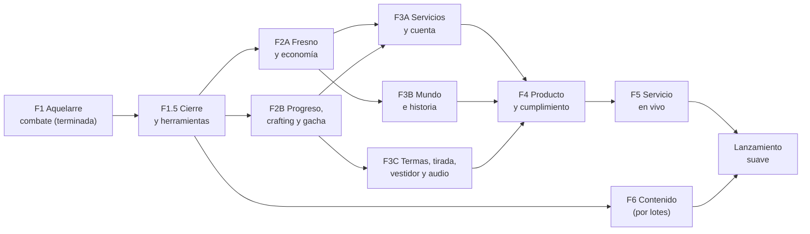
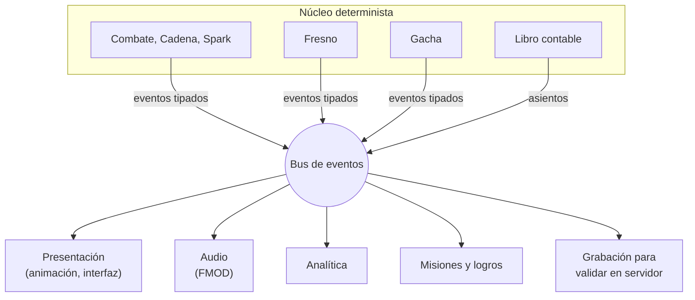

# Hoja de ruta: de la Fase 1 al lanzamiento suave

Cómo pasar del prototipo de combate a un juego que se pueda publicar. Lo que falta está en [HUECOS.md](HUECOS.md); aquí está **cómo se integra cada cosa, en qué orden y con qué prompt**. El GDD sigue mandando: esta hoja amplía su sección 23 y no la reemplaza.

## 1. Resumen

- Las tres fases del GDD validan combate, progreso y producto, pero dejan fuera unos 30 sistemas que las tiendas o el servicio en vivo exigen (cuenta, borrar la cuenta, validación en servidor, tutorial, misiones, pase, localización con pipeline, herramientas de contenido). Ver HUECOS, sección 5.
- La **Fase 1 ya terminó** y está en `main`: 140 pruebas, simulador de balance y escena de prueba ([FASE1.md](FASE1.md)).
- Propongo **once sesiones de programación** en lugar de tres: la Fase 1, un cierre con herramientas (1.5), la Fase 2 partida en dos, la Fase 3 partida en tres, y tres fases nuevas de producto, servicio en vivo y contenido.
- Todo se integra con el mismo patrón que ya usa la Fase 1: **reglas en el núcleo, eventos tipados hacia fuera y servicios detrás de interfaces** con una implementación local para pruebas.
- Hay **quince decisiones** en la sección 4; dos ya están tomadas. Las más caras son cómo se explora una región, la escala de almitas y cuántas regiones salen al lanzamiento.
- En paralelo a la programación corren cinco frentes que no son código: arte, audio y música, narrativa, legal y comunidad.



## 2. Cómo se integra cada sistema

### 2.1 Principios

1. **El núcleo decide, la presentación muestra.** Toda regla nueva (Fresno, gacha, misiones, Paralaje) vive en C# puro y emite eventos. La interfaz, el audio, la analítica y los logros se cuelgan de esos eventos sin tocar el núcleo.
2. **Un servicio, dos implementaciones.** Todo lo externo (servidor, guardado, reloj, tienda, analítica, audio, notificaciones) entra por una interfaz. La implementación local o falsa sirve para pruebas y para jugar sin conexión; la remota llega en la Fase 3A sin cambiar a quien la usa.
3. **Un solo libro contable.** Cada cambio de recurso es un asiento con recurso, cantidad, fuente o sumidero, procedencia (ganado o comprado) e ID de operación. El servidor valida los mismos asientos. Así se cumplen la 11.4, la versión de Bélgica y el soporte al cliente con una sola pieza.
4. **Datos con ID y versión.** Cada archivo de datos tiene `schemaVersion`; cada entidad tiene un ID canónico compartido con arte, audio y localización. La configuración remota solo sobreescribe valores, nunca agrega reglas.
5. **Todo se puede repetir.** Semilla más entradas da el mismo resultado. Las runs del Fresno, los Juicios y los combates grabados se guardan en ese formato para validarlos en el servidor y usarlos como pruebas.

### 2.2 Mapa de módulos

| Módulo | Pieza del GDD 21.2 | Carpeta | Depende de | Fase |
| --- | --- | --- | --- | --- |
| Combate, Magia, Cadena, Eventos | Núcleo | `Core/Combat`, `Core/Magic`, `Core/Chain`, `Core/Events` | — | 1 |
| Grabación y repetición | Núcleo | `Core/Replay` | Combate | 1.5 |
| Libro contable y recursos | Núcleo | `Core/Economy` | — | 2A |
| Fresno | Núcleo | `Core/Fresno` | Combate, Libro contable | 2A |
| Guardado y migraciones | Núcleo + servicio | `Core/Save` | Libro contable | 2A |
| Progreso de brujas y Juicios | Núcleo | `Core/Progression` | Combate, Libro contable | 2B |
| Crafting y Salmueras | Núcleo | `Core/Crafting` | Libro contable | 2B |
| Gacha | Núcleo + servicio | `Core/Gacha` | Libro contable | 2B |
| Cuenta, servidor, compras, configuración remota, analítica | Backend, Analítica | `Services/` y proyecto de servidor | Todo lo anterior | 3A |
| Historia, Libro Mayor, Paralaje, eclipses, Senderos | Núcleo + meta-cliente | `Core/Story`, `Core/Paralaje` | Libro contable, Guardado | 3B |
| Termas, tirada, vestidor, tienda | Presentación + meta-cliente | `Presentation/Termas`, `Presentation/Shop` | Gacha, servicios | 3C |
| Audio | Presentación | `Presentation/Audio` | Eventos | 3C |
| Onboarding, ajustes, localización, cumplimiento | Meta-cliente, Localización | `Presentation/Onboarding`, `Localization/` | Todo | 4 |
| Misiones, logros, pase, eventos, correo, amigos | Núcleo + servicio | `Core/Meta` | Libro contable, Reloj | 5 |
| Herramientas de contenido | Editor | `Editor/` y `Tools/` | Datos | 1.5 y 6 |

### 2.3 Interfaces de servicio

| Interfaz | Implementación local | Implementación remota | Fase |
| --- | --- | --- | --- |
| `IRandomSource` | Generador con semilla | La misma, sembrada por el servidor | 1 |
| `IClock` | Reloj fijo o del sistema | Hora del servidor, reinicio diario, día planetario y fase lunar | 2A |
| `ISaveStore` | Archivo JSON local | Guardado en la nube con conflictos | 2A y 3A |
| `IGachaService` | Gacha local con la misma lógica del núcleo | Tirada en el servidor con registro | 2B y 3A |
| `IEconomyService` | Libro contable local | Libro contable autoritativo | 2A y 3A |
| `IAccountService` | Cuenta local | Anónima más Apple y Google; borrar cuenta | 3A |
| `IStoreService` | Compras falsas | Unity IAP con recibos validados en servidor | 3A |
| `IRemoteConfig` | Valores de los datos | Banners, tasas, eventos y Tránsitos remotos | 3A |
| `IAnalytics` | Registro en consola | Eventos con la taxonomía de la 3A | 3A |
| `IAudioService` | Silencio | FMOD (ver `docs/audio/INTEGRACION_AUDIO.md`) | 3C |
| `INotificationService` | Nada | Push local y remota | 4 |

### 2.4 Cómo llegan los eventos a cada sistema



Con esto, agregar el audio, la analítica o los logros no cambia una sola regla de combate, y una prueba puede comprobar que **cada tipo de evento tiene su sonido, su evento de analítica o una excepción explícita**.

### 2.5 Integrar la Fase 1

La Fase 1 ya está en `main` con su `.meta` generado. Lo que falta antes de la Fase 2:

1. Abrir el proyecto en Unity y correr las pruebas EditMode desde el Test Runner (la sesión que lo construyó no tenía Unity). Confirmar que la escena se construye con **Sal y Almas > Construir escena de combate**.
2. Decidir la versión de Unity (D-14). El reporte pedía 6000.0 LTS y el proyecto se abrió con 6000.6.7f1.
3. Correr la prueba con jugadores de la sección 7.
4. Correr la Fase 1.5. Renombra `zarigueya` y `topo` (D-03), agrega los eventos que piden el Fresno y el audio (HUECOS C-69) y deja las herramientas de contenido.
5. Pasar al GDD las interpretaciones de la Fase 1 que coinciden con HUECOS (sección 3.1), para que la Fase 2 no tenga que adivinarlas.

## 3. Plan de fases

| Fase | Qué valida | Lo principal | Depende de |
| --- | --- | --- | --- |
| **1 Aquelarre** | El combate es divertido y la Cadena se entiende | Prompt del GDD 23.1. **Terminada**; falta la prueba con jugadores | — |
| **1.5 Cierre** | Lo construido es correcto y se puede producir contenido | Auditoría contra el GDD, combates grabados, validador de datos, editor de brujas, simulador en la CI | 1 |
| **2A Fresno y economía** | El endgame se siente distinto en cada run | Fresno, libro contable, almitas, guardado versionado, reloj | 1.5 |
| **2B Progreso, crafting y gacha** | Refinar y fabricar cambian cómo pelea la bruja | Grados y Juicios, armas, reforja, Salmueras, gacha local | 1.5 |
| **3A Servicios y cuenta** | El juego puede tener jugadores reales sin trampas | Backend, cuenta, guardado en nube, validación de runs, compras, configuración remota, analítica, fallos | 2A y 2B |
| **3B Mundo e historia** | La historia no lineal funciona | Motor de historia, Libro Mayor, Paralaje, eclipses, Aries y Capricornio | 2A |
| **3C Termas, tirada, vestidor y audio** | Se siente como el juego final | Termas 3D, tirada en Timeline, vestidor, tienda, audio con FMOD | 2B |
| **4 Producto y cumplimiento** | Se puede publicar en las tiendas | Onboarding, ajustes, accesibilidad, localización, cumplimiento legal, rendimiento, compilaciones nocturnas | 3A, 3B, 3C |
| **5 Servicio en vivo** | Una versión de seis semanas corre sola | Misiones, logros, pase, tarjeta, tienda, correo, eventos, mazmorra del día, amigos, herramientas de soporte | 4 |
| **6 Contenido** | Hay juego para el lanzamiento | 18 kits, 10 regiones, armas, Injertos, Juicios, bestiario; por lotes | 1.5 |
| **Lanzamiento suave** | Retención, mezcla de ingresos y comprensión | Lista de la sección 22.4 | 5 y 6 |

Cada fase es una sesión de Claude Code. Si una no cabe, aplica la regla del GDD 23: primero núcleo y pruebas, después presentación.

### Frentes en paralelo

| Frente | Qué produce | Cuándo tiene que estar | Documento |
| --- | --- | --- | --- |
| Arte 2D | Retratos de las 12 brujas de la primera ola, luego bustos y fase Destilada | Antes de la 3B | `docs/Retratos para Codex.md` |
| Arte 3D | Rig base compartido, morphs de fase, 12 rigs de Ascendente | Antes de la 3C | GDD 19 |
| Audio y música | Pistas con Suno (empezar por las 22 del vertical slice), efectos y voces | Temporales en la 3C, finales antes de la 4 | `docs/audio/SOUNDTRACK_SUNO.md` §5 a §7 |
| Narrativa | Biblia narrativa y guion de Aries y Capricornio | Antes de la 3B | H-14 |
| Legal y marca | Búsqueda de marcas, privacidad, términos, clasificación, revisión de Japón | Antes de la 4 | HUECOS S-12 a S-15 |
| Comunidad | Preinscripción, Discord, redes | Tres meses antes del lanzamiento suave | GDD 22.4 |

## 4. Decisiones que necesito de ti

| ID | Decisión | Bloquea | Mi recomendación |
| --- | --- | --- | --- |
| D-01 | Cómo se explora una región (H-13) | 3B | Mapa ilustrado con puntos de interés, escenas con retratos 2D y combates. Solo las Termas son 3D navegables. Los dioramas 3D, después del lanzamiento |
| D-02 | Escala de almitas (H-01) | 2A | Bajar el costo de nivel a `40·n^1.5` y escribir la tabla de ingresos; revisar con la propuesta de crafting |
| D-03 | Nombres de las 4★ y 3★ (C-26) | 1.5 | **Decidido:** Brea, Cempa, Muertita, Salitre, Topacia y Axa, también como IDs. Ya están en el GDD |
| D-04 | Backend: UGS, Nakama o PlayFab (C-28) | 3A | **Unity Gaming Services.** Cloud Code acepta módulos en C#, así que el mismo núcleo determinista valida runs y tiradas en el servidor sin reescribirlo |
| D-05 | Git LFS para arte y audio (S-29) | — | **Decidido: por ahora no.** Revisarlo antes de que entren modelos 3D o audio |
| D-06 | Spine o Live2D para los retratos animados | 3B | Spine: licencia por puesto y sin regalías; Live2D cobra licencia de publicación según ingresos. Verifica los términos vigentes antes de firmar |
| D-07 | Aceptar las propuestas de `docs/propuestas/` como base y responder sus preguntas (18 del Fresno, 13 de crafting, 15 de meta-juego) | 2A y 2B | Sí, como punto de partida marcado `// TUNING`. Cada propuesta trae su recomendación en cada pregunta; basta con marcar las que cambias |
| D-08 | Orden de la Fase 3 | 3 | Servicios primero (3A): es el mayor riesgo técnico y define los contratos que usan las demás |
| D-09 | Música con Suno: plan de pago, y si contratas voz humana para el tema principal | 3C | Ver `docs/audio/SOUNDTRACK_SUNO.md`, sección de riesgos |
| D-10 | Cuentas y licencias: Unity, Apple Developer, Google Play, secretos de la CI | 4 | Abrir las de Apple y Google pronto; la verificación tarda |
| D-11 | Plan de Suno y voz humana | Antes de generar música | **Premier** en una cuenta del estudio mientras dure la producción: solo lo generado con plan de pago activo da derechos comerciales, y Pro no alcanza por el límite de descargas. Modelo híbrido: una persona compone el tema y los 8 leitmotivs, y una vocalista canta el tema, las Termas de noche, los finales y las Ascensiones III. Así hay autoría humana que proteger |
| D-12 | Presupuesto de FMOD | 3C | Presupuestar la licencia de FMOD por título según el presupuesto del juego (probablemente Premium) y confirmarla en fmod.com antes de firmar |
| D-13 | Cuántas regiones salen al lanzamiento (C-36) | 3B, música, meta | Cuatro (Aries, Cáncer, Libra y Capricornio): el signo de la Calculista elige la más cercana por elemento. Las demás llegan por versión |
| D-14 | Versión de Unity | Ya | Fijar la versión LTS vigente de Unity 6 para producción móvil; si 6000.6 no es LTS, volver a la LTS antes de la Fase 1.5 |
| D-15 | Regla de uso de IA en el GDD 24 (C-68) | Antes de la 4 | Escribirla: qué se genera con IA (música, retratos), con qué plan, qué revisa una persona y cómo se declara en las tiendas |

## 5. Protocolo común de los prompts

Pega este bloque al inicio de cada prompt de las fases 1.5 a 6. Así cada sesión empieza y termina igual.

```
ANTES DE EMPEZAR
1. Lee CLAUDE.md, docs/HUECOS.md, docs/HOJA_DE_RUTA.md y los reportes de docs/fases/. Del GDD (docs/GDD.md) lee completas las secciones que mandan en esta fase.
2. Corre todas las pruebas existentes (`dotnet test Tests/Core.Tests`, con el SDK de .NET 8). Si alguna falla, detente y repórtalo antes de cambiar nada.
3. Trabaja en tu propia rama. No reescribas sistemas de fases anteriores; si cambias una interfaz, hazlo de forma compatible y dilo en el reporte.
4. Si un número o regla no está en el GDD, busca en docs/HUECOS.md y docs/propuestas/. Si tampoco está, propón uno. Todo valor que no venga del GDD lleva // TUNING.
5. Si este prompt contradice al GDD, gana el GDD y me lo reportas.

AL TERMINAR
- Escribe docs/FASE<id>.md (por ejemplo docs/FASE2A.md, como docs/FASE1.md) con: qué construiste, cómo correrlo y probarlo, la lista de valores // TUNING, los huecos y contradicciones del GDD que encontraste, y las decisiones que tomaste por tu cuenta.
- Todas las pruebas, nuevas y anteriores, pasan en la CI.
```

## 6. Prompts

### 6.1 Fase 1.5: cierre y herramientas de contenido

```
Eres ingeniero de herramientas y QA senior para un RPG por turnos en Unity. Vas a cerrar la FASE 1 de "Sal y Almas" y preparar la producción de contenido. En esta fase mandan las secciones 7, 8, 9, 14, 17 y 21 del GDD.

[PROTOCOLO COMÚN]

OBJETIVO
Que el núcleo de combate sea correcto, repetible y fácil de llenar de contenido. No agregas mecánicas nuevas.

ALCANCE
1. Auditoría: tabla de cada regla de las secciones 7, 8, 9 y 14 → archivo donde vive → prueba que la cubre → estado. Parte de docs/FASE1.md y de docs/HUECOS.md (secciones 3, 3.1 y 3.2). Corrige con prueba cada error que encuentres.
2. Grabación y repetición (Core/Replay): formato versionado de semilla + entradas + versión de datos. Graba 10 combates de referencia con su lista de eventos esperada y una prueba que los repite. Este formato es el que validará el servidor en la Fase 3A.
3. Determinismo entre plataformas: redondea a entero en cada golpe y cada cambio de estado (vida, Firmeza, Salinidad, Ánima, Resonancia). Documenta qué cálculos siguen en double y por qué son seguros.
4. IDs canónicos (decisión D-03): renombra en datos, pruebas y registro de combate zarigueya → muertita y topo → topacia, con sus nombres Muertita y Topacia. Los IDs están en el GDD 18. Corrige el signo de Muertita: el GDD 17 le da Escorpio, no Cáncer.
4b. Eventos nuevos (HUECOS C-69): BattleStarted, AVShifted (avances y retrasos con su causa), HealApplied, ShieldAbsorbed, UnitDefeated y SalinityChanged con el valor de 0 a 150. Los necesitan el Fresno (docs/propuestas/FRESNO.md) y el audio (docs/audio/INTEGRACION_AUDIO.md). Los combates grabados se actualizan una sola vez y se explica por qué.
5. Validador de datos: IDs referenciados, frames dentro de rango, campos obligatorios, schemaVersion, y lista de valores TUNING. Corre en dotnet test y desde el menú Sal y Almas > Validar datos.
6. Editor de brujas: ventana de Unity para ver y editar el kit de una bruja, con vista previa de la Partitura contra otra bruja y los Spark calculados con PreviewChain.
7. Simulador de balance como herramienta de línea de comandos y como prueba de la regla del +5 % de la sección 17.1, con un reporte en Markdown por bruja y papel.
8. Importador de CSV a JSON para tablas largas (armas, Injertos), con el mismo validador.

FUERA DE ALCANCE
Mecánicas nuevas, Fresno, gacha, arte y audio.

CRITERIOS DE ACEPTACIÓN
- Ninguna regla de las secciones 7, 8, 9 y 14 queda sin prueba o sin una nota que explique por qué.
- Los 10 combates grabados se repiten idénticos.
- El validador detecta 5 errores sembrados a propósito en una copia de los datos.
- El editor muestra la Partitura y los Spark de dos brujas.
- El simulador corre en la CI en menos de 2 minutos.
```

### 6.2 Fase 2A: Fresno y economía

```
Eres diseñador de sistemas y desarrollador senior de juegos móviles. Vas a construir la FASE 2A de "Sal y Almas": el Fresno y la economía. Mandan las secciones 10 y 11 del GDD y docs/propuestas/FRESNO.md. Es la primera mitad del prompt 23.2 del GDD.

[PROTOCOLO COMÚN]

OBJETIVO
Escalar el Fresno, perder y recuperar almas y ganar progreso permanente, con todo registrado en un libro contable. Lógica en el núcleo; interfaz de prueba con figuras simples.

ALCANCE
1. Libro contable (Core/Economy): todos los recursos de la 11.1 más bases y reactivos (HUECOS C-22). Cada asiento con recurso, cantidad, fuente o sumidero, procedencia ganada o comprada (C-25) e ID de operación. Nada cambia un recurso sin asiento.
2. Reloj: interfaz IClock con reinicio diario y semanal; nada lee la hora del sistema.
3. Guardado (Core/Save): JSON local detrás de ISaveStore, con schemaVersion y migraciones probadas.
4. Fresno: generador con semilla de 4 zonas de 10 nodos con rutas que se bifurcan, los nodos de la 10.2 y el estado que persiste entre nodos (propuesta de Fresno).
5. Injertos: las 7 Ramas con los 5 Injertos marcados ★ en la propuesta con efecto real, los otros 10 en datos, y su Fruto. Mutaciones, hasta 5 maldiciones (H-04 según la propuesta) y Bendición del Paria.
6. Muerte y almas: almitas sueltas, Santuarios, Mancha de Sal, recuperación, 30 % como Savia.
7. Eco (3 ranuras), Raíces, Ofrenda al Fresno y tope semanal sin energía.
8. Cada run se graba con el formato de Core/Replay para validarla después en el servidor.
9. Interfaz de prueba: mapa del Fresno, elección de Injerto, Santuario, Mercader y resumen de la run con su libro contable.

PRUEBAS MÍNIMAS
Generador con semilla fija; las tres situaciones de la Mancha de Sal; Eco; maldiciones; tope semanal; libro contable cuadrado tras 3 runs; guardado y carga sin pérdida, incluida una migración de versión; repetición de una run grabada.

CRITERIOS DE ACEPTACIÓN
- Todas las pruebas de las fases anteriores pasan.
- Se juegan tres runs seguidas, y la tercera se siente distinta por el Eco, las almas recuperadas y la Savia.
- El libro contable explica cada almita ganada y gastada.
```

### 6.3 Fase 2B: progreso, crafting y gacha

```
Eres diseñador de sistemas y desarrollador senior de juegos móviles. Vas a construir la FASE 2B de "Sal y Almas": progreso de brujas, crafting y gacha. Mandan las secciones 12, 14, 15 y 16 del GDD y docs/propuestas/CRAFTING.md. Es la segunda mitad del prompt 23.2 del GDD. Usa el libro contable y el guardado de la Fase 2A si ya existen; si no, crea interfaces compatibles.

[PROTOCOLO COMÚN]

OBJETIVO
Refinar brujas sin duplicados, fabricar armas y pociones que cambian el combate, y tirar en el gacha. Lógica en el núcleo; interfaz de prueba simple.

ALCANCE
1. Progreso: nivel 1 a 80 con la curva que diga el GDD (revisa la decisión D-02); grados D a SS con su costo, sal refinada y nivel mínimo; Juicio de Pureza contra el propio Ascendente con su condición LitRPG; Vía Mayor y Vía Menor; Dignidad y Talentos de Cadena.
2. Armas: las 12 familias con los frames de la propuesta, 5 niveles y 2 variantes en datos, y la regla de qué arma usa cada bruja (H-06). El arma cambia los frames, así que cambia PreviewChain.
3. Recetas con estaciones, recetas de dos estaciones y las fusiones de la 15.3.
4. Reforja con prefijos; Rítmico y Pausado mueven los frames −2 y +2 y una prueba demuestra que cambian el resultado de PreviewChain.
5. Salmueras con base, sal, reactivo y almitas; tres potencias; Salmuera Turbia al fallar; Recetario.
6. Gacha detrás de IGachaService con implementación local: tasas y pity de la 16.2, 4★ garantizada cada 10, 75/25 con garantía, contador compartido, banner de inicio y selector a las 300. Exclusión de duplicados con las reglas C-23 y C-24 de HUECOS. Cada tirada se registra con su semilla.
7. Simulación de un millón de tiradas: 5★ promedio en 52.9 ± 1 y destacada en 66.1 ± 1 (HUECOS, sección 2).
8. Interfaz de prueba: pantalla de grados con vista previa de las tres fases (placeholders), Yunque, Caldero y Termas con termómetro de pity, color de vapor e historial.

PRUEBAS MÍNIMAS
Curvas de nivel y grado; condiciones de Juicio; recetas y fusiones; prefijos que mueven el Spark; tasas por simulación; exclusión de duplicados en todos los casos de C-23; Sales de Baño compradas contra ganadas en la versión de Bélgica.

CRITERIOS DE ACEPTACIÓN
- Todas las pruebas de las fases anteriores pasan.
- Una bruja sube de D a B en el Editor pasando por sus Juicios.
- Cambiar el arma o el prefijo de una bruja cambia los Spark de una Cadena real.
```

### 6.4 Fase 3A: servicios y cuenta

```
Eres ingeniero de backend y de plataforma para un gacha móvil en producción. Vas a construir la FASE 3A de "Sal y Almas": servidor autoritativo, cuenta y servicios. Mandan las secciones 16.6, 21 y 22 del GDD y la decisión D-04 de la hoja de ruta (Unity Gaming Services, salvo que diga otra cosa).

[PROTOCOLO COMÚN]

OBJETIVO
Que el juego pueda tener jugadores reales: cuenta, guardado en la nube, gacha y economía en el servidor, runs validadas, compras de prueba y datos de uso. Todo detrás de las interfaces de la sección 2.3 de la hoja de ruta, con la implementación local intacta.

ALCANCE
1. Cuenta: inicio anónimo, vincular Apple y Google, transferir a otro teléfono y borrar la cuenta desde el juego.
2. Guardado en la nube con resolución de conflictos y las migraciones de la Fase 2A.
3. Reloj del servidor: reinicio diario y semanal, día planetario y fase lunar.
4. Gacha y libro contable autoritativos en Cloud Code en C#, reutilizando el núcleo. Cada tirada y cada asiento quedan registrados.
5. Validación de runs del Fresno y de Juicios: el servidor repite la grabación con el núcleo y solo entonces entrega la recompensa.
6. Compras con Unity IAP en modo de pruebas: recibos validados en el servidor, reembolso que retira Perlas, historial de compras.
7. Configuración remota: banners, tasas por mercado, eventos, Tránsitos y la bandera de Bélgica.
8. Analítica: taxonomía de eventos (tutorial, primera Cadena, primera 5★, runs, tiradas, compras) escrita en docs/analitica.md; el cliente la emite desde el bus de eventos.
9. Captura de fallos y monitoreo de rendimiento.
10. Herramienta interna mínima: buscar a un jugador, ver su libro contable y su historial de tiradas, enviarle un correo de compensación.

FUERA DE ALCANCE
Historia, Termas 3D, tienda de cosméticos y audio.

CRITERIOS DE ACEPTACIÓN
- Una compra de prueba otorga lo correcto y queda registrada en el servidor; su reembolso la revierte.
- Una run falsificada (recompensa alterada en el cliente) se rechaza; una honesta se acepta.
- Una cuenta pasa de un teléfono a otro sin perder nada, y se puede borrar.
- El juego sigue funcionando con las implementaciones locales y todas las pruebas pasan sin red.
```

### 6.5 Fase 3B: mundo e historia

```
Eres líder técnico y diseñador narrativo de un RPG móvil. Vas a construir la FASE 3B de "Sal y Almas": el motor de historia LitRPG. Mandan las secciones 6 y 13 del GDD, la decisión D-01 de la hoja de ruta sobre la exploración y la biblia narrativa si ya existe (H-14).

[PROTOCOLO COMÚN]

OBJETIVO
Dos regiones jugables de principio a fin con decisiones que importan, en orden libre, con la forma de exploración que diga D-01.

ALCANCE
1. Motor de historia en el núcleo, guiado por datos: regiones, capítulos, escenas, decisiones con chequeos de umbral fijo (Cálculo, Temple, Encanto, Oficio) y bonos por bruja presente.
2. Marcas de Destino, Títulos, Almas digeridas, Senderos de la Calculista con su nivel (H-17) y Relectura.
3. Reloj de eclipses con los estados de corrupción por región (H-16); nunca bloquea al jugador.
4. Paralaje como medidor de cuenta con sus bandas (H-15).
5. Ventanas del Libro Mayor con el ejemplo de la 13.1 y la falla por Paralaje (shader o animación de interfaz).
6. Creador de la Calculista (H-18) y elección del signo que define la región inicial.
7. Contenido: Aries (Montes de Hierro Rojo) y Capricornio (Salinas de Obsidiana), cinco misiones cada una, con retratos 2D de art/retratos/<id>/ por ID y diálogos en tablas de localización.

PRUEBAS MÍNIMAS
Chequeos de umbral; marcas que cambian una escena en otra región; eclipses tras dos regiones; Relectura; guardado y carga a mitad de capítulo.

CRITERIOS DE ACEPTACIÓN
- Las dos regiones se terminan en cualquier orden y el orden cambia algo visible.
- Ningún texto visible está escrito en el código.
```

### 6.6 Fase 3C: Termas, tirada, vestidor y audio

```
Eres líder técnico de presentación de un gacha móvil en Unity 6 con URP. Vas a construir la FASE 3C de "Sal y Almas": la base en las Termas, la tirada completa, el vestidor, la tienda de cosméticos y el audio. Mandan las secciones 16, 19 y 20 del GDD, docs/REFERENCIAS.md y docs/audio/INTEGRACION_AUDIO.md.

[PROTOCOLO COMÚN]

OBJETIVO
Que el juego se sienta como el producto final en sus momentos de más impacto, con arte temporal donde no haya final.

ALCANCE
1. Termas sobre la Tortuga: base navegable con interacciones de reposo, tocar y conversar (docs/propuestas/META_Y_ONBOARDING.md); el baño baja el Paralaje.
2. Tirada completa de la 16.1 en Timeline: sales que caen, vapor por rareza, reflejo de constelación para 5★, emergencia, sacudida por especie, tarjeta, saltar y modo de diez. El resultado viene de IGachaService; la animación nunca lo decide.
3. Vestidor: atuendos que se ajustan a las tres fases por blendshapes (con modelos temporales), atuendos de Ascendente, color de sal, Manantiales y marcos del Libro Mayor.
4. Tienda de cosméticos con IStoreService.
5. Presentación de combate: sombreado cel con Shader Graph, efectos de Spark y Quiebre, cámara de la Ascensión III (19.3), y la opción de reducir destellos (HUECOS S-18).
6. Audio según docs/audio/INTEGRACION_AUDIO.md, con su prompt detallado de la sección 13.3: FMOD, AudioDirector colgado del bus de eventos, música por capas con las pistas de docs/audio/SOUNDTRACK_SUNO.md, efectos y voces temporales.

CRITERIOS DE ACEPTACIÓN
- La escena de combate mantiene 60 fps en gama alta y 30 en gama baja con el presupuesto de la 19.5.
- Cada tipo de evento del núcleo tiene sonido o una excepción explícita, comprobado por una prueba.
- La tirada se puede saltar en cualquier punto sin cambiar el resultado.
```

### 6.7 Fase 4: producto y cumplimiento

```
Eres productor técnico de un gacha móvil a punto de su lanzamiento suave. Vas a construir la FASE 4 de "Sal y Almas": todo lo que exigen las tiendas y los jugadores fuera del juego en sí. Mandan las secciones 2, 5, 16.6, 21 y 22 del GDD, docs/propuestas/META_Y_ONBOARDING.md y la sección 5 de docs/HUECOS.md.

[PROTOCOLO COMÚN]

ALCANCE
1. Primera sesión guionizada según la propuesta de onboarding: primera Cadena antes del minuto 3, desbloqueo progresivo de sistemas y banner de inicio.
2. Ajustes: gráficos y fps, ahorro de batería, volúmenes, idioma de texto y de voz por separado, modo recatado, reducir destellos, notificaciones, cuenta, soporte y legal.
3. Accesibilidad: texto grande, colores de planeta seguros para daltonismo (docs/paleta.svg), subtítulos, saltar cinemáticas.
4. Localización: pipeline con tablas, contexto para traducir y seudolocalización; español de México, inglés y japonés con fuentes CJK.
5. Cumplimiento: página de probabilidades por banner, historial de un año, límite de gasto y recordatorios, versión de Bélgica, consentimiento de privacidad por región, edad mínima.
6. Notificaciones push con permiso y opción de apagarlas; soporte dentro del juego.
7. Rendimiento: perfiles de gama baja y alta (21.1), Addressables con catálogo remoto, descarga inicial de 2 GB como máximo.
8. Compilaciones nocturnas de Android e iOS y subida a pruebas internas; los combates grabados de la Fase 1.5 corren en un teléfono real.

CRITERIOS DE ACEPTACIÓN
- En una prueba con jugadores nuevos, la primera Cadena llega antes del minuto 3.
- La app pasa las listas de revisión de App Store y Google Play (borrar cuenta, probabilidades, privacidad, clasificación).
- Los combates grabados dan lo mismo en .NET y en IL2CPP en ARM64.
```

### 6.8 Fase 5: servicio en vivo

```
Eres diseñador de live ops y desarrollador senior de gachas móviles. Vas a construir la FASE 5 de "Sal y Almas": todo lo que hace que una versión de seis semanas funcione sin compilar el cliente. Mandan las secciones 7.7, 10.7, 16 y 22 del GDD y docs/propuestas/META_Y_ONBOARDING.md.

[PROTOCOLO COMÚN]

ALCANCE
1. Misiones diarias y semanales, logros conectados con los Títulos (13.4) y nivel de cuenta. Ningún logro pide juntar brujas del gacha.
2. Pase Grimorio (gratuito y premium) y tarjeta Diezmo de Sal.
3. Tienda: Perlas, cosméticos directos y Polvo Astral; precios por país desde la configuración remota.
4. Correo con adjuntos y compensaciones masivas.
5. Plantilla de evento de versión: historia, moneda y tienda de evento, todo por configuración remota.
6. Mazmorra de sal del día planetario y efectos de la fase lunar real, con el reloj del servidor.
7. Amigos e Invitada: lista, sugeridos, NPC por defecto y recompensa por prestar.
8. Calendario de banners y Tránsitos por configuración remota.

PRUEBAS MÍNIMAS
Una versión de seis semanas simulada de principio a fin con el reloj falso: el jugador gratuito obtiene unas 70 tiradas (16.3); un evento empieza y termina sin compilar el cliente.

CRITERIOS DE ACEPTACIÓN
- Todas las pruebas anteriores pasan.
- Un evento nuevo se lanza solo con datos y configuración remota.
```

### 6.9 Fase 6: contenido por lotes

Esta fase se repite. Cada sesión produce un lote con las herramientas de la Fase 1.5.

```
Eres diseñador de contenido y balance de un gacha por turnos. Vas a producir un LOTE de contenido de "Sal y Almas": [elige uno: 4 kits de bruja | 2 regiones | una familia de armas | 2 Ramas de Injertos | los Juicios de 6 brujas | el bestiario de 2 regiones]. Mandan las secciones 17 y 18 del GDD y la propuesta que corresponda en docs/propuestas/.

[PROTOCOLO COMÚN]

ALCANCE
1. El contenido en datos, con el validador de la Fase 1.5 en verde.
2. Para kits: Apertura, Enlace y Cierre con frames, Autohechizo, Ascensiones, Regencia, Vía Mayor y Vía Menor, y su truco único si es "kk" (17.4).
3. Balance con el simulador: ninguna 5★ supera en más de 5 % a la mejor de su papel (17.1); cada 3★ tiene un nicho medible.
4. Combates grabados nuevos para el contenido nuevo.

CRITERIOS DE ACEPTACIÓN
- El validador, el simulador y todas las pruebas pasan.
- El reporte incluye la tabla de balance antes y después.
```

## 7. Prueba con jugadores de la Fase 1

El criterio de la Fase 1 pide que alguien nuevo venza al jefe en menos de 15 minutos y entienda que el orden de la Cadena importa. Protocolo breve:

1. **Quiénes:** de 5 a 8 personas que no conocen el juego; al menos 3 que juegan gachas por turnos.
2. **Cómo:** una sesión de 20 minutos en el Editor o en una compilación de escritorio. Sin explicarles nada más que "vence al jefe". Grabas la pantalla y su voz si lo permiten.
3. **Qué mides:** minuto de la primera Cadena, minuto de la victoria o derrota, cuántas veces reordenan la Partitura antes de confirmar y cuántos Spark logran.
4. **Al final, tres preguntas:** ¿Qué hace la Cadena? ¿Por qué cambiarías el orden? ¿Qué te confundió?
5. **Éxito:** al menos 6 de 8 vencen al jefe antes del minuto 15, y al menos 5 de 8 explican con sus palabras que el orden cambia los Spark o los Aspectos.

## 8. Infraestructura

- **CI:** `.github/workflows/ci.yml` corre `dotnet test Tests/Core.Tests` en cada push a `main`, `claude/**` y `fase/**`, y en cada pull request. Las pruebas EditMode de Unity se activan solas cuando existe el proyecto de Unity y agregas los secretos `UNITY_LICENSE`, `UNITY_EMAIL` y `UNITY_PASSWORD` ([guía de activación de GameCI](https://game.ci/docs/github/activation)).
- **Fusión de escenas y prefabs:** `.gitattributes` ya marca los archivos YAML de Unity para UnityYAMLMerge. Para activarlo en tu computadora, agrega esto a tu `.git/config` o a tu configuración global, con la ruta de tu versión de Unity:

```
[merge "unityyamlmerge"]
    name = Unity SmartMerge
    driver = "'C:/Program Files/Unity/Hub/Editor/<versión>/Editor/Data/Tools/UnityYAMLMerge.exe' merge -h -p --force %O %B %A %A"
    recursive = binary
```

- **Ramas:** una rama por fase. Los reportes viven en `docs/FASE<id>.md`.
- **Archivos grandes:** sin Git LFS por ahora (D-05). `.gitattributes` ya marca los binarios para que Git no intente fusionarlos.

## 9. Próximos pasos

1. Abre el proyecto en Unity, corre las pruebas EditMode y decide la versión de Unity (D-14).
2. Haz la prueba con jugadores de la sección 7 con la escena de la Fase 1.
3. Decide la escala de almitas (D-02) y cuántas regiones salen al lanzamiento (D-13): las tres propuestas dependen de ellas.
4. Revisa las preguntas de las propuestas (D-07). Cada una trae su recomendación.
5. Corre la Fase 1.5 con su prompt.
6. En paralelo: contrata Suno Premier (D-11) y genera las 22 pistas del vertical slice con `docs/audio/SOUNDTRACK_SUNO.md`; empieza la biblia narrativa (H-14).
