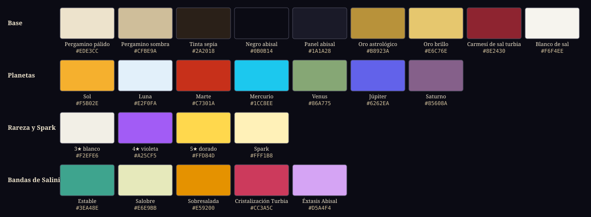

# Referencias visuales de Sal y Almas: La Odisea del Fresno

Tablero de referencias pedido en la sección 23.4 del GDD · 4 de noviembre de 2026

Este documento solo trae enlaces. La única imagen incluida es [paleta.svg](paleta.svg), hecha para este proyecto.

## Lo más importante

- **Nuestro mayor hueco es el de la categoría 2.** No encontré ninguna mujer antropomorfa completa con sombreado cel de calidad HoYoverse. Es el mismo hueco de mercado que señala el GDD, así que hay que cubrirlo combinando referencias y diseñando las brujas desde cero. Tampoco pude revisar portafolios de artistas: ArtStation y Behance bloquean las consultas automáticas.
- **La Partitura tiene dos referencias muy fuertes.** Baude Cordier escribió partituras en círculo y en forma de corazón hacia 1400 (7.1), y el medidor de frames de Street Fighter 6 ya resuelve cómo mostrar golpes por frame (7.2). Juntas dan la idea completa: un pentagrama astrolabio que se lee frame a frame.
- **La premisa tiene un antecedente real.** Un grabado de 1489 ya muestra brujas con cabeza de animal y cuerpo de mujer (2.8).
- **La interfaz de gacha quedó con poco sustento.** Solo Persona 5 tiene una fuente de los propios diseñadores. Ninguna fuente da tamaños de texto ni toques hasta combatir; esos números hay que medirlos en un teléfono.
- **El oro tiene cuatro significados en la paleta:** interfaz, Sol, 5★ y Spark. La sección de paleta los separa y fija reglas para que no se confundan.

## Cómo se comprobó

| Marca | Significado |
| --- | --- |
| **Foto vista** | Abrí la imagen y no vi personas. La revisión fue a baja resolución, así que puede escaparse una figura diminuta |
| **Página leída** | Leí el texto de la página, y de ahí salen el título y el dato de licencia |
| **†** | Dato de conocimiento general que la página enlazada no confirma. Compruébalo antes de citarlo |
| **Secundaria** | La fuente no es el estudio, el museo ni el archivo original |

**Licencias:** *Dominio público*, *Uso libre* (con la licencia exacta) o *Solo referencia* (con derechos: sirve para estudiar, no para meter en el juego). Un manuscrito antiguo puede tener una foto con condiciones propias; por ejemplo, la Bodleian publica con licencia no comercial. Antes de usar cualquier imagen en el juego, hay que releer la licencia en su ficha.

**Menores y personas reales.** El encargo pide estudiar juegos cuyo elenco incluye menores o personajes escolares, como NieR Replicant y Persona 5. Los dejé porque el encargo los nombra, pero solo como referencia de paisaje, luz o interfaz, y cada entrada lo indica. Las obras que solo servían por sus personajes quedaron fuera (ver [Descartadas](#descartadas)). También descarté fotos concretas tras revisarlas: en tres había personas, incluida una de Tolantongo llena de bañistas.

## Las cinco primeras de cada categoría

El número es el mismo que en las tablas de abajo.

| Categoría | 1 | 2 | 3 | 4 | 5 |
| --- | --- | --- | --- | --- | --- |
| 1. Dirección general | NieR Replicant | Villa Epecuén | Salar de Uyuni | Das Eismeer | Salinas de Zapotitlán |
| 2. Brujas antropomorfas | Blacksad: Under the Skin | Zootopia | Mujeres Hrothgar | Armello | Hennin |
| 3. Ascendentes | Estrellas fijas de al-Sufi | Harmonia Macrocosmica | Astrolabio del Met | Fludd | Darkest Dungeon |
| 4. Horror cósmico | Grabado Flammarion | Melencolia I | Salt Bride | Wunderzeichenbuch | Carceri |
| 5. Termas | Takaragawa | Cascada de Tolantongo | Estrellas en un lago | Río de Tolantongo | Pamukkale |
| 6. Interfaz de gacha | Honkai: Star Rail | Persona 5 | Arknights | Genshin Impact | Reverse: 1999 |
| 7. Interfaz propia | Cordier | Medidor de frames de SF6 | Pentiment | Domesday Book | Reloj de Praga |
| 8. Efectos visuales | Halita | Ori | Pyreflies | Unity VFX Graph | Kintsugi |
| 9. Tipografía | Alegreya | Pirata One | Texturina | Noto Sans Symbols | Shippori Mincho |

## Referencias por categoría

### 1. Dirección general

| # | Referencia y fuente | Qué tomar | Qué evitar | Licencia y comprobación |
| --- | --- | --- | --- | --- |
| 1.1 | [NieR Replicant ver.1.22474487139](https://www.square-enix-games.com/en_US/games/nier-replicant), Square Enix | El tono: belleza triste, ruinas tranquilas y luz neblinosa en un mundo que se acaba†. Es la vara con la que se mide todo lo demás | Sus personajes: Nier joven y Yonah son menores†. Mira solo paisajes e interfaz | Solo referencia. Título oficial confirmado; el contenido carga por JavaScript y no se pudo leer |
| 1.2 | [Ruinas de Villa Epecuén](https://commons.wikimedia.org/wiki/File:Laguna_Epecu%C3%A9n_26.jpg), Wikimedia Commons (secundaria) | Árboles muertos y claros frente a una torre en ruinas, en un pueblo inundado en 1985. Es el análogo real más cercano al mundo del juego; úsalo para la silueta de los pueblos de Halia | El cielo duro de mediodía. La costra de sal casi no se ve en esta foto: hay que agregarla | Uso libre, CC BY-SA 4.0. Foto vista |
| 1.3 | [Salar de Uyuni al amanecer](https://commons.wikimedia.org/wiki/File:Salar_de_Uyuni,_Bolivia,_2016-02-04,_DD_10-12_HDR.JPG), Commons (secundaria) | Una montaña y su reflejo sobre sal mojada, con degradado rosa y azul. Da la luz de las salinas y la base del reflejo en las Termas | El HDR forzado. La sal de Halia es turbia; esta se ve limpia | Uso libre, CC BY-SA 4.0. Foto vista |
| 1.4 | [Das Eismeer, Caspar David Friedrich](https://commons.wikimedia.org/wiki/File:Caspar_David_Friedrich_-_Das_Eismeer_-_Hamburger_Kunsthalle.jpg), Hamburger Kunsthalle vía Commons (secundaria) | Placas rotas apiladas sobre un barco aplastado: un mundo vencido por un mineral blanco. Sirve de composición para derrotas y eclipses | El vacío monumental: en horizontal, la interfaz lo tapa | Dominio público (Commons, obra de 1823-24) |
| 1.5 | [Salinas de Zapotitlán](https://commons.wikimedia.org/wiki/File:Salinas_en_Zapotitl%C3%A1n_Salinas,_Puebla._M%C3%A9xico.jpg), Commons (secundaria) | Pozas blancas entre laderas de cactus. Paleta y terreno directos para Capricornio, las Salinas de Obsidiana | El cielo de postal. Falta agregar obsidiana y luz baja | Uso libre, CC BY-SA 4.0. Foto vista |
| 1.6 | [Valle Salado de Añana](https://commons.wikimedia.org/wiki/File:Salinas_de_A%C3%B1ana_--_Valle_Salado_05.jpg), Commons (secundaria). [Sitio oficial](https://www.vallesalado.com/en/) | Terrazas de madera y piedra de salinas medievales: arquitectura salinera para Aries, de inspiración ibérica | La reconstrucción turística demasiado limpia | Uso libre, CC BY-SA 4.0. Foto vista. El sitio oficial no se revisó por personas |
| 1.7 | [Abtei im Eichwald, Friedrich](https://smb.museum-digital.de/object/144605), Staatliche Museen zu Berlin. [Copia en Commons](https://commons.wikimedia.org/wiki/File:Caspar_David_Friedrich_-_Abtei_im_Eichwald_-_Google_Art_Project.jpg) | Ruina gótica y árboles desnudos al crepúsculo: es la luz melancólica que buscamos | La procesión de monjes: no encaja con la fe de Halia | Copia en Commons: dominio público. El museo no indica licencia |
| 1.8 | [Capilla de Santa Kinga, Wieliczka](https://commons.wikimedia.org/wiki/File:Saint_Kinga_Chapel_in_Wieliczka_Salt_Mine.jpg), Commons (secundaria). [Sitio oficial](https://www.wieliczka-saltmine.com/) | Nave tallada en sal con candelabros de cristal. Muestra cómo se ve una arquitectura hecha de sal; sirve para los templos de las Siete Sabias | El brillo dorado de la iluminación turística | Uso libre, CC BY-SA 4.0. Foto vista. El sitio oficial no se revisó por personas |

**Reserva:** [Casas con costra de sal en el Salton Sea](https://commons.wikimedia.org/wiki/File:Salton_Sea_homes.JPG) (dominio público, foto vista), [barcos varados en Moynaq](https://commons.wikimedia.org/wiki/File:Moynaq,_Aral_Lake,_Ship_Wrecks,_Uzbekistan.jpg) (CC BY-SA 4.0, foto vista) y [Dallol](https://commons.wikimedia.org/wiki/File:ET_Afar_asv2018-01_img48_Dallol.jpg), paleta de azufre para Escorpio (Free Art License, foto vista).

**Pocas referencias buenas:** de **Cuyutlán** solo hallé la [fachada del Museo de la Sal](https://commons.wikimedia.org/wiki/File:Museo_de_la_Sal.JPG) (CC BY-SA 3.0, foto vista); no hay foto libre de sus salinas. De **Zapotitlán** hay una sola foto útil. Las ruinas realmente cubiertas de sal son raras: el Salton Sea es la única donde la costra se ve con claridad.

### 2. Brujas antropomorfas

| # | Referencia y fuente | Qué tomar | Qué evitar | Licencia y comprobación |
| --- | --- | --- | --- | --- |
| 2.1 | [Blacksad: Under the Skin](https://microids.com/blacksad-under-the-skin-to-be-released-on-september-26th-2019), Microids | **Furry y pelaje cel.** La página lo define como *cel-shading* con personajes antropomorfos. Úsalo para decidir cuánto pelaje se pinta en textura y cuánto resuelve la rampa de luz, en Marisal y la osa | El realismo noir: esa riqueza de pelaje no se lee a 64 px | Solo referencia (© Microids). Página leída. Protagonista adulto; no se revisaron sus escenas |
| 2.2 | [Zootopia: arte conceptual de Cory Loftis](https://www.acmi.net.au/stories-and-ideas/disney-zootopia-illustrating-humanity-through-animals/), museo ACMI (secundaria sobre Disney) | **Furry y actuación.** Orejas y nariz expresan emociones. Aplícalo a Tormentina y Cervanda: la actuación también pasa por orejas y cola | La ropa moderna y las proporciones de animal pequeño | Solo referencia (© Disney). Página leída |
| 2.3 | [Mujeres Hrothgar, FFXIV: Dawntrail](https://na.finalfantasyxiv.com/dawntrail/system/), Square Enix | **Furry y silueta.** Raza adulta, descrita como esbelta y musculosa, que no es una versión reducida del macho. Sirve para la osa y la hiena | El modelo 3D realista: no es sombreado cel | Solo referencia (© Square Enix). Página leída |
| 2.4 | [Armello](https://armello.com/), League of Geeks | **Silueta y moda.** Clanes animales en fantasía medieval, con capas y armas: una familia de formas por especie | Las proporciones de cuento: las brujas deben verse adultas | Solo referencia (© League of Geeks). Página leída; no indica edades |
| 2.5 | [Hennin](https://en.wikipedia.org/wiki/Hennin), Wikipedia (secundaria) | **Sombreros.** Formas reales de tocado medieval: cono, truncado, velo y cornet. Es materia prima para 24 sombreros únicos: velo largo en Selenia, cono truncado en Cervanda | Tomarla como referencia visual: hay que buscar las piezas en museos | Texto CC BY-SA 4.0; imágenes según cada archivo. Página leída |
| 2.6 | [Les Très Riches Heures](https://les-tres-riches-heures.chateaudechantilly.fr/), Château de Chantilly | **Moda.** Calendario de nobles y campesinos vestidos para cada mes: colores de tocados y capas de corte | Copiar rostros y poses: mira solo las prendas | Manuscrito antiguo (c. 1412-16); la página no declara derechos sobre sus fotos. Trátalo como solo referencia |
| 2.7 | [Unite Tokyo 2018, render anime de Honkai Impact 3rd](https://docswell.com/s/UnityJapan/KWLQP5-unite-tokyo-20183rd), Jack He (miHoYo), publicado por Unity Japan | **Sombreado cel.** Rampas múltiples con trazo de pincel y contorno por geometría y por imagen: es la ruta técnica en Unity | Las diapositivas no hablan de pelaje: hay que adaptarlo | Solo referencia (sin licencia indicada). Página leída |
| 2.8 | [De Lamiis de Ulrich Molitor, 1489](https://museumofwitchcraftandmagic.co.uk/object/witch-picture-36/), Museum of Witchcraft and Magic. [Artículo de la Library of Congress](https://blogs.loc.gov/loc/2020/10/the-first-book-of-illustrated-witchcraft-15th-century-visions/) | **Premisa.** Brujas con cabeza de animal y cuerpo de mujer sobre una horquilla, hace más de 500 años. Da peso histórico a Halia y una idea de silueta de grupo | Su contexto: es propaganda de persecución de brujas | Obra de 1489; la reproducción muestra © del museo, así que solo referencia. Página leída |

**Reserva:** [Zenless Zone Zero](https://zenless.hoyoverse.com/en-us/) como techo de acabado cel de HoYoverse† (su antropomorfo más conocido, Von Lycaon, es hombre† y no pude leer su ficha oficial), [vídeo de Acerola sobre pelaje](https://www.youtube.com/watch?v=9dr-tRQzij4) para las capas de *shell fur* de la sección 19.5, [Mouse Guard](https://www.mouseguard.net/) (capas), [Ghost of a Tale](https://www.ghostofatale.com/) (ropa sobre pelaje), [Charr de Guild Wars 2](https://www.guildwars2.com/en/the-game/races/charr/) y [Rivet](https://gameinformer.com/2021/04/26/ratchet-clank-rift-apart-trailer-reveals-new-characters-name-is-rivet-and-confirms-photo).

**Pocas referencias buenas:** ninguna cubre sola a una bruja antropomorfa adulta con sombreado cel. La combinación es esta: 2.1 y 2.7 para el acabado, 2.2 y 2.3 para cuerpo y actuación, 2.4 para la silueta, y 2.5 y 2.6 para sombreros y ropa. Falta un buen referente de sombrero de bruja en personajes adultos.

### 3. Ascendentes

| # | Referencia y fuente | Qué tomar | Qué evitar | Licencia y comprobación |
| --- | --- | --- | --- | --- |
| 3.1 | [Libro de las estrellas fijas de al-Sufi](https://digital.bodleian.ox.ac.uk/objects/c1caa84c-f6d2-483f-9eb4-2439cccdc801/), Bodleian (MS. Marsh 144) | Constelaciones dibujadas como figuras de contorno oscuro†: base de silueta y línea para Aries, Tauro, Leo y Sagitario | Copiar sus rostros o usar sus leyendas en árabe como adorno sin sentido | Solo referencia: CC BY-NC 4.0, no permite uso comercial (dato del registro de Biblissima). Título confirmado |
| 3.2 | [Harmonia Macrocosmica de Cellarius](https://commons.wikimedia.org/wiki/Category:Harmonia_Macrocosmica), Commons (secundaria) | Anillos zodiacales y esferas dobles†: el aro de signos alrededor de cada Ascendente | Reutilizar un escaneo sin leer su licencia: cada archivo trae la suya | Obra de 1660. Licencia por archivo; la categoría no la indica |
| 3.3 | [Astrolabio planisférico, 1654-55](https://www.metmuseum.org/art/collection/search/451699), The Met | Rete calada, anillos y escala graduada†: el contorno mecánico del Ascendente y de los menús radiales | Usar su caligrafía como texto legible | Dominio público. La página del Met lo indica |
| 3.4 | [Rueda celeste de Robert Fludd](https://wellcomecollection.org/works/fdwmfqr5), Wellcome Collection | Anillos concéntricos: las capas de esfera de cada Ascendente y de la carta natal procedural (19.4) | Las figuras humanas y los rostros de otras láminas del tratado | Dominio público en la ficha; el manifiesto de la imagen dice CC BY 4.0. Da crédito por prudencia |
| 3.5 | [Darkest Dungeon](https://www.darkestdungeon.com/darkest-dungeon/), Red Hook Studios | **Contorno de tinta.** Negro grueso y sombras planas†: el peso de línea de los Ascendentes | La sangre y la suciedad | Solo referencia (© Red Hook). Página leída; no describe su estilo |
| 3.6 | [Urania's Mirror](https://www.publicdomainreview.org/collection/uranias-mirror-or-a-view-of-the-heavens), Public Domain Review (secundaria) | Figura de constelación con estrellas perforadas†: Carnero, León y Centauro con sus líneas emisivas encima | Los colores pastel a mano: toma el trazo | Dominio público; la copia digital remite a sus fuentes. Página leída |
| 3.7 | [Splendor Solis](https://content.www.wellcomecollection.org/works/tsjc85mn), Wellcome Collection (foto de 1948 del manuscrito de la British Library) | Oro, plata y cobre alquímicos, y los marcos de cada escena†: acabado metálico por planeta | Las figuras desnudas†: quédate con paleta y ornamento | Dominio público. Página leída |
| 3.8 | [Okami HD](https://store.steampowered.com/app/587620/OKAMI_HD/), Capcom (ficha de Steam) | **Contorno de tinta.** Su estilo de tinta sumi-e: un trazo de pincel con grosor variable†, para que el contorno se sienta dibujado | Tomar su iconografía japonesa: la nuestra es astrológica | Solo referencia (© Capcom). Página leída |

**Reserva:** [Kitab al-Bulhan](https://digital.bodleian.ox.ac.uk/objects/5c9da286-6a02-406c-b990-0896b8ddbbb0/) (CC BY-NC 4.0), [Ripley Scroll](https://wellcomecollection.org/works/zt96ns9m) (CC BY 4.0), [Atalanta Fugiens](https://digital.sciencehistory.org/works/pc289j53n) (dominio público; evita sus emblemas con cadáveres) y [Hevelius en la Linda Hall Library](https://www.lindahall.org/experience/digital-exhibitions/out-of-this-world/22-the-innovations-of-hevelius-1690-1731/) (licencia no indicada).

**Pocas referencias buenas:** nada en dominio público muestra un espíritu astral de cuerpo entero. Estas fuentes dan silueta, anillos y metal; el Ascendente completo hay que diseñarlo.

### 4. Horror cósmico

| # | Referencia y fuente | Qué tomar | Qué evitar | Licencia y comprobación |
| --- | --- | --- | --- | --- |
| 4.1 | [Grabado Flammarion](https://commons.wikimedia.org/wiki/File:Flammarion.jpg), Commons (secundaria) | **Cielo cercano.** El borde del cielo como una cáscara con mecanismos detrás†: es la imagen exacta del Firmamento Exterior | Dejar la figura en primer plano: quítala o hazla diminuta | Dominio público (Commons). Página leída |
| 4.2 | [Melencolia I de Durero](https://www.metmuseum.org/art/collection/search/336228), The Met | **Geometría imposible.** Un sólido extraño bajo un cielo con cometa†: la composición de una presencia que no se explica, y además es melancólica | El ángel central: el Huésped nunca se muestra completo | Dominio público. La página del Met lo indica |
| 4.3 | [Salt Bride de Sigalit Landau](https://www.sigalitlandau.com/salt-bride-2016), sitio de la artista | **Cuerpo de sal.** Un vestido de novia cristalizado en el mar Muerto†: textura para los Cristalizados, sin cuerpo y sin gore | Las tomas con buzo†: usa solo la textura de la tela | Solo referencia. Página abierta; no vi personas a baja resolución |
| 4.4 | [Augsburger Wunderzeichenbuch, 1552](https://en.wikipedia.org/wiki/Augsburg_Book_of_Miracles), Wikipedia (secundaria). [Folios en Commons](https://commons.wikimedia.org/wiki/Category:Augsburger_Wunderzeichenbuch) | **Cielo cercano.** Cielos con anillos, halos y cometas†: el pavor de un cielo que sabe algo | Las páginas con muertos y batallas | Solo referencia hasta revisar cada folio: la obra es antigua, pero los archivos vienen de un facsímil |
| 4.5 | [The Giant Wheel, Carceri de Piranesi](https://www.metmuseum.org/art/collection/search/362675), The Met | **Geometría imposible.** Escaleras y arquitectura sin fin†: el interior de un Huésped | Las figuras de prisioneros | Dominio público. La página del Met lo indica |
| 4.6 | [Animales calcificados de Nick Brandt](https://www.thisiscolossal.com/2013/10/lake-natron-nick-brandt/), Colossal (secundaria) | **Cuerpo de sal.** Aves y murciélagos cubiertos de mineral en el lago Natron: la quietud de los Cristalizados, sin sangre | El patetismo de animales muertos reales: toma textura y postura | Solo referencia (© Nick Brandt). Página leída |
| 4.7 | [Lot's Wife de Alfred George Stevens](https://clevelandart.org/art/1980.22), Cleveland Museum of Art | **Cuerpo de sal.** Una mujer pálida convertida en sal, vestida y sobre un fondo de remolinos: lo más cercano a un Cristalizado humano | Su aire de dibujo académico | Dominio público, CC0. Imagen vista: figura vestida |
| 4.8 | [Doré, Paradiso, Canto 31](https://commons.wikimedia.org/wiki/File:Dor%C3%A9,_Gustave_-_Paradiso_Canto_31.jpg), Commons (secundaria) | **Escala.** Ruedas concéntricas de seres luminosos†: es lo más cercano a los ojos en patrón de constelación | Las figuras en primer plano y el tono devocional | Dominio público (Commons) |

**Reserva, con cautela:** [Remina de Junji Ito](https://en.wikipedia.org/wiki/Remina), solo el planeta con ojo que se acerca (tiene gore†), y los [ángeles de Evangelion](https://en.wikipedia.org/wiki/Angel_%28Neon_Genesis_Evangelion%29), solo la geometría de Ramiel y la sombra de Leliel† (los pilotos son menores†). Las dos son solo referencia.

**Pocas referencias buenas:** para cuerpos en sal solo hay tres, y únicamente 4.7 muestra a una persona. No encontré una persona a medio cristalizar en dominio público. Excluí a propósito los restos humanos reales.

### 5. Termas

| # | Referencia y fuente | Qué tomar | Qué evitar | Licencia y comprobación |
| --- | --- | --- | --- | --- |
| 5.1 | [Takaragawa Onsen](https://commons.wikimedia.org/wiki/File:Takaragawa_Onsen_01.jpg), Commons (secundaria) | Vapor sobre agua oscura, una cabaña y árboles de otoño. Es la mejor foto de atmósfera para el manantial de la Tortuga | Copiar la arquitectura japonesa. Es un baño mixto: las demás fotos del lugar pueden tener personas | Uso libre, CC BY-SA 2.1 JP. Foto vista |
| 5.2 | [Cascada de las Grutas de Tolantongo](https://commons.wikimedia.org/wiki/File:Cascada_Grutas_de_Tolantongo,_Hidalgo.jpg), Commons (secundaria) | Velo de agua sobre roca mineral: la pared del manantial y el referente mexicano | Las demás fotos del lugar: suelen tener bañistas | Uso libre, CC BY-SA 4.0. Foto vista |
| 5.3 | [Estrellas en un lago](https://commons.wikimedia.org/wiki/File:Stars_in_a_lake_%28Unsplash%29.jpg), Wil Stewart vía Commons (secundaria) | La Vía Láctea reflejada en agua quieta: el paso 3 de la tirada, cuando se dibuja la constelación de la 5★ | Dejar el reflejo demasiado nítido: el vapor debe romperlo | Uso libre, CC0. Foto vista |
| 5.4 | [Río termal de Tolantongo](https://commons.wikimedia.org/wiki/File:Tolantongo,_Hidalgo,_Mexico.jpg), Commons (secundaria) | Agua turquesa lechosa corriendo sobre roca: el color del agua termal | Llevar ese turquesa a toda la paleta | Uso libre, CC BY-SA 2.0. Foto vista |
| 5.5 | [Terrazas de Pamukkale](https://commons.wikimedia.org/wiki/File:TR_Pamukkale_White_Terraces_asv2020-02_img16.jpg), Commons (secundaria) | Terrazas blancas con pozas: la forma en niveles del caparazón, y un mineral que ya se parece a la sal | El cielo de postal | Uso libre, Free Art License. Foto vista |
| 5.6 | [Hierve el Agua](https://commons.wikimedia.org/wiki/File:Cascada_petrificada_de_Hierve_el_Agua_en_Oaxaca.jpg), Commons (secundaria) | Una cascada petrificada: los bordes minerales del manantial | Confundir travertino con sal en el mismo plano | Uso libre, CC BY-SA 4.0. Foto vista |
| 5.7 | [Ginzan Onsen de noche](https://commons.wikimedia.org/wiki/File:Night_in_Ginzan_Onsen_town_January_2022_A.jpg), Commons (secundaria) | Faroles cálidos, nieve y noche: la luz nocturna de un lugar seguro | La arquitectura específica de Japón | Uso libre, CC BY-SA 4.0. Foto vista |

**Pocas referencias buenas:** no hay foto libre y sin gente del techo de luciérnagas de Waitomo, que sería ideal para la constelación reflejada. Tampoco hallé una referencia de bruja emergiendo del agua: esa secuencia hay que diseñarla. Para las Termas elegí 7 referencias en vez de rellenar hasta 8.

### 6. Interfaz de gacha

Herramientas para mirar capturas (secundarias): [Interface In Game](https://interfaceingame.com/) y [Game UI Database](https://www.gameuidatabase.com/). La segunda pide una verificación de Cloudflare en cada página, así que no pude revisar sus fichas por juego.

**6.1 [Honkai: Star Rail](https://hsr.hoyoverse.com/en-us/home)**, con [capturas en Interface In Game](https://interfaceingame.com/games/honkai-star-rail/). Horizontal†.

- **Jerarquía:** línea de turnos arriba a la izquierda, habilidades abajo a la derecha y retratos abajo†. Es la base de nuestra pantalla de combate (sección 9.1).
- **Transiciones:** la tirada anticipa la rareza con el color de un destello antes de mostrar al personaje†.
- **Móvil:** botones grandes en el borde derecho, al alcance del pulgar†.
- **Tomar:** el orden de lectura del combate. Revisa las 22 capturas de HUD en Interface In Game.
- **Evitar:** el exceso de iconos de su menú principal†. Parte de su elenco luce joven†: estudia la interfaz, no los personajes.
- **Licencia:** solo referencia.

**6.2 [Persona 5](https://www.siliconera.com/?p=668266)**, resumen de Siliconera sobre la charla de Atlus en CEDEC+KYUSHU 2017 (secundaria). Horizontal, de consola†.

- **Jerarquía:** un solo color dominante, sin subcolores salvo en HP y MP. Líneas centrales guían la vista, y la información va sobre las zonas blancas. Es la única fuente de los propios diseñadores (página leída).
- **Transiciones:** el menú usa un modelo 3D que gira y termina en pose, con herramienta propia. El diseñador de combate revisaba cada frame con el programador. El artículo no habla de transiciones entre pantallas.
- **Móvil:** no aplica; es de consola.
- **Tomar:** un dominante con un solo acento, reservar colores extra para Ánima y Salinidad, y colocar la información sobre la zona clara del pergamino.
- **Evitar:** su elenco escolar (estudia solo menús) y sus arcanos del tarot, prohibidos por la sección 8.3.
- **Licencia:** solo referencia.

**6.3 [Arknights](https://www.arknights.global/)**, con [análisis de BINUS](https://binus.ac.id/bekasi/2025/05/exploring-the-impact-of-ui-ux-design-on-player-experience-in-arknights/) (secundaria, nivel estudiantil). Horizontal†.

- **Jerarquía:** pantalla en cuatro zonas, con Combate, Escuadras y Tienda a la derecha (página leída).
- **Transiciones:** el análisis las describe como suaves y discretas, sin más detalle.
- **Móvil:** el análisis destaca el contraste y los iconos distintivos, pero no da tamaños.
- **Tomar:** las acciones principales en el borde derecho, para la mano derecha en horizontal.
- **Evitar:** citarlo como fuente de cifras de legibilidad, porque no las tiene.
- **Licencia:** solo referencia.

**6.4 [Genshin Impact](https://genshin.hoyoverse.com/en/home)**, con [capturas en Interface In Game](https://interfaceingame.com/games/genshin-impact/). Horizontal†.

- **Jerarquía:** primero el mundo, con los menús colgados de iconos en las esquinas†.
- **Transiciones:** en la tirada, el color del meteoro anuncia la rareza†. Es el antecedente directo de nuestro vapor por color.
- **Móvil:** muchos botones sobre el mundo†.
- **Tomar:** el suspenso de un solo color, y compararlo con 6.1.
- **Evitar:** su menú de mundo abierto, que no sirve para turnos. Tiene personajes de apariencia infantil†: no los uses como referencia.
- **Licencia:** solo referencia.

**6.5 [Reverse: 1999](https://re1999.bluepoch.com/)**, con [entrevista en PocketGamer.biz](http://www.pocketgamer.biz/unconventional-characters-and-respect-for-creative-freedom-drive-reverse-1999s-100m-success/) (secundaria). Horizontal†.

- **Jerarquía, transiciones y móvil:** no encontré fuente sobre su interfaz.
- **Tomar:** su disciplina de época. Tiene una identidad clara del siglo XX, y decide ropa y eventos a partir de lo que era popular en cada momento. Es el modelo para que el Libro Mayor sea una identidad completa. La nota dice además que evita la sexualización fuerte, lo que nos sirve para la sección 5.
- **Evitar:** citarlo como análisis de interfaz sin ver capturas.
- **Licencia:** solo referencia.

**6.6 [Chaos Zero Nightmare](https://chaoszeronightmare.onstove.com/en)**, con [reseña de GamingonPhone](https://gamingonphone.com/reviews/chaos-zero-nightmare-game-review) (secundaria). Orientación no confirmada.

- **Jerarquía:** las explicaciones quedan escondidas o vagas, según la reseña.
- **Transiciones:** no se describen.
- **Móvil:** la reseña, hecha en iPhone 12, dice que el combate se lee bien aunque haya muchos estados. Le da 7 de 10 a controles e interfaz.
- **Tomar:** la claridad del combate con muchos estados.
- **Evitar:** el descuido fuera de combate, que el GDD ya marca en la sección 3.
- **Licencia:** solo referencia. La página parece la oficial, pero su texto no lo dice.

**6.7 [Goddess of Victory: Nikke](https://nikke-en.com/)**, con [nota sobre su orientación](https://animecorner.me/goddess-of-victory-nikke-game-celebrates-launch-with-animated-pv/) (secundaria). **Vertical, confirmado:** la nota dice que se juega en vertical y con una mano.

- **Jerarquía, transiciones y móvil:** no encontré análisis de su tirada ni de sus menús.
- **Tomar:** solo la idea de tener los controles al alcance del pulgar, llevada a los bordes laterales.
- **Evitar:** copiar su composición vertical y su cámara, que chocan con la sección 5†.
- **Licencia:** solo referencia.

**Pocas referencias buenas:** solo 6.2 tiene una fuente de diseñadores, y 6.3 un análisis de nivel estudiantil. Solo la orientación de Nikke está confirmada. No hay cifras de tamaño de texto, contraste ni toques hasta combatir: hay que medirlas jugando en un teléfono.

### 7. Interfaz propia

| # | Referencia y fuente | Qué tomar | Qué evitar | Licencia y comprobación |
| --- | --- | --- | --- | --- |
| 7.1 | [Baude Cordier, partituras en corazón y en círculo](https://www.ipm.org/harmonia/eye-music-ear-candy/), Indiana Public Media (secundaria). [Imagen](https://en.wikipedia.org/wiki/File:CordierColor.jpg) | **Partitura y radial.** El pentagrama toma la forma del tema: un canon en círculo y notas rojas dentro de un corazón. La Partitura puede enrollarse en un astrolabio, con los Spark en dorado | Sacrificar la lectura por la forma, como hace él | Imagen: CC BY-SA 3.0 y GFDL, según su ficha. Página leída |
| 7.2 | [Medidor de frames de Street Fighter 6](https://words.infil.net/w03-sf6beta-p6.html), análisis de infil (secundaria) | **Partitura.** Una barra muestra la duración de cada movimiento, y las secuencias largas se envuelven dejando un fantasma de los 60 frames anteriores. Es la lectura por frame que necesita el Spark | La densidad de herramienta de entrenamiento: la Partitura debe entenderla un jugador nuevo | Solo referencia. Página leída |
| 7.3 | [Pentiment](https://pentiment.obsidian.net/), Obsidian | **Libro.** Personajes y texto viven dentro de la página, con estilo del siglo XVI, y traen la opción *Easy-read* para quitar las fuentes estilizadas. Esa opción es obligatoria para el móvil | Que las fuentes de época dañen la legibilidad | Solo referencia (© Obsidian). Página leída |
| 7.4 | [Domesday Book](https://www.nationalarchives.gov.uk/help-with-your-research/research-guides/domesday-book/), The National Archives | **Libro contable.** Entradas por condado y propietario, con numeración romana en rojo: el Libro Mayor literal, un registro de todo lo que existe | Su falta de índice: nuestra interfaz sí lo necesita | Uso libre, Open Government Licence v3.0, salvo indicación. Página leída |
| 7.5 | [Reloj astronómico de Praga](https://en.wikipedia.org/wiki/Prague_astronomical_clock), Wikipedia (secundaria) | **Radial.** Anillos concéntricos con cifras doradas y un anillo móvil del zodiaco, donde uno gira respecto al otro | El exceso de anillos: en móvil, un máximo de tres | Texto CC BY-SA 4.0. Página leída |
| 7.6 | [Astronomicum Caesareum de Apiano, 1540](https://en.wikipedia.org/wiki/Astronomicum_Caesareum), Wikipedia (secundaria) | **Radial.** 21 de sus 36 grabados son discos de papel girables para calcular planetas: una interfaz que se gira para calcular, como la elección de la Cadena | Quedarse en la curiosidad histórica: toma solo la mecánica de capas | Texto CC BY-SA 4.0; imágenes sin revisar. Página leída |
| 7.7 | [Solo Leveling: ARISE](https://sololeveling.netmarble.com/en), Netmarble | **LitRPG.** Ventanas de estado que aparecen sobre el mundo, con barras y misiones†. La especificación real es el ejemplo de la sección 13.1 del GDD | Su azul holográfico: lo nuestro es tinta sobre pergamino | Solo referencia. Título confirmado; la página no da más. Protagonista de 24 años según fuentes de fans, no oficiales |
| 7.8 | [Chips de NieR: Automata](https://siliconera.com/?p=607396), Siliconera (secundaria) | **Falla.** Los chips muestran partes del HUD; sin instalarlos, esas partes desaparecen. Con Paralaje alto, nuestra interfaz puede perder piezas de forma sistémica | Hacer que el jugador pierda información vital de combate | Solo referencia. Página leída |

**Reserva:** [Book of Hours](https://www.weatherfactory.biz/book-of-hours/) y [Cultist Simulator](https://www.weatherfactory.biz/cultist-simulator/) (las páginas no describen su interfaz), [Getty Open Content](https://www.getty.edu/projects/open-content-program/) (manuscritos con pan de oro; confirma cada ficha), [Pony Island](https://en.wikipedia.org/wiki/Pony_Island) (falla de interfaz) y [Theatrhythm Final Fantasy](https://en.wikipedia.org/wiki/Theatrhythm_Final_Fantasy) (notas como lectura rítmica).

**Pocas referencias buenas:** para **LitRPG** solo hay 7.7 y es débil. Para **radial** solo hay fuentes históricas, sin un menú de juego comprobado. Ninguna referencia reúne todo lo que debe hacer la Partitura.

### 8. Efectos visuales

| # | Referencia y fuente | Qué tomar | Qué evitar | Licencia y comprobación |
| --- | --- | --- | --- | --- |
| 8.1 | [Cristal de halita](https://commons.wikimedia.org/wiki/File:Halite-249324.jpg), Commons (secundaria) | **Cristales.** Cubos translúcidos apilados en escalones: la forma de la sal en pelaje y objetos. La arista recta es lo que la distingue de la nieve | Formas puntiagudas de cuarzo o hielo | Uso libre, CC BY-SA 3.0. Imagen vista |
| 8.2 | [Ori](https://www.orithegame.com/), Moon Studios | **Almitas.** Luces pequeñas y suaves que hacen de moneda y guía en pantalla† | Copiar su silueta y su paleta azul | Solo referencia. Solo título confirmado |
| 8.3 | [Pyreflies de Final Fantasy X](https://en.wikipedia.org/wiki/Pyreflies), Wikipedia (secundaria) | **Almitas.** Almas que suben como luz†: casi nuestra misma idea, útil para el ascenso de almitas al ganar | Sus capturas: su elenco principal tiene 17 años† | Texto CC BY-SA†. Sección confirmada; cuerpo sin leer |
| 8.4 | [Unity VFX Graph Samples](https://github.com/Unity-Technologies/VisualEffectGraph-Samples), Unity Technologies | **Técnica.** Plantillas de partículas masivas para almitas y vapor | Exige compute en GPU: comprueba si corre en gama baja antes de depender de él | Uso libre, Unity Companion License. Página leída |
| 8.5 | [Jarra reparada con kintsugi](https://www.clevelandart.org/art/1928.172), Cleveland Museum of Art | **Destellos.** Grietas rellenas de oro (kintsugi significa unión de oro): para el Quiebre, la interfaz agrietada y la grieta antes del Spark | Dejar que el oro sea el único acento de la pantalla | Licencia no indicada en la página: trátala como solo referencia. Página leída |
| 8.6 | [Figuras de constelaciones](https://noirlab.edu/public/images/noirlab2430h), NOIRLab | **Líneas.** Trazos finos entre estrellas: base para la línea de Aspecto entre dos brujas | Reutilizarla sin dar el crédito obligatorio | Exige crédito completo; confirma la licencia exacta. Página leída |
| 8.7 | [Estudio del cohete de Pharah](https://realtimevfx.com/t/overwatch-fx-pharah-rocket-study/758), foro Real Time VFX | **Destellos.** Flipbook pintado en gris, con color por degradado en el shader: técnica barata para el estallido de estrellas del Spark | Su forma de explosión | Sin licencia indicada: solo referencia. Solo título confirmado |
| 8.8 | [Guilty Gear Xrd, GDC](https://www.gdcvault.com/play/1022031/GuiltyGearXrd-s-Art-Style-The), Junya Motomura, Arc System Works | **Criterio.** Lo 3D debe leerse como 2D dibujado†: vapor y destellos planos y con pocos frames, para no romper el sombreado cel | Citarla para efectos concretos: la página no los menciona | Solo referencia. Título confirmado |

**Reserva:** [Stellarium](https://github.com/Stellarium/stellarium), solo para consultar figuras (GPL: no integres su código en el juego).

**Pocas referencias buenas:** **vapor** y **almitas** no tienen fuente técnica original con enlace estable. Para el vapor, usa la foto 5.1. Las almitas salen de obras comerciales. No encontré una página fiable para las luces de gracia de Elden Ring.

### 9. Tipografía

Todas se revisaron en el repositorio [google/fonts](https://github.com/google/fonts), salvo Junicode. La licencia SIL OFL 1.1 permite incrustarlas en un juego comercial, siempre que se incluya la licencia. Las cabeceras confirman que son OFL; el texto completo no se leyó en todas.

| # | Fuente | Uso | Cobertura comprobada | Qué evitar | Licencia |
| --- | --- | --- | --- | --- | --- |
| 9.1 | [Alegreya](https://github.com/google/fonts/tree/main/ofl/alegreya) | Humanista, cuerpo | latin y latin-ext (español e inglés) | Pesos finos en móvil: prueba Medium | OFL 1.1 |
| 9.2 | [Pirata One](https://github.com/google/fonts/tree/main/ofl/pirataone) | Gótica, nombre del juego y títulos grandes | latin y latin-ext | Tamaños chicos. Si la modificas, debes cambiarle el nombre | OFL 1.1, nombre reservado "Pirata" |
| 9.3 | [Texturina](https://github.com/google/fonts/tree/main/ofl/texturina) | Gótica con legibilidad humanista, títulos medianos | latin y latin-ext | Es variable: revisa el peso del archivo | OFL 1.1 |
| 9.4 | [Noto Sans Symbols](https://github.com/google/fonts/tree/main/ofl/notosanssymbols) y [Symbols 2](https://github.com/google/fonts/tree/main/ofl/notosanssymbols2) | Glifos de planetas, signos y Aspectos | [Symbols](https://notofonts.github.io/noto-docs/specimen/NotoSansSymbols/) incluye el bloque alquímico y [Symbols 2](https://notofonts.github.io/noto-docs/specimen/NotoSansSymbols2/) el de símbolos varios. **Los puntos de código exactos no se comprobaron** | Darlas por buenas sin comprobar cada glifo | OFL 1.1 |
| 9.5 | [Shippori Mincho](https://github.com/google/fonts/tree/main/ofl/shipporimincho) | Japonés, títulos | japanese, latin y latin-ext | Atlas completo: incluye solo los caracteres usados | OFL 1.1 |
| 9.6 | [Noto Serif JP](https://github.com/google/fonts/tree/main/ofl/notoserifjp) | Japonés, cuerpo | japanese, latin y latin-ext | El mismo problema de peso | OFL 1.1 |
| 9.7 | [EB Garamond](https://github.com/google/fonts/tree/main/ofl/ebgaramond) | Humanista, cartas y textos de saber | latin y latin-ext | Su trazo fino en texto chico | OFL 1.1 |
| 9.8 | [Junicode 2](https://github.com/psb1558/Junicode-font) | Humanista con abreviaturas medievales, para detalles del Libro Mayor | Recomendación MUFI 4.0 (según su repositorio); español sin confirmar | Usarla como fuente principal: es una familia grande | OFL 1.1, según el repositorio |

**Recomendación:** Pirata One en el nombre del juego y títulos grandes, Texturina en títulos medianos y Alegreya en todo lo que se lee. En japonés, Shippori Mincho y Noto Serif JP. Noto Sans Symbols y Symbols 2 van como fuentes de reserva para los glifos. La gótica nunca va en botones ni en texto chico.

**Falta:** el **Salmódico** necesita una fuente propia: ninguna de estas sirve para un idioma inventado. Las góticas de reserva son [Grenze Gotisch](https://github.com/google/fonts/tree/main/ofl/grenzegotisch) y [UnifrakturMaguntia](https://github.com/google/fonts/tree/main/ofl/unifrakturmaguntia) (esta última, muy cerrada para móvil).

## Paleta

| Grupo | Color | Hex | Uso |
| --- | --- | --- | --- |
| Base | Pergamino pálido | `#EDE3CC` | Fondo del Libro Mayor |
| Base | Pergamino sombra | `#CFBE9A` | Paneles y hojas de fondo |
| Base | Tinta sepia | `#2A2018` | Texto sobre pergamino |
| Base | Negro abisal | `#0B0B14` | Fondo de combate y de zonas de horror |
| Base | Panel abisal | `#1A1A28` | Paneles sobre negro |
| Base | Oro astrológico | `#B8923A` | Marcos y pan de oro |
| Base | Oro brillo | `#E6C76E` | Luz sobre el oro y texto dorado sobre oscuro |
| Base | Carmesí de sal turbia | `#8E2430` | Sellos y texto de alerta sobre pergamino |
| Base | Blanco de sal | `#F6F4EE` | Sal Blanca y texto sobre carmesí |
| Planeta | Sol (oro) | `#F5B02E` | Ámbar, más naranja que el 5★ |
| Planeta | Luna (plata) | `#E2F0FA` | Plata fría |
| Planeta | Marte (hierro) | `#C7301A` | Rojo óxido |
| Planeta | Mercurio (azogue) | `#1CC8EE` | Cian vivo |
| Planeta | Venus (cobre) | `#86A775` | Cardenillo apagado |
| Planeta | Júpiter (estaño) | `#6262EA` | Azul de tormenta |
| Planeta | Saturno (plomo) | `#85608A` | Plomo violáceo |
| Rareza | 3★ | `#F2EFE6` | Vapor blanco |
| Rareza | 4★ | `#A25CF5` | Vapor violeta |
| Rareza | 5★ | `#FFD84D` | Vapor dorado |
| Evento | Spark | `#FFF1B8` | Nota y estallido, casi blanco |
| Salinidad | Estable (0 a 39) | `#3EA48E` | Agua de mar |
| Salinidad | Salobre (40 a 69) | `#E6E9BB` | Sal clara |
| Salinidad | Sobresalada (70 a 99) | `#E59200` | Ámbar de alerta |
| Salinidad | Cristalización Turbia (100 a 149) | `#CC3A5C` | Carmesí rosado |
| Salinidad | Éxtasis Abisal (150) | `#D5A4F4` | Lila pálido, siempre con animación de grietas |

### Qué se midió

**Contraste (WCAG).** Valores calculados:

| Par | Contraste | Veredicto |
| --- | --- | --- |
| Tinta sobre pergamino | 12.49:1 | Texto |
| Tinta sobre pergamino sombra | 8.71:1 | Texto |
| Pergamino sobre negro abisal | 15.35:1 | Texto |
| Oro astrológico sobre negro abisal | 6.73:1 | Texto |
| Carmesí sobre pergamino | 6.73:1 | Texto |
| Blanco de sal sobre carmesí | 7.81:1 | Texto |
| Oro astrológico sobre pergamino | 2.28:1 | **Solo adorno, nunca texto** |
| Carmesí sobre panel abisal | 2.00:1 | **Nunca sobre oscuro** |

Los 7 planetas y las 5 bandas de Salinidad superan 3:1 sobre el panel abisal; los más justos son Marte (3.16:1) y Saturno (3.30:1). Sobre pergamino, Sol, Luna, Mercurio y Venus no llegan a 3:1, y por eso sus glifos deben ir sobre un sello oscuro.

**Daltonismo.** Simulé protanopía, deuteranopía y tritanopía con las matrices de Machado (2009) y medí la distancia en OKLab, multiplicada por 100. Usé 10 como umbral de trabajo; es un criterio mío, no una norma, y falta probarlo con personas.

| Grupo | Visión normal | Protanopía | Deuteranopía | Tritanopía |
| --- | --- | --- | --- | --- |
| Planetas, par más cercano | 15.8 | 11.1 | 14.4 | 14.1 |
| Rarezas, par más cercano | 15.7 | 17.3 | 15.3 | **9.6** |
| Salinidad, par más cercano | 22.1 | 12.2 | **8.4** | 13.1 |

Dos valores quedan bajo 10. El de rarezas compara 3★ y 5★ con tritanopía, y las estrellas de la tarjeta lo resuelven. El de Salinidad compara Estable con Cristalización, que no son bandas contiguas, y la posición en la barra lo resuelve.

**A cambio de esta separación**, Venus quedó más apagado que un verde esmeralda y Éxtasis Abisal es claro aunque su nombre sugiera oscuridad: un color oscuro no se leería sobre el panel. La sensación abisal debe venir de la animación. Si prefieres otro tono, hay que volver a medir.

### Reglas para que los colores no se confundan

1. **El oro tiene cuatro papeles.** Marcos, Sol, 5★ y Spark van de más apagado a más luminoso: `#B8923A`, `#F5B02E`, `#FFD84D` y `#FFF1B8`. Sol y 5★ son los más cercanos (9.8): nunca compartan indicador, y el 5★ siempre va con estrellas.
2. **El rojo tiene tres papeles.** Carmesí es de interfaz, Marte es óxido y Cristalización es rosado. Marte y Cristalización quedan cerca (7.0): cuando una bruja de Marte tenga Salinidad alta, el estado se lee por la barra y el glifo.
3. **Hay dos casi blancos.** Luna y 3★ casi no se distinguen (3.2). Luna siempre lleva su glifo, y 3★ sus estrellas.
4. **El color nunca va solo.** Planeta con glifo, rareza con estrellas, y Salinidad con posición y nombre de la banda. Lo pide también la Fase 3 del GDD en accesibilidad.

## Mapa de pantallas

Los números remiten a las tablas de arriba. Los enlaces a Game UI Database salen del menú de su página de inicio; no se abrieron por su verificación de Cloudflare, y sus galerías mezclan juegos, así que no se revisó su contenido.

| Pantalla | Referencias | Qué mirar |
| --- | --- | --- |
| **Termas (inicio)** | 5.1, 5.5, 5.7, 6.3, 6.7 | Vapor y luz cálida de zona segura, terrazas del caparazón, y acciones en el borde derecho. Es la pantalla más cálida del juego |
| **Combate** | 6.1, 6.2, 3.5, 8.8 | Orden de lectura de HSR, un dominante con un acento, y Ascendentes con línea de tinta sobre fondo oscuro |
| **Cadena y Partitura** | 7.1, 7.2, 7.5, 7.6, 8.6 | Cuatro pistas de notas por frame, Spark en dorado, y la forma de pentagrama astrolabio. Hay que prototiparla: ninguna referencia la resuelve entera |
| **Tirada** | 5.3, 5.2, 6.4, 6.1, 8.2 | Vapor que anuncia la rareza, constelación reflejada, y suspenso de un solo color. La emergencia del agua hay que diseñarla |
| **Libro Mayor** | 7.4, 7.3, 7.7, 7.8, 8.5, 9.1, 9.8 | Registro con numeración roja, opción de lectura fácil, y fallas con grietas doradas cuando sube el Paralaje |
| **Yunque y Caldero** | 3.7, 8.1, 7.6. [Crafting en Game UI Database](https://www.gameuidatabase.com/index.php?&scrn=75). [Book of Hours](https://www.weatherfactory.biz/book-of-hours/) | Metales por planeta, cristales de sal, y la idea de un disco que se gira para combinar. **Pocas referencias:** falta una interfaz de recetas buena y con fuente |
| **Mapa del Fresno** | [Slay the Spire en Interface In Game](https://interfaceingame.com/games/slay-the-spire/), 3.4, 1.2, 6.6. [Mapas de área](https://www.gameuidatabase.com/index.php?&scrn=91) | Rutas de nodos que suben, con anillos como zonas y árboles muertos en las raíces |
| **Vestidor** | 2.4, 2.5, 2.6. [Edición de personaje](https://www.gameuidatabase.com/index.php?&scrn=38) | Familias de silueta, tocados y ropa de época, con las tres fases visuales a la vista. **Pocas referencias:** ningún vestidor gacha comprobado |
| **Tienda** | 7.4, 6.5. [Tienda premium](https://www.gameuidatabase.com/index.php?&scrn=121), [tienda de moneda](https://www.gameuidatabase.com/index.php?&scrn=122), [gachas y cajas](https://www.gameuidatabase.com/index.php?&scrn=125) | Precios y probabilidades claros, como asientos de un libro. **Pocas referencias:** falta una tienda bien analizada |

## Antirreferencias

| No debemos parecer | Por qué | Qué hacer en su lugar |
| --- | --- | --- |
| **JoJo** ([Stands](https://en.wikipedia.org/wiki/Stand_%28JoJo%27s_Bizarre_Adventure%29)): la palabra *Stand*, nombres de cartas del tarot, onomatopeyas amenazantes en katakana, poses copiadas y ráfagas de puñetazos con grito | Propiedad intelectual ajena y prohibición expresa de la sección 8.3 | Glifos planetarios, astrolabios y cartas natales. El Ascendente se mueve como un mecanismo celeste |
| **Humanas con orejas y cola** | La sección 18.1 pide antropomorfas completas, con hocico y pelaje | Pensar primero en el animal: la silueta debe leerse a 64 px |
| **Estética infantil** en cualquier bruja, y referencias como Witch Hat Atelier o Little Witch Academia, aunque su diseño de sombreros sea bueno | Regla absoluta de la sección 5 | Rostros y proporciones claramente adultos en todas las fases |
| **Fanservice que se detiene en el cuerpo**, como la hechicera de Dragon's Crown† o los encuadres típicos de Nikke† | La sección 5 no permite primeros planos de zonas íntimas | La silueta manda, con cuerpos variados y modo recatado |
| **Galerías furry para adultos** (FurAffinity, e621) como fuente | Contenido fuera de las reglas | Portafolios profesionales, estudios y museos |
| **Sal que parece nieve** | Es el mayor riesgo visual: un mundo blanco se lee como invierno | Cristal cúbico (8.1), costra irregular, sombra cálida en vez de azul, y suciedad turbia |
| **Sal que parece hielo** | Lo mismo: las puntas de hielo no son sal | Aristas rectas y cubos en escalón, nunca agujas |
| **Terror con gore o sustos**, como la sangre de [Bloodborne](https://www.playstation.com/en-us/games/bloodborne/) (la ficha de PlayStation avisa de sangre y gore) o el Junji Ito corporal | La sección 6.5 pide pavor sin gore y sin sustos repentinos | Escala, indiferencia y quietud |
| **Huésped entero en cámara** | La sección 19.1 dice que nunca se muestra completo | Fragmentos, sombras y ojos en patrón |
| **Falla que parece error real**, como las pantallas falsas de Pony Island | Dentro de un gacha, un fallo falso parece un error de verdad y genera desconfianza | La falla vive dentro del Libro Mayor: tinta corrida, grietas, glifos |
| **Fantasía móvil genérica**: botones con bisel dorado, degradados y barras de moneda por todas partes† | Borra la identidad de libro contable | Una sola superficie de pergamino, con el oro usado con moderación |
| **Interfaz descuidada fuera de combate** | Es el punto débil que la sección 3 señala en Chaos Zero Nightmare | Termas y Libro Mayor con el mismo cuidado que el combate |
| **Gótica en todo** | La letra fraktur chica no se lee en móvil | Gótica solo en títulos y humanista en el texto (categoría 9) |
| **Copiar a NieR** en melodías, nombres o personajes | Sección 24 | Tomar el tono y la idea de un idioma inventado |

## Descartadas

| Referencia | Motivo |
| --- | --- |
| Witch Hat Atelier, Little Witch Academia, Kiki, Frieren, Beastars, BNA, Seton Academy, Kemono Jihen, Made in Abyss, La tumba de las luciérnagas, Doki Doki Literature Club | Elenco de menores o ambiente escolar. No se consultaron |
| El viaje de Chihiro (fotogramas oficiales de Ghibli) | La protagonista es una niña de 10 años†. Era muy buena referencia de baño nocturno, y por eso lo registro |
| La princesa Mononoke (ficha de Ghibli) | Sus protagonistas son adolescentes†, y la página muestra fotogramas |
| Tokyo Afterschool Summoners | Tiene personajes escolares y contenido sugerente†: no se pudo declarar segura |
| [Boca de la gruta de Tolantongo](https://commons.wikimedia.org/wiki/File:MouthGrottoTolantongo.JPG) | **Revisión visual: multitud de bañistas** |
| [Baño de pies de Ginzan](https://commons.wikimedia.org/wiki/File:Ginzan_Onsen_Ashiyu_night_view.jpg) | **Revisión visual: dos personas** |
| [Umi Jigoku de Beppu](https://commons.wikimedia.org/wiki/File:Beppu_Umi-jigoku04n4272.jpg) | **Revisión visual: personas en primer plano.** Lástima: tenía el mejor vapor |
| [Hierve_el_Agua_nature.jpg](https://commons.wikimedia.org/wiki/File:Hierve_el_Agua_nature.jpg) | **Revisión visual:** muestra montañas, no la cascada |
| Galería completa de Nick Brandt | No pude descartar personas en toda la serie; se enlaza un artículo solo con los animales del lago Natron (4.6) |
| Pompeya, Hombres de Sal de Irán, momias, Melancholia, Annihilation | Restos humanos o actores reales |
| Beksiński | Exceso de gore y cadáveres, difícil de separar |
| Waitomo, página oficial | Muestra un error 404 en el navegador, y la foto libre del techo tiene turistas |
| okami-game.com, blacksad.com, persona5.com, ninesols.com, motoi.biz | Fuera de línea, en venta o con otro contenido (motoi.biz ahora es un casino). No confiar en estos dominios |
| Symbola y Astronomicon | Licencia contradictoria o no encontrada |
| Weiditz (GNM), Paul Kidby, Lisa de Genshin, Vulpera, Motoi Yamamoto | Sin página confirmada: bloqueo o enlace dudoso |

## Pendientes que requieren a una persona

1. **Buscar portafolios de mujeres antropomorfas adultas** en ArtStation y Behance, que bloquean las consultas automáticas. Es lo más valioso que falta, y hay que revisar que cada portafolio cumpla la sección 5.
2. **Medir la interfaz en un teléfono:** tamaño de texto, toques hasta combatir y duración de cada tirada. Conviene medir HSR, Arknights y Reverse: 1999, y confirmar la orientación de cada juego.
3. **Revisar Game UI Database** por juego y por pantalla, ya con la verificación humana de Cloudflare.
4. **Comprobar los glifos** de Noto Sans Symbols con un verificador de cobertura: planetas, signos, Aspectos y sal (U+1F714).
5. **Revisar las fotos a resolución completa** antes de circular este documento, porque revisé a baja resolución.
6. **Decidir la arquitectura de las Termas.** Las referencias de onsen son japonesas, mientras que el mundo es un cruce de culturas y las Termas viajan con la caravana. El GDD no lo define y afecta a varias pantallas.
7. **Encargar fotos propias de Cuyutlán,** si esa región va a importar visualmente.
