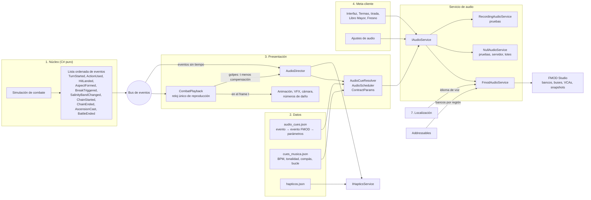
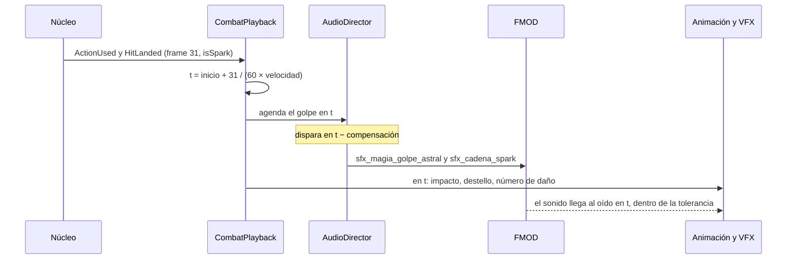

# Integración de audio de Sal y Almas: La Odisea del Fresno

Plan técnico de música, efectos de sonido, voces y háptica · 5 de noviembre de 2026 · Dirección técnica de audio

Este plan dice cómo entra el audio al juego: arquitectura, catálogo de efectos, voces, mezcla, rendimiento, plataformas, háptica, accesibilidad, producción, pruebas y fases. La lista de cues de música y los prompts para generarla viven en [SOUNDTRACK_SUNO.md](SOUNDTRACK_SUNO.md). Aquí no hay prompts de Suno ni lista de canciones. El [GDD](../GDD.md) manda sobre los dos documentos.

**Contrato con SOUNDTRACK_SUNO.md.** Los dos documentos lo siguen. Nadie lo cambia sin cambiar los dos.

| Tema | Regla |
| --- | --- |
| Middleware | FMOD Studio con su integración para Unity |
| Música | Cada cue se llama `mus_<contexto>_<nombre>` y declara BPM, tonalidad, compás y longitud de bucle en compases |
| Capas | Stems alineados de una misma generación: base, percusión, voz y coro. La Desafinación no se genera: es DSP en FMOD controlado por parámetro |
| Parámetros globales de FMOD | `Tension` (0 a 1), `Salinidad` (máxima del equipo, 0 a 150), `Paralaje` (0 a 3: bajo, medio, alto, máximo), `EnCadena` (0 o 1), `AscendenteActivo` (0 o 1), `EsJefe` (0 o 1) |
| Efectos y voces | `sfx_<sistema>_<accion>` y `vo_<bruja>_<tipo>`. El ID de bruja va en snake_case y sin acentos |

**Lo que este plan agrega sin tocar el contrato:** parámetros *locales* de evento (sección 3.1), el sistema `ambiente` para lechos (`sfx_ambiente_<lugar>`), snapshots `snap_*`, VCAs `vca_*` y los nombres de buses.

**IDs de bruja.** Uso los del GDD 18: `marisal`, `selenia`, `solenne`, `cervanda`, `tormentina`, `cupria`, `brea`, `cempa`, `muertita`, `salitre`, `topacia` y `axa`. Las otras 12 reciben su ID cuando tengan nombre. Mientras tanto, el audio temporal usa la especie (`cuerva`, `osa`, `hiena`, `nutria`, `lince`, `murcielaga`, `jaguar`, `lechuza`, `ratona`, `oveja`, `eriza`, `pata`) y se renombra una sola vez. **El ID no es el nombre visible:** si una bruja se renombra después, su ID no cambia, porque todas las claves de voz dependen de él.

**Documentos relacionados:** la Fase 3C de [HOJA_DE_RUTA.md](../HOJA_DE_RUTA.md) construye este plan con pistas temporales; [HUECOS.md](../HUECOS.md) lista las contradicciones conocidas del GDD; la propuesta [META_Y_ONBOARDING.md](../propuestas/META_Y_ONBOARDING.md) define la voz de la Calculista y la Confianza. Todo número de este plan que no venga del GDD lleva `// TUNING` en código y datos.

## 1. Resumen de decisiones

- **FMOD Studio 2.03 con FMOD for Unity 2.03.** Su documentación lista compatibilidad con Unity 6.0 LTS y 6.3 LTS. El audio de Unity se desactiva: FMOD es la única salida.
- **El núcleo no cambia.** Un `AudioDirector` en Presentación escucha los mismos eventos que la escena de combate y los traduce con una tabla de datos (`Data/Audio/audio_cues.json`): evento del núcleo → evento de FMOD → parámetros. Todo pasa por `IAudioService`, con una implementación nula para pruebas, servidor y modo por lotes.
- **Un solo reloj manda.** El sonido de cada golpe se agenda con el mismo frame de dato que usa la animación: `t = inicio + frame / (60 × velocidad)`. Se dispara antes, lo que tarde la salida de audio, para que llegue al oído junto con la imagen. El Spark suena con una sola campana por grupo de golpes, también a ×2.
- **La sal tiene sonido propio.** Cada ritual termina en el mismo crujido de sal, con la cola del metal de su planeta: oro, plata, hierro, azogue, cobre, estaño o plomo. Un parámetro de Pureza cambia el grano de sal por tono limpio a medida que la bruja refina.
- **La Partitura suena.** Cada golpe de una Cadena toca una nota en la escala del cue de música que esté sonando, con el timbre del metal de su planeta. El Spark es una campana. Es una capa discreta, con interruptor en ajustes y prueba A/B por configuración remota.
- **Voces:** japonés e inglés completos y español latinoamericano en la historia principal, con tablas de audio localizadas de FMOD. Solo se carga un idioma por banco. Las voces quedan fuera de la descarga inicial, salvo las del tutorial. Calculo unas 108 líneas de sistema por Regente, 85 por Oficiala y 63 por Aprendiza, y entre 70 y 85 MB por idioma completo.
- **Mezcla:** cinco buses (Música, SFX, Voz, Interfaz, Ambiente), VCAs para los volúmenes del jugador, diez snapshots y ducking por sidechain. Objetivo en móvil: −18 LUFS integrados ±2 LU y pico verdadero de −1 dBTP como máximo, medidos con BS.1770 en una captura automática y en el dispositivo.
- **Formatos:** Vorbis en streaming para música y voces, FADPCM en memoria para efectos cortos y PCM solo para clics de interfaz. Los bancos van por región con Addressables. Presupuesto: hasta 120 MB de audio en la descarga inicial y hasta 40 MB de RAM en gama baja (64 MB en gama alta).
- **Plataforma y háptica:** sesión `Ambient` en iOS, foco de audio con `USAGE_GAME` en Android, compensación de latencia para audífonos Bluetooth y callbacks estáticos para IL2CPP. La háptica marca Spark, Quiebre, Ascensión y la emergencia de 4★ y 5★, con tres niveles en ajustes.
- **Licencias:** según fuentes secundarias, FMOD es gratis con presupuesto menor a 600 000 USD e ingresos menores a 200 000 USD al año. Con un presupuesto como el de este juego, lo probable es la licencia Premium, de unos 18 000 USD por juego. No pude abrir la página oficial: hay que confirmarlo antes de presupuestar (sección 10.4).

## 2. Arquitectura

### 2.1 El audio en las siete piezas

| Pieza (GDD 21.2) | Qué pone el audio | Qué no hace |
| --- | --- | --- |
| 1. Núcleo de simulación | Nada. Solo emite sus eventos tipados | No referencia ensamblados de audio ni FMOD. Una prueba lo verifica |
| 2. Datos | `audio_cues.json` (mapeo), `audio_contrato.json` (parámetros globales y rangos), `cues_musica.json` (BPM, tonalidad, compás y bucle de cada cue, tomados de SOUNDTRACK_SUNO.md), `hapticos.json` y el guion de voces | No guarda audio, solo referencias |
| 3. Presentación | `AudioDirector`, `AudioScheduler`, `FmodAudioService`, snapshots y pistas de FMOD en Timeline para las cinemáticas | No decide reglas: si una regla falta en un evento, no la recalcula |
| 4. Meta-cliente | Sonidos de interfaz, Termas, tirada, Libro Mayor, taller y Fresno; pantalla de ajustes; valor de Paralaje | No llama a FMOD directo: usa `IAudioService` |
| 5. Backend autoritativo | Nada. El resultado de la tirada llega del servidor y la Timeline lo muestra | El audio nunca revela un resultado antes que la imagen |
| 6. Analítica y live ops | Eventos de ajustes (volúmenes, idioma de voz, háptica, compensación) y descargas de voces. Configuración remota: `partitura_notas` (prueba A/B) y una lista de modelos con háptica apagada | No cambia la mezcla a distancia |
| 7. Localización | Idioma de voz independiente del idioma de texto; subtítulos en tablas de Unity Localization con la misma clave que la línea de voz | No traduce el Salmódico |

### 2.2 Componentes

| Componente | Ensamblado | Responsabilidad |
| --- | --- | --- |
| `IAudioService`, `NullAudioService`, `RecordingAudioService` | `SalYAlmas.Audio.Logic` (C# puro, `noEngineReferences = true`) | Contrato del servicio. La nula no hace nada; la de grabación anota cada llamada con su tiempo, para las pruebas |
| `AudioCueTable`, `AudioCueResolver` | `SalYAlmas.Audio.Logic` | Lee la tabla y convierte un evento del núcleo en órdenes de audio |
| `AudioScheduler` | `SalYAlmas.Audio.Logic` | Frame a tiempo, velocidad ×2, grupos de Spark, compensación de latencia |
| `ContractParams` | `SalYAlmas.Audio.Logic` | Calcula Tension, Salinidad, EnCadena, AscendenteActivo, EsJefe y las capas derivadas |
| `AudioDirector` | `SalYAlmas.Audio` (Unity) | MonoBehaviour en la escena. Se suscribe al reproductor de eventos y a la interfaz |
| `FmodAudioService` | `SalYAlmas.Audio`, tras el símbolo `SALYALMAS_FMOD` | Implementación real: instancias, parámetros, snapshots, VCAs, bancos |
| `BankLoader` | `SalYAlmas.Audio` | Carga y descarga bancos por región con Addressables (sección 6.3) |
| `PlatformAudioSession` | `SalYAlmas.Audio` más plugins nativos | Sesión de iOS, foco de Android, latencia de salida |
| `IHapticsService` | `SalYAlmas.Audio` más plugins nativos | Háptica de iOS y Android (sección 8) |
| Validadores y escena de prueba | `SalYAlmas.Audio.Editor` | Revisa la tabla contra los bancos y arma la escena de prueba |

La lógica vive en C# puro para que corra con `dotnet test`, igual que el núcleo. Así se prueba la sincronía sin abrir Unity.

### 2.3 Flujo de eventos



### 2.4 La tabla de mapeo

La tabla vive en `Assets/SalYAlmas/Data/Audio/audio_cues.json`. Es JSON como el resto de los datos de la Fase 1, para que diseño la edite y git la compare. Cada regla dice qué evento escucha, con qué condición, qué evento de FMOD dispara, en qué momento y de dónde salen los parámetros.

```json
{
  "schemaVersion": 1,
  "contractVersion": "1.0",
  "rules": [
    {
      "id": "golpe_normal",
      "event": "HitLanded",
      "when": { "source": "weapon" },
      "fmodEvent": "event:/SFX/Combate/sfx_combate_golpe",
      "timing": "OnFrame",
      "parameters": { "Arma": "attackerWeaponFamily", "Material": "targetMaterial", "Peso": "hitWeight", "Velocidad": "playbackSpeed" },
      "priority": 2,
      "cooldownMs": 25,
      "haptic": null
    },
    {
      "id": "spark",
      "event": "HitLanded",
      "when": { "isSpark": true },
      "fmodEvent": "event:/SFX/Cadena/sfx_cadena_spark",
      "timing": "OnFrame",
      "group": "SparkGroup",
      "parameters": { "SparkIndice": "sparkIndexInChain", "Semitonos": "currentCueTonic" },
      "priority": 1,
      "haptic": "spark"
    },
    {
      "id": "cadena_inicio",
      "event": "ChainStarted",
      "fmodEvent": "event:/SFX/Cadena/sfx_cadena_calculo",
      "timing": "OnReceive",
      "globals": { "EnCadena": 1 },
      "snapshot": "snap_cadena"
    }
  ],
  "exceptions": [
    { "event": "DebugNote", "reason": "Solo para el registro de combate; no tiene sonido" }
  ]
}
```

- Las claves van en inglés, como todo identificador de código (CLAUDE.md); los nombres de parámetros y eventos de FMOD siguen el contrato. Los valores de `parameters` no son fórmulas. Son nombres de **extractores**, una lista cerrada de funciones en `AudioCueResolver` (por ejemplo, `hitWeight` o `attackerWeaponFamily`). Diseño elige; programación agrega extractores. Así no hay intérprete de expresiones ni reflexión en tiempo de ejecución, que es frágil con IL2CPP.
- `timing` puede ser `OnReceive` (al llegar el evento), `OnFrame` (agendado por frame de dato) u `OnActionEnd` (al acabar la animación de la acción).
- Todo evento sin sonido a propósito va en `exceptions` con su motivo. La prueba de cobertura (sección 12) falla si aparece un tipo de evento sin regla ni excepción.
- `FmodAudioService` resuelve cada ruta a su `EventDescription` y cada parámetro a su `PARAMETER_ID` al cargar el banco. En combate no busca por texto.

### 2.5 El servicio de audio

```csharp
namespace SalYAlmas.Audio
{
    // Contrato del servicio. Sin tipos de Unity ni de FMOD.
    public interface IAudioService
    {
        bool IsReady { get; }
        AudioHandle Play(in AudioRequest request);            // efecto, música o voz
        void Stop(AudioHandle handle, bool allowFadeOut = true);
        void SetGlobal(GlobalParam param, float value);        // solo los seis del contrato
        void SetLocal(AudioHandle handle, LocalParam param, float value);
        void SetSnapshot(SnapshotId snapshot, bool active);
        void SetVolume(VolumeChannel channel, float linear01); // VCAs de ajustes
        void SetVoiceLanguage(string locale);                  // "ja", "en" o "es-419"
        void PauseGameplay(bool paused);                       // pausa del juego, no de la app
        double OutputLatencySeconds { get; }                   // para la compensación
    }

    public enum GlobalParam { Tension, Salinidad, Paralaje, EnCadena, AscendenteActivo, EsJefe }

    public readonly struct AudioRequest
    {
        public readonly CueId Cue;        // índice a la tabla, resuelto al cargar
        public readonly ParamSet Params;  // hasta 6 parámetros locales, en la pila
        public readonly int ActorId;      // posición 3D y corte de voces de quien cae
        public readonly VoiceKey Voice;   // clave de la tabla de voces, o vacío
        public AudioRequest(CueId cue, ParamSet p, int actor, VoiceKey voice)
        { Cue = cue; Params = p; ActorId = actor; Voice = voice; }
    }
}
```

- **`NullAudioService`** devuelve manejadores vacíos y no hace nada. Se usa en `dotnet test`, en pruebas EditMode, en compilaciones por lotes (`Application.isBatchMode`), en bots de prueba y en cualquier proceso de servidor que cargue la presentación. También se usa si FMOD no logra iniciar: el juego sigue sin sonido y lo reporta a analítica.
- **`RecordingAudioService`** guarda cada llamada con su tiempo. Con ella se prueban la sincronía y los parámetros sin FMOD.
- **Regla de memoria:** cero asignaciones por evento. `AudioRequest` y `ParamSet` son estructuras; las listas se reservan al iniciar el combate. En IL2CPP una recolección de basura en plena Cadena se nota.

### 2.6 Sincronía: lo que se ve y lo que se oye nunca se separan

La sección 21.3 del GDD pide que lo que se ve y lo que se calcula nunca se separen. El audio entra a la misma regla con cuatro decisiones:

1. **Un solo reloj.** `CombatPlayback` convierte los frames de dato del núcleo (60 por segundo) a tiempo real. Animación, efectos visuales, cámara, números de daño, audio y háptica leen ese mismo reloj. Nadie lleva su propio temporizador. El bus de eventos de la hoja de ruta (sección 2.4) entrega los eventos cuando el núcleo los calcula, no cuando se muestran: el Director los recibe del bus, pero agenda los que dependen del tiempo con el reloj de `CombatPlayback`.
2. **Los golpes no salen de eventos de animación.** El sonido de un golpe sale del `HitLanded` con su frame, no de un evento puesto a mano en el clip. Los eventos de animación solo disparan foley decorativo: barridos de arma, ropa, pasos.
3. **Se dispara antes, lo que tarde la salida.** El núcleo ya calculó todos los golpes de la acción, así que el Director los conoce por adelantado y puede disparar cada sonido antes de su frame. Lo adelanta lo que tarde el audio en llegar al oído menos lo que tarde la imagen en llegar a la pantalla.
4. **El Spark se agrupa.** Golpes de brujas distintas a 2 frames o menos forman un grupo de Spark. El grupo suena con una sola campana en el frame del primer golpe. Cada golpe conserva su impacto, pero el segundo pierde el transitorio y baja 3 dB para que no suene a eco. Si el núcleo marca `isSpark` solo en uno de los golpes (el GDD 9.6 habla de "ese golpe"), el agrupador busca a su pareja en la lista ya calculada; no recalcula la regla.

```text
t_golpe  = t_inicio_accion + frame_absoluto / (60 × velocidad)
frame_absoluto (eslabón n de una Cadena) = 24 × (n − 1) + frame_del_golpe
t_disparo = t_golpe − compensacion
compensacion = clamp(latencia_audio − latencia_imagen + ajuste_manual, 0 ms, 300 ms)
latencia_audio = búfer de FMOD + latencia de salida del sistema (Bluetooth incluido)
latencia_imagen ≈ 2 frames de pantalla (33 ms a 60 fps, 66 ms a 30 fps), calibrable
```

**Ejemplo con la Cadena del GDD 9.5.** Marisal abre y golpea en el frame 30 de su eslabón. Selenia entra 24 frames después y golpea en el frame 7 del suyo, que es el frame absoluto 31. Están a un frame: hay Spark.

| Velocidad | Golpe de Marisal | Golpe de Selenia | Campana del Spark | Con audífonos Bluetooth (compensación 180 ms) |
| --- | --- | --- | --- | --- |
| ×1 | 500.0 ms | 516.7 ms | Se dispara en 500.0 ms | La campana se dispara en 320.0 ms |
| ×2 | 250.0 ms | 258.3 ms | Se dispara en 250.0 ms | La campana se dispara en 70.0 ms |

- **A ×2 los sonidos no se aceleran.** Cambiar el tono de un golpe cambia su timbre. Lo que cambia es el parámetro local `Velocidad`: colas más cortas y menos capas. La ventana del Spark mide 16.7 ms reales a ×2 y los dos golpes se funden en uno, que es justo lo que debe pasar.
- **Si la compensación no cabe.** Si un golpe cae antes de lo que tarda la salida (por ejemplo, una Varita que golpea en el frame 8 con audífonos de 250 ms), la presentación retrasa el inicio de esa acción lo que falte, con un tope de 150 ms. En un juego por turnos eso no se siente.
- **Gama baja a 30 fps.** El reloj sigue contando en frames de dato de 60 fps. El disparo se redondea al frame de pantalla, así que el error máximo es de 33 ms, dentro de la ventana de un Spark. Si en pruebas se nota, la campana del Spark puede agendarse con el reloj DSP de FMOD (retraso por muestra en el grupo de canales del evento). Esa mejora queda para producción.
- **Pausa de impacto.** Los 3 frames de pausa de la Ascensión III (50 ms) no congelan el audio. Durante esos 50 ms la mezcla baja 20 dB, y el impacto entra al terminar la pausa. El contraste hace que el golpe pese más.
- **Saltar.** Si el jugador salta una cinemática, el reloj brinca. Los sonidos pendientes con tiempo anterior se descartan, salvo los marcados como obligatorios (impacto, campana de Spark), que suenan una vez en el momento del salto.
- **Tolerancia.** La norma ITU-R BT.1359 pone el umbral de detección entre 45 ms con el sonido adelantado y 125 ms con el sonido atrasado (pruebas con voz). Para impactos, la meta es más estricta: en dispositivo, el sonido llega entre 10 ms antes y 40 ms después de la imagen.



### 2.7 Reglas para programar audio

- El Director nunca escribe en el núcleo ni cambia el orden de los eventos. Es un oyente.
- Las llamadas a FMOD van en el hilo principal. Los callbacks de FMOD no tocan la API de Unity: encolan y el Director procesa en `Update` (sección 7.4).
- Un sonido que falta no rompe nada: `FmodAudioService` registra el error una vez por ruta y sigue.
- Un efecto nunca anuncia lo que la imagen todavía no muestra: la rareza de una tirada antes del vapor, o el ataque de un jefe antes de su animación de carga.

## 3. Catálogo de efectos de sonido

### 3.1 Convenciones

**Disparadores.** El nombre de un evento del núcleo (por ejemplo, `HitLanded`) significa que la tabla de mapeo lo escucha. Los demás prefijos:

| Prefijo | Origen |
| --- | --- |
| `ui:` | Evento de la interfaz o del HUD del meta-cliente |
| `anim:` | Evento de animación, solo para foley decorativo |
| `tl:` | Pista o marcador de FMOD en una Timeline de Unity (cinemáticas, tirada) |
| `f2:` | Evento de los sistemas de la Fase 2 (Fresno, taller, gacha). Nombre por definir con esa rama |
| `meta:` | Cambio de estado de cuenta, como el Paralaje |
| `deriv:` | Dato derivado en Presentación sin recalcular reglas (por ejemplo, la barra de vida llega a cero) |

**Prioridad.** P1 nunca se roba (lectura de combate). P2 importante. P3 normal. P4 repetitivo. P5 decorativo. Cada evento declara además su máximo de instancias y su enfriamiento en FMOD.

**Espacio.** 2D va al centro. 3D usa el espaciador de FMOD con atenuación mínima y paneo limitado a ±50 %: la pantalla de un teléfono es chica y en mono no se debe perder nada.

**Parámetros locales** (viven en cada evento; no son del contrato):

| Parámetro | Valores | Para qué |
| --- | --- | --- |
| `Planeta` | Etiquetas: sol, luna, marte, mercurio, venus, jupiter, saturno | Timbre del metal |
| `Pureza` | 0.70 a 1.00 | Del grano de sal al tono limpio |
| `Peso` | 0 a 1 | Golpe ligero, medio o pesado, según el daño relativo a la vida máxima del objetivo |
| `Arma` | 12 familias del GDD 15.1 | Capa del arma |
| `Material` | pelaje, sal, metal_liquido, madera, astral, piedra | Capa del objetivo |
| `Especie` | 8 grupos (sección 3.5.10) | Sacudida, emergencia y tacto en las Termas |
| `Rareza` | 3, 4 o 5 | Tirada y tarjeta |
| `Papel` | apertura, enlace, cierre | Eslabones de Cadena |
| `SparkIndice` | 1 a 5 | Cada Spark de la misma Cadena sube un grado de la escala |
| `Semitonos` | −12 a 12 | Transporta notas, campanas e intervalos a la tonalidad del cue actual |
| `Velocidad` | 1 o 2 | Colas más cortas a ×2 |
| `RitualLargo` | 0 o 1 | Primer plano del ritual de 0.4 s (primera vez) o de 0.2 s |
| `CapaVoz`, `CapaCoro` | 0 a 1 | Solo en música; se derivan de los parámetros del contrato (sección 5.4) |
| `Cinematica` | 0 o 1 | Solo en música de combate; la baja a silencio en 200 ms durante la Ascensión III (sección 4.4) |

Los parámetros que usa un solo evento (por ejemplo `Forma` del Autohechizo, `Efecto` de las pociones, `Manantial` o `Pity` de la tirada) se documentan en ese evento.

### 3.2 El sonido de la sal

La sal es el maná del juego, así que su sonido es la firma de todo el audio. **Cada ritual termina en el mismo crujido de sal** (`sfx_sal_crujido`), de 120 a 250 ms, con una cola del metal de su planeta. El jugador aprende ese crujido en el primer minuto. Después lo reconoce en el Altar del Árbol, en las Salinas y en los Cristalizados.

**Cómo se arma el crujido:**

1. **Fractura:** halita (sal de roca) partida con pinzas cerca de un micrófono de diafragma chico, más un micrófono de contacto en la piedra.
2. **Granos:** sal de grano de Cuyutlán y flor de sal cayendo sobre piel curtida y sobre vidrio.
3. **Cola planetaria:** el metal de la sección 3.3, a −8 dB, con 300 a 600 ms de cola.
4. **Pureza:** con `Pureza` en 0.70 domina la fractura sucia, con ruido. En 0.85 la fractura y el tono pesan igual. Desde 0.97 entra un armónico limpio y la sal suena casi a campana. El pilar "Refinar es transformarse" también se oye.

Las grabaciones de sal se hacen a 96 kHz y 24 bits. Bajarlas una o dos octavas da los crujidos lentos de la Cristalización Turbia y de los Cristalizados sin que aparezcan artefactos.

**Rituales de las Regentes.** El primer plano dura 0.4 s la primera vez por combate y 0.2 s después (GDD 19.2). El evento `sfx_ritual_<bruja>` contiene al crujido como evento anidado: hay una sola fuente de verdad.

| Bruja | Ritual (GDD 18.2) | Capa de boca o gesto | Capa de sal | Cola (planeta principal) | Modo recatado |
| --- | --- | --- | --- | --- | --- |
| `marisal` | Muerde un cristal de sal de roca | Mordida seca, sin saliva | Halita partida en dos fragmentos | Hierro: chispa y placa de acero | Igual |
| `selenia` | Disuelve sal en té negro | Un trago corto | Granos cayendo en líquido; cucharita contra porcelana | Plata: crótalo suave | Igual |
| `solenne` | Sal en un gajo de limón con chile | Mordida jugosa de 150 ms | Sal gruesa sobre pulpa; chile en polvo como fricción de papel | Oro: chisporroteo | Sin mordida: solo sal y gajo |
| `cervanda` | Salero de plata con modales de corte | Ninguna | Dos sacudidas rítmicas del salero; cuchara de plata | Plomo: golpe sordo y tic de reloj | Igual |
| `tormentina` | Lame sal del dorso de la pata | Un lengüetazo corto, seco y cómico, sin sorber ni respiración | Sal fina sobre gamuza | Estaño: grito del estaño y estática | Sin lengüetazo: sal sacudida de la pata |
| `cupria` | Su Ascendente le pone la sal en la lengua | Ninguna (no hay sonido de boca) | Sal que cae de dedos astrales, con reverberación | Cobre: cuenco cantor | Igual |

- La cola usa el planeta **dominante en su grado actual**. Si la bruja eligió la Vía Menor en el grado B, la cola cambia de metal.
- Los rituales de Oficialas y Aprendizas no están en el GDD. Mientras se definen, cada una toma una de las seis familias de arriba con variación por especie (sección 14.2).
- Los **rituales de sal alternos** que se venden como cosmético (GDD 16.5) traen su propio evento. Son parte de la lista de entrega de cada cosmético.

### 3.3 El timbre de cada planeta

Cada planeta suena a su metal. El mismo timbre aparece en el Golpe Astral, en el Quiebre, en la cola del ritual y en la nota de la Partitura. La escalera de pureza del GDD 7.1 se oye: Turbia es ruido y grano, Destilada es tono con textura, Quintaesencia es tono puro con aura.

| Planeta | Metal | Carácter | Qué se graba | Turbia | Destilada | Quintaesencia | Grado en la Partitura |
| --- | --- | --- | --- | --- | --- | --- | --- |
| Luna | Plata | Puro, frío, cola larga | Copa de cristal frotada, crótalos, cuchara de plata, agua quieta | *Bruma Salina*: siseo filtrado | *Marea de Plata*: tono que va y viene | *Espejo Lunar*: senoidal limpia con eco | I |
| Mercurio | Azogue | Líquido, rápido, inestable | Gotas sobre metal, armónica de vidrio, tubos con agua, glissandos | *Humo Ácido*: burbujeo y siseo | *Azogue Vivo*: gotas afinadas que se mueven | *Mente Relámpago*: arpegio veloz | II |
| Venus | Cobre | Cálido, redondo, vegetal | Cuencos y campanas de cobre, hojas, tallos que crujen | *Cardenillo*: cuenco desafinado con ruido | *Savia de Cobre*: cuenco limpio y hojas | *Jardín Esmeralda*: acorde de cuencos y brotes | III |
| Sol | Oro | Brillante, cálido, chisporroteante | Campanillas y crótalos de latón, cerillos, fuego | *Ceniza Salobre*: crepitar con ruido | *Fuego Pálido*: fuego limpio con campanilla | *Corona Solar*: acorde mayor de campanas | IV |
| Marte | Hierro | Seco, medio grave, áspero | Yunque, cadena, esmeril, placa de acero, óxido raspado | *Herrumbre*: raspado y polvo | *Sangre Férrea*: golpe de forja | *Acero Carmesí*: hoja de acero frotada con arco | V |
| Júpiter | Estaño | Eléctrico, solemne | El "grito del estaño" (el crujido de una barra de estaño al doblarse), lámina de trueno, estática de radio | *Estática Gris*: crepitar | *Trueno de Estaño*: lámina y grito | *Ley Tonante*: trueno afinado con campana grave | VI |
| Saturno | Plomo | Sordo, pesado, lento | Plomo golpeado (casi no resuena), péndulo, reloj, piedra arrastrada | *Ceniza Gris*: golpe sordo | *Plomo Lento*: golpe estirado en el tiempo | *Hora Final*: campanada grave de reloj, cortada | VII |

- **Por qué este orden de grados.** Es el orden clásico de las esferas, de la más cercana a la más lejana: Luna, Mercurio, Venus, Sol, Marte, Júpiter y Saturno. Saturno cae en el séptimo grado, el más inestable de la escala, y eso le queda a la *Hora Final*. La idea de que los planetas forman una escala viene de la *Harmonices Mundi* de Kepler (1619), de dominio público.
- **Lectura sobre todo.** El metal distingue al planeta antes que la nota. Quien no distingue tonos igual reconoce el yunque de Marte o el cuenco de Venus.
- **El mismo idioma que la música.** Los metales coinciden con la tabla 3.4 de SOUNDTRACK_SUNO.md (campanas de oro, cristal de plata, yunque de hierro, campanillas de azogue, cuencos de cobre, lámina de trueno de estaño, campanas apagadas de plomo). Música y efectos se refuerzan en vez de competir.
- **Cuidado con la Campana de Bronce.** Esa familia de armas (GDD 15.1) también suena a campana. Su sonido va en registro grave y con onda diferida. La campana del Spark es aguda, corta y dorada. Nunca deben confundirse.

### 3.4 La Partitura que suena

**La idea:** cada golpe de una Cadena toca una nota con el timbre del metal de su planeta, en la escala del cue de música actual. El Spark se convierte en campana. Así el acertijo de orden también se escucha.

| A favor | En contra | Cómo se resuelve |
| --- | --- | --- |
| Refuerza el pilar "El orden es poder": una buena Cadena suena mejor | Con cinco brujas y armas de muchos golpes, puede saturar | Capa a −14 dB frente a los golpes, notas de 150 ms, máximo 6 instancias |
| Da una pista sonora del Spark: accesibilidad para quien ve poco | Notas fuera de tonalidad chocarían con la música | Las notas leen la tonalidad del cue en `cues_musica.json` y se transportan con `Semitonos`. Si no hay tonalidad, usan pentatónica menor de La |
| Une música y combate, que es la identidad sonora del juego | Puede cansar en peleas largas | Interruptor en ajustes ("Notas de la Partitura") y prueba A/B con configuración remota |
| Sirve en la pantalla de preparación | Sonar al reordenar cada vez sería molesto | Botón **Escuchar** en la Partitura: toca la Cadena prevista a ×1, con sus campanas, sin ejecutarla |

**Decisión: sí, con estas reglas.**

1. Solo suena con `EnCadena = 1` y con el botón Escuchar. Fuera de la Cadena, los golpes no tocan notas.
2. Nota = grado del planeta (sección 3.3) en el modo del cue. La octava sale del papel: Apertura grave, Enlace media y Cierre aguda con acorde.
3. La campana del Spark toca la tónica, y cada Spark de la misma Cadena sube por las notas del acorde: 1.ª, 3.ª, 5.ª, 8.ª y 10.ª, según `SparkIndice`.
4. La campana se graba en seis alturas, a cuatro semitonos de distancia (dos octavas), para no transportar ninguna muestra más de ±2 semitonos.
5. **Cadena a tiempo (opcional).** SOUNDTRACK_SUNO.md fija el combate, la Partitura y el Éxtasis en Re menor a 128 BPM. A ese tempo, un tiempo dura 469 ms y los 24 frames entre eslabones (400 ms) no caen en el pulso. Lo que sí se puede: que la ejecución espere al siguiente tiempo (como máximo 469 ms) para que la Apertura caiga en el pulso. Las notas igual suenan en tonalidad. Si las pruebas con jugadores piden una Cadena rítmica completa, la salida es llevar el combate a 150 BPM, que también está en la lista de tempos de ese documento: ahí cada eslabón cae en una negra y, a ×2, en una corchea. Es la pregunta 5 de la sección 14.2.

**Métricas de la prueba A/B:** porcentaje de Cadenas con al menos un Spark, uso del reordenamiento y del botón Escuchar, y cuántos jugadores apagan las notas en su primera semana.

### 3.5 Catálogo por sistema

Las variaciones cuentan archivos distintos que FMOD alterna sin repetir. Los buses están en la sección 5.1.

#### 3.5.1 Combate

| ID | Cuándo suena | Disparador | Variaciones | Prioridad | Espacio | Bus |
| --- | --- | --- | --- | --- | --- | --- |
| `sfx_combate_entrada` | Transición a la escena de combate | `ui:combate_inicia` | 3 | P3 | 2D | SFX/Combate |
| `sfx_combate_turno` | Empieza un turno: tic suave si es aliada, grave si es enemiga | `TurnStarted` | 2 por bando | P4 | 2D | Interfaz |
| `sfx_combate_ataque` | Barrido del arma antes del golpe | `anim:arma_barrido` | 3 × 12 familias | P3 | 3D | SFX/Combate |
| `sfx_combate_golpe` | Impacto de ataque básico o de eslabón físico | `HitLanded` (origen arma, isSpark falso o verdadero) | 4 × 12 armas × 3 pesos, más 6 materiales | P2 | 3D | SFX/Combate |
| `sfx_combate_critico` | Capa extra en un crítico | `HitLanded` con `isCritical`; si el campo no existe, excepción | 3 | P2 | 3D | SFX/Combate |
| `sfx_combate_dano_recibido` | Reacción del cuerpo golpeado: pelaje, plumas, ropa | `HitLanded` (objetivo aliada) | 4 × 8 especies | P3 | 3D | SFX/Combate |
| `sfx_combate_estado_tick` | Daño por turno: quemadura, sangrado, veneno, electrocución | `HitLanded` (origen estado) | 3 × 4 | P3 | 3D | SFX/Combate |
| `sfx_combate_escudo` | Escudo que se pone o se rompe | `ActionUsed` (efecto escudo) | 3 + 3 | P3 | 3D | SFX/Magia |
| `sfx_combate_caida` | Una unidad cae | `deriv:vida_cero` | 3 | P2 | 3D | SFX/Combate |
| `sfx_combate_revivir` | Revive (ajolote, Salmuera) | `ActionUsed` (efecto revivir) | 2 | P2 | 3D | SFX/Magia |
| `sfx_combate_jefe_aviso` | El jefe carga su ataque definitivo | `ActionUsed` del jefe con carga o `anim:jefe_carga` | 2 | P1 | 3D | SFX/Lectura |
| `sfx_combate_granos` | Sube o baja un Grano de Sal | `ui:granos_cambian` | 2 + 2 | P4 | 2D | Interfaz |
| `sfx_combate_velocidad` | Cambia a ×1 o ×2 | `ui:velocidad` | 2 | P4 | 2D | Interfaz |
| `sfx_combate_auto` | Activa o quita el modo automático | `ui:auto` | 2 | P4 | 2D | Interfaz |
| `sfx_combate_victoria` | Gana el combate (más el stinger de música) | `BattleEnded` (victoria) | 2 | P1 | 2D | SFX/Lectura |
| `sfx_combate_derrota` | Pierde el combate | `BattleEnded` (derrota) | 1 | P1 | 2D | SFX/Lectura |

#### 3.5.2 Cadena y Partitura

| ID | Cuándo suena | Disparador | Variaciones | Prioridad | Espacio | Bus |
| --- | --- | --- | --- | --- | --- | --- |
| `sfx_cadena_resonancia_llena` | La Resonancia llega a 100 | `ui:resonancia_llena` | 1 | P2 | 2D | Interfaz |
| `sfx_cadena_abrir` | Se abre la Partitura y el mundo se detiene | `ui:cadena_abrir` | 1 | P2 | 2D | Interfaz |
| `sfx_cadena_tomar` / `sfx_cadena_soltar` | Arrastrar y soltar una bruja en la Partitura | `ui:partitura_tomar`, `ui:partitura_soltar` | 3 y 3 | P3 | 2D | Interfaz |
| `sfx_cadena_spark_previsto` | Aparece o desaparece un Spark previsto | `ui:preview_cambia` (resultado de PreviewChain) | 2 | P3 | 2D | Interfaz |
| `sfx_cadena_confirmar` | Confirmar: trazo de pluma | `ui:cadena_confirmar` | 2 | P2 | 2D | Interfaz |
| `sfx_cadena_calculo` | "El sonido del cálculo": engranes de astrolabio y cuentas de ábaco; la Calculista calcula en silencio | `ChainStarted` | 2 | P2 | 2D | SFX/Lectura |
| `sfx_cadena_eslabon` | Entrada de cada eslabón: aire que se corta, sin voz | `ActionUsed` (papel de Cadena) | 3 por papel | P2 | 3D | SFX/Magia |
| `sfx_partitura_nota` | Una nota por golpe durante la Cadena o con Escuchar; en un Spark, la campana la reemplaza | `HitLanded` (EnCadena = 1, sin Spark); `ui:partitura_escuchar` | 7 metales × 3 octavas | P3 | 2D | SFX/Partitura |
| `sfx_cadena_spark` | La campana del Spark | `HitLanded` (isSpark), una por grupo | 6 alturas | P1 | 2D | SFX/Lectura |
| `sfx_cadena_invitada` | La Invitada cierra la Cadena | `ActionUsed` (Cierre de la Invitada) | 2 | P2 | 3D | SFX/Magia |
| `sfx_cadena_fin` | Acorde de resolución: más brillante con más Spark | `ChainEnded` (número de Spark) | 3 | P2 | 2D | SFX/Lectura |

#### 3.5.3 Magia y ritual

| ID | Cuándo suena | Disparador | Variaciones | Prioridad | Espacio | Bus |
| --- | --- | --- | --- | --- | --- | --- |
| `sfx_ritual_<bruja>` | Primer plano del ritual de sal (24 eventos) | `ActionUsed` (Hechizo), `RitualLargo` | 3 por bruja | P2 | 2D | SFX/Magia |
| `sfx_sal_crujido` | Firma al final de todo ritual | Anidado en `sfx_ritual_*` y en el Altar | 6 × 7 planetas | P2 | 2D | SFX/Magia |
| `sfx_magia_canalizar` | La bruja canaliza y el Ascendente se prepara | `ActionUsed` (Hechizo) | 2 × 7 | P3 | 3D | SFX/Magia |
| `sfx_magia_ascendente_aparece` | El Ascendente aparece con la firma de su signo | `anim:ascendente_invoca` | 2 × 12 signos | P3 | 3D | SFX/Magia |
| `sfx_magia_golpe_astral` | Impacto del Golpe Astral | `HitLanded` (origen Hechizo) | 4 × 7 planetas × 3 purezas | P2 | 3D | SFX/Magia |
| `sfx_magia_autohechizo` | Agujas y sello (cristal y siseo, sin gore), hilos (cuerdas tensas) o frenesí (Sal Negra y gruñido del Ascendente) | `ActionUsed` (Autohechizo) | 3 × 3 formas | P2 | 3D | SFX/Magia |
| `sfx_magia_vislumbre` | Fusión de 2 s con la forma del grado siguiente | `ActionUsed` (Vislumbre) | 2 × 3 fases | P2 | 2D | SFX/Magia |
| `sfx_magia_sal_negra` | Capa de Sal Negra: crujido húmedo y grave, y un cuenco frotado hasta que gime (como en SOUNDTRACK_SUNO.md 3.4) | `ActionUsed` (gasta Sal Negra) | 3 | P2 | 3D | SFX/Magia |
| `sfx_magia_ascendente_retira` | El Ascendente se retira | `anim:ascendente_retira` | 2 | P4 | 3D | SFX/Magia |

#### 3.5.4 Salinidad por banda

| ID | Cuándo suena | Disparador | Variaciones | Prioridad | Espacio | Bus |
| --- | --- | --- | --- | --- | --- | --- |
| `sfx_salinidad_baja` | Baja de banda: alivio, sal que se disuelve | `SalinityBandChanged` (baja) | 3 | P3 | 3D | SFX/Magia |
| `sfx_salinidad_salobre` | Entra a Salobre (40 a 69) | `SalinityBandChanged` | 2 | P3 | 3D | SFX/Magia |
| `sfx_salinidad_sobresalada` | Entra a Sobresalada (70 a 99) | `SalinityBandChanged` | 2 | P2 | 3D | SFX/Magia |
| `sfx_salinidad_cristalizacion` | Entra a Cristalización Turbia (100 a 149) | `SalinityBandChanged` | 2 | P2 | 3D | SFX/Magia |
| `sfx_salinidad_cristal_bucle` | Cristales que crecen mientras siga en esa banda | Mismo evento; se detiene al bajar | 1 bucle | P4, máximo 2 | 3D | SFX/Magia |
| `sfx_salinidad_perdida_vida` | Pierde 5 % de vida por turno en Cristalización | `TurnStarted` (bruja en esa banda) | 3 | P3 | 3D | SFX/Magia |
| `sfx_salinidad_extasis` | Éxtasis Abisal: el Ascendente toma el control | `SalinityBandChanged` (a 150) | 2 | P1 | 2D | SFX/Lectura |
| `sfx_salinidad_desalada` | Sale del Éxtasis y queda Desalada | `SalinityBandChanged` (de 150 a 60) | 2 | P2 | 3D | SFX/Magia |

#### 3.5.5 Quiebre por planeta

`sfx_quiebre_firmeza` siempre suena primero: una placa de sal que se rompe con una grieta dorada. Después entra la capa del planeta del golpe que quebró.

| ID | Cuándo suena | Disparador | Variaciones | Prioridad | Espacio | Bus |
| --- | --- | --- | --- | --- | --- | --- |
| `sfx_quiebre_firmeza` | La Firmeza llega a cero | `BreakTriggered` | 3 | P1 | 3D | SFX/Lectura |
| `sfx_quiebre_sol` | Quemadura: llamarada y siseo | `BreakTriggered` (Sol) | 2 | P2 | 3D | SFX/Magia |
| `sfx_quiebre_luna` | Encierro: jaula de plata que se cierra, crótalos | `BreakTriggered` (Luna) | 2 | P2 | 3D | SFX/Magia |
| `sfx_quiebre_marte` | Sangrado fuerte: cadena de hierro y óxido raspado, sin chapoteo | `BreakTriggered` (Marte) | 2 | P2 | 3D | SFX/Magia |
| `sfx_quiebre_mercurio` | Veneno y retraso: azogue que burbujea | `BreakTriggered` (Mercurio) | 2 | P2 | 3D | SFX/Magia |
| `sfx_quiebre_venus` | Encanto: acorde suave de cuencos de cobre | `BreakTriggered` (Venus) | 2 | P2 | 3D | SFX/Magia |
| `sfx_quiebre_jupiter` | Electrocución que salta: grito del estaño y arcos | `BreakTriggered` (Júpiter) | 2 más 3 saltos | P2 | 3D | SFX/Magia |
| `sfx_quiebre_saturno` | Gravedad: plomo que cae y un reloj que se frena | `BreakTriggered` (Saturno) | 2 | P2 | 3D | SFX/Magia |

#### 3.5.6 Aspectos y Reacciones Híbridas

Los Aspectos son ángulos entre planetas, así que suenan como intervalos musicales transportados a la tonalidad del cue. Los armónicos (Trígono, Sextil) suenan consonantes. Los tensos (Cuadratura, Oposición) suenan ásperos. El jugador aprende si fue un buen Aspecto sin leer nada.

| ID | Cuándo suena | Disparador | Variaciones | Prioridad | Espacio | Bus |
| --- | --- | --- | --- | --- | --- | --- |
| `sfx_aspecto_conjuncion` | Unísono reforzado (mismo planeta) | `AspectFormed` (Conjunción) | 2 | P2 | 2D | SFX/Magia |
| `sfx_aspecto_oposicion` | Octava que se quiebra, antes de la Reacción | `AspectFormed` (Oposición) | 2 | P2 | 2D | SFX/Magia |
| `sfx_aspecto_sextil` | Tercera mayor rápida que "adelanta" | `AspectFormed` (Sextil) | 2 | P2 | 2D | SFX/Magia |
| `sfx_aspecto_trigono` | Quinta justa cálida y un grano de sal | `AspectFormed` (Trígono) | 2 | P2 | 2D | SFX/Magia |
| `sfx_aspecto_cuadratura` | Segunda menor áspera | `AspectFormed` (Cuadratura) | 2 | P2 | 2D | SFX/Magia |
| `sfx_reaccion_eclipse` | Sol con Saturno: un tono brillante tragado por plomo y 200 ms de silencio | `AspectFormed` (reacción Eclipse) | 2 | P1 | 2D | SFX/Lectura |
| `sfx_reaccion_helada_negra` | Luna con Saturno: escarcha en cámara lenta | `AspectFormed` (Helada Negra) | 2 | P1 | 2D | SFX/Lectura |
| `sfx_reaccion_espinas_rojas` | Marte con Venus: espinas de hierro y un cuenco que cura | `AspectFormed` (Espinas Rojas) | 2 | P1 | 2D | SFX/Lectura |
| `sfx_reaccion_tempestad` | Mercurio con Júpiter: rayo en cadena; cada golpe extra usa su propio `HitLanded` | `AspectFormed` (Tempestad) | 2 | P1 | 2D | SFX/Lectura |

#### 3.5.7 Ascensiones

| ID | Cuándo suena | Disparador | Variaciones | Prioridad | Espacio | Bus |
| --- | --- | --- | --- | --- | --- | --- |
| `sfx_ascension_carga` | El anillo de Ánima llega a 100, 200 o 300 | `ui:anima_umbral` | 3 niveles | P3 | 2D | Interfaz |
| `sfx_ascension_lanzar` | El jugador lanza y el tiempo se congela | `AscensionCast` | 1 por nivel | P1 | 2D | SFX/Lectura |
| `sfx_ascension_i` | Técnica del Ascendente, 1.5 s | `AscensionCast` (nivel 1) | 1 por signo, capa de planeta | P1 | 2D | SFX/Magia |
| `sfx_ascension_ii` | Técnica mayor con efecto de equipo, 3 s | `AscensionCast` (nivel 2) | 1 por signo, capa de planeta | P1 | 2D | SFX/Magia |
| `sfx_ascension_iii_<bruja>` | Cinemática de firma: versión de 6 a 8 s y corta de 2 a 3 s | `AscensionCast` (nivel 3) → `tl:` pista de FMOD en la Timeline | 2 versiones por bruja | P1 | 2D | SFX/Magia |
| `sfx_ascension_impacto` | Impacto tras la pausa de 3 frames | `tl:impacto` | 2 × 7 planetas | P1 | 2D | SFX/Lectura |
| `sfx_ascension_duo` | Dos Ascensiones encimadas con Spark | `HitLanded` (isSpark, origen Ascensión) | 1 | P1 | 2D | SFX/Lectura |
| `sfx_ascension_saltar` | Saltar: corte limpio al impacto | `ui:saltar` | 1 | P2 | 2D | Interfaz |

#### 3.5.8 Pociones

| ID | Cuándo suena | Disparador | Variaciones | Prioridad | Espacio | Bus |
| --- | --- | --- | --- | --- | --- | --- |
| `sfx_pocion_cinturon` | Tocar una ranura del cinturón | `ui:cinturon` | 2 | P4 | 2D | Interfaz |
| `sfx_pocion_destapar` | Corcho y oleaje según la base: agua termal, vinagre o leche lunar | `ActionUsed` (Poción) | 3 × 3 bases | P3 | 3D | SFX/Magia |
| `sfx_pocion_beber` | Un trago corto | `ActionUsed` (Poción) | 3 | P3 | 3D | SFX/Magia |
| `sfx_pocion_efecto` | Brillo según el efecto: cura, escudo, velocidad, retraso, Ánima, Salinidad | `ActionUsed` (efecto) | 2 × 6 | P2 | 3D | SFX/Magia |
| `sfx_pocion_turbia` | Salmuera Turbia con efecto aleatorio: burbujeo raro | `ActionUsed` (Salmuera Turbia) | 3 | P3 | 3D | SFX/Magia |

#### 3.5.9 Fresno

| ID | Cuándo suena | Disparador | Variaciones | Prioridad | Espacio | Bus |
| --- | --- | --- | --- | --- | --- | --- |
| `sfx_fresno_zona_entrar` | Entrar a Raíces, Tronco, Ramas o Copa | `f2:zona_entrar` | 4 | P2 | 2D | SFX/Mundo |
| `sfx_fresno_nodo_elegir` | Elegir un nodo del mapa | `ui:nodo_elegir` | 3 | P3 | 2D | Interfaz |
| `sfx_fresno_ruta` | La ruta se dibuja en el mapa | `ui:ruta_trazo` | 2 | P4 | 2D | Interfaz |
| `sfx_fresno_injerto` | Elegir un Injerto: metal de su Rama | `f2:injerto_elegido` | 7 | P2 | 2D | Interfaz |
| `sfx_fresno_fruto` | Se activa un Fruto (tres Injertos de una Rama) | `f2:fruto_activado` | 7 | P1 | 2D | SFX/Lectura |
| `sfx_fresno_mutacion` | Aceptar una Mutación del Árbol | `f2:mutacion` | 2 | P2 | 2D | SFX/Mundo |
| `sfx_fresno_maldicion` | Aceptar una maldición: campana más grave con cada una (1 a 5) | `f2:maldicion_aceptada` | 5 | P2 | 2D | SFX/Mundo |
| `sfx_fresno_santuario` | Guardar almitas en un Santuario | `f2:almitas_guardadas` | 2 | P1 | 2D | SFX/Mundo |
| `sfx_fresno_descanso` / `sfx_fresno_entrenar` | Elegir descanso o entrenamiento en el Santuario | `f2:santuario_eleccion` | 1 y 1 | P2 | 2D | SFX/Mundo |
| `sfx_fresno_mancha_aparece` | La Mancha de Sal aparece en su nodo | `f2:mancha_en_nodo` | 1 | P2 | 3D | SFX/Mundo |
| `sfx_fresno_mancha_recuperar` | Recuperar las almitas perdidas | `f2:mancha_recuperada` | 1 | P1 | 2D | SFX/Lectura |
| `sfx_fresno_mancha_absorbida` | El Fresno absorbe la Mancha y devuelve 30 % como Savia | `f2:mancha_absorbida` | 1 | P2 | 2D | SFX/Mundo |
| `sfx_fresno_eco` | Guardar un Eco | `f2:eco_guardado` | 1 | P2 | 2D | Interfaz |
| `sfx_fresno_ofrenda` | Ofrenda: el árbol crece (madera, hojas) | `f2:ofrenda` | 3 | P2 | 2D | SFX/Mundo |
| `sfx_ambiente_raices`, `_tronco`, `_ramas`, `_copa` | Lecho de cada zona | Carga de escena | 1 bucle por zona | P5 | 2D | Ambiente/Lechos |

#### 3.5.10 Termas y tirada del gacha

La tirada sigue los seis pasos del GDD 16.1 y vive en una Timeline: cada sonido cae en su marcador. **El sonido nunca revela la rareza antes que el color del vapor.**

Grupos de `Especie` para la sacudida, la emergencia y el tacto:

| Grupo | Brujas | Sacudida |
| --- | --- | --- |
| `canida` | loba (Marisal), zorra (Solenne), coyota (Cempa), hiena | Se sacude entera: ráfaga de agua y orejas que golpean |
| `felina` | gata negra (Brea), lince, jaguar | Sacudida breve, molesta; se lame la pata una vez |
| `ave` | cuerva, lechuza, pata | Esponja las plumas |
| `alada` | polilla (Selenia), murciélaga | Aleteo con polvo de escamas o membranas que se tensan |
| `escamosa` | serpiente (Cupria), ajolote (Axa) | Deslizamiento y gotas que escurren |
| `ungulada` | cierva (Cervanda), cabra (Salitre), oveja | Sacude la cabeza y la cornamenta o la lana |
| `pequena` | liebre (Tormentina), ratona, topo (Topacia), zarigüeya (Muertita), eriza | Sacudida rápida y aguda |
| `robusta` | osa, nutria | Sacudida lenta y pesada |

| ID | Cuándo suena | Disparador | Variaciones | Prioridad | Espacio | Bus |
| --- | --- | --- | --- | --- | --- | --- |
| `sfx_ambiente_termas_dia` / `_noche` | Lecho de las Termas según la hora local | Carga de escena | 1 bucle cada uno, por Manantial | P5 | 2D | Ambiente/Lechos |
| `sfx_termas_tortuga_respira` | La tortuga respira cada 20 a 40 s | Temporizador de escena | 3 | P5 | 3D | Ambiente/Lechos |
| `sfx_termas_tocar` | Tocar a una bruja: cabeza, mano, sombrero, cola | `ui:termas_tocar` | 3 × 8 grupos | P3 | 3D | SFX/Mundo |
| `sfx_termas_bano` | Entrar y salir del agua | `ui:bano` | 3 × 2 | P3 | 3D | SFX/Mundo |
| `sfx_termas_paralaje_baja` | El baño baja el Paralaje: el agua lava los susurros | `meta:paralaje_baja` | 1 | P2 | 2D | SFX/Mundo |
| `sfx_tirada_tomar` | La Calculista toma 1 o 10 Sales de Baño | `ui:tirada` | 2 | P2 | 2D | SFX/Mundo |
| `sfx_tirada_sales_caer` | Las sales caen al manantial | `tl:sales_caen` | 4 (1 tirada) y cascada (10) | P2 | 3D | SFX/Mundo |
| `sfx_tirada_burbujas` | Las sales se disuelven | `tl:disolver` | 3 | P3 | 3D | SFX/Mundo |
| `sfx_tirada_vapor` | Vapor por rareza: blanco, violeta o dorado | `tl:vapor` (`Rareza`) | 2 × 3 | P1 | 2D | SFX/Lectura |
| `sfx_tirada_subida` | El vapor pasa de violeta a dorado | `tl:vapor_sube` | 1 | P1 | 2D | SFX/Lectura |
| `sfx_tirada_quietud` | El agua se aquieta: silencio dirigido y un brillo | `tl:agua_quieta` | 1 | P2 | 2D | SFX/Mundo |
| `sfx_tirada_constelacion` | 5★: la constelación de su Ascendente se dibuja; cada estrella toca una nota de la firma de 2 compases de su leitmotiv (solista aislado de SOUNDTRACK_SUNO.md) | `tl:constelacion` | 1 por 5★ | P1 | 2D | SFX/Lectura |
| `sfx_tirada_silueta` | Una silueta bajo el agua | `tl:silueta` | 2 | P2 | 3D | SFX/Mundo |
| `sfx_tirada_emergencia` | La bruja emerge y el agua escurre de su pelaje | `tl:emerge` (`Especie`, `Rareza`) | 2 × 8 | P1 | 3D | SFX/Mundo |
| `sfx_tirada_sacudida` | Se sacude según su especie | `tl:sacudida` (`Especie`) | 3 × 8 | P2 | 3D | SFX/Mundo |
| `sfx_tirada_tarjeta` | Aparece su tarjeta | `tl:tarjeta` (`Rareza`) | 3 | P2 | 2D | Interfaz |
| `sfx_tirada_saltar` | Saltar la animación | `ui:saltar` | 1 | P3 | 2D | Interfaz |
| `sfx_tirada_termometro` | El agua se calienta con el pity y hierve desde la tirada 60 | `ui:termometro` (pity 0 a 70) | 1 bucle | P4 | 2D | SFX/Mundo |
| `sfx_tirada_polvo_astral` | El resultado se vuelve Polvo Astral | `tl:polvo_astral` | 1 | P2 | 2D | Interfaz |

Los **Manantiales cosméticos** (volcánico, lunar, de cerezos, de obsidiana) cambian el lecho y las capas de agua con un parámetro local `Manantial`, y la música con su cue `mus_termas_<manantial>` (SOUNDTRACK_SUNO.md 5.3). Son parte del producto que se vende.

**La música de la tirada** vive en SOUNDTRACK_SUNO.md y cae en los mismos marcadores de la Timeline: `mus_tirada_suspenso` (con una región tibia y otra que hierve en el pity suave), `mus_tirada_vapor_blanco`, `_violeta` y `_dorado`, `mus_tirada_subida_dorada` y `mus_tirada_emergencia_5`. Los efectos de esta tabla son el agua y el vapor; los stingers son la música. Cada uno va en su bus y ninguno se adelanta al color del vapor.

#### 3.5.11 Libro Mayor e interfaz

| ID | Cuándo suena | Disparador | Variaciones | Prioridad | Espacio | Bus |
| --- | --- | --- | --- | --- | --- | --- |
| `sfx_ui_tocar` | Toque genérico: pergamino y pluma | `ui:tocar` | 4 | P4 | 2D | Interfaz |
| `sfx_ui_confirmar` / `sfx_ui_cancelar` | Confirmar o volver | `ui:confirmar`, `ui:cancelar` | 3 y 3 | P3 | 2D | Interfaz |
| `sfx_ui_error` | Acción imposible: tic sordo de plomo | `ui:error` | 2 | P3 | 2D | Interfaz |
| `sfx_ui_pestana` | Cambiar de pestaña: vuelta de hoja | `ui:pestana` | 4 | P4 | 2D | Interfaz |
| `sfx_ui_deslizar` | Deslizar listas (máximo uno cada 80 ms) | `ui:deslizar` | 3 | P5 | 2D | Interfaz |
| `sfx_ui_astrolabio` | Menú radial: engranes de latón por posición | `ui:astrolabio_paso` | 3 | P4 | 2D | Interfaz |
| `sfx_ui_notificacion` / `sfx_ui_recompensa` | Aviso y recompensa recibida | `ui:notificacion`, `ui:recompensa` | 2 y 3 | P3 | 2D | Interfaz |
| `sfx_ui_compra` | Compra confirmada. Neutral: nada de monedas ni tragamonedas | `ui:compra_ok` | 1 | P3 | 2D | Interfaz |
| `sfx_libro_abrir` / `sfx_libro_cerrar` | Abrir y cerrar el Libro Mayor: cuero y pan de oro | `ui:libro_abrir`, `ui:libro_cerrar` | 2 y 2 | P3 | 2D | Interfaz |
| `sfx_libro_folio` | Una ventana de estado se escribe: pluma que anota números | `ui:folio` | 3 | P3 | 2D | Interfaz |
| `sfx_libro_titulo` | Título ganado: sello de lacre y campanilla | `ui:titulo` | 2 | P2 | 2D | Interfaz |
| `sfx_libro_falla` | Con Paralaje alto, la ventana falla: sílaba de Salmódico al revés y papel que se rasga | `ui:falla` | 4 | P4 | 2D | Interfaz |

#### 3.5.12 Taller (crafting)

| ID | Cuándo suena | Disparador | Variaciones | Prioridad | Espacio | Bus |
| --- | --- | --- | --- | --- | --- | --- |
| `sfx_taller_yunque` | Martillo del Yunque Astral, más brillante por nivel de arma | `f2:forja` (nivel 1 a 5) | 3 × 5 | P3 | 2D | SFX/Mundo |
| `sfx_taller_reforja` | Reforja: el astrolabio gira y se detiene en un prefijo | `f2:reforja` | 2 | P2 | 2D | SFX/Mundo |
| `sfx_taller_fusion` | Fusión legendaria | `f2:fusion` | 1 | P1 | 2D | SFX/Mundo |
| `sfx_taller_caldero` | Hervor del Caldero de Bruja | Pantalla del Caldero | 1 bucle | P4 | 2D | SFX/Mundo |
| `sfx_taller_ingrediente` | Echar base, sal, reactivo o almitas | `ui:ingrediente` | 3 × 4 | P3 | 2D | SFX/Mundo |
| `sfx_taller_salmuera_ok` | Salmuera lista: básica, mejorada o maestra | `f2:salmuera_ok` | 3 | P2 | 2D | SFX/Mundo |
| `sfx_taller_salmuera_turbia` | Falla: Salmuera Turbia | `f2:salmuera_turbia` | 2 | P2 | 2D | SFX/Mundo |
| `sfx_taller_altar` | Refinar sal en el Altar del Árbol: del crujido al tono puro (`Pureza`) | `f2:refinar` | 2 × 7 | P2 | 2D | SFX/Mundo |
| `sfx_taller_receta` | Receta nueva en el Recetario | `f2:receta_nueva` | 1 | P2 | 2D | Interfaz |

#### 3.5.13 Almitas

| ID | Cuándo suena | Disparador | Variaciones | Prioridad | Espacio | Bus |
| --- | --- | --- | --- | --- | --- | --- |
| `sfx_almita_soltar` | Algo muere o se rompe y suelta almitas: campanilleo | `deriv:almitas_soltadas`, `f2:` | 6 | P5, máximo 4, enfriamiento 60 ms | 3D | SFX/Mundo |
| `sfx_almita_recoger` | Recoger almitas: arpegio que crece con la cantidad | `ui:almitas_recogidas` | 3 | P4 | 2D | SFX/Mundo |
| `sfx_almita_nombre` | Almita con nombre que carga un recuerdo | `f2:almita_nombre` | 2 | P2 | 2D | SFX/Mundo |
| `sfx_almita_spark` | Almita extra del Spark | `HitLanded` (isSpark), capa | 2 | P3 | 3D | SFX/Mundo |
| `sfx_almita_ascendente` | El Ascendente come almitas al subir de Dignidad | `f2:dignidad` | 2 | P3 | 2D | SFX/Mundo |
| `sfx_almita_flotar` | Almitas que flotan hacia el Fresno | Escena de exploración | 1 bucle | P5 | 3D | Ambiente/Lechos |

#### 3.5.14 Horror y Paralaje

Las reglas del GDD 6.5 mandan: pavor antes que gore, nada de sustos repentinos y las Termas siempre son zona segura. Ningún sonido de horror supera la sonoridad de corto plazo del combate.

| ID | Cuándo suena | Disparador | Variaciones | Prioridad | Espacio | Bus |
| --- | --- | --- | --- | --- | --- | --- |
| `sfx_horror_huesped` | Huéspedes: señales de radiotelescopio, pulsos y barridos | Escena o `anim:` | 6 | P2 | 3D | SFX/Horror |
| `mus_horror_capa_paralaje` | Coro desafinado y textura sin tono sobre cualquier cue, desde Paralaje medio. Es música (SOUNDTRACK_SUNO.md, P40), no efecto | `Paralaje` ≥ 1 | 1 bucle | P4 | 2D | Musica/Paralaje |
| `sfx_horror_salmodico_reves` | Susurro de Salmódico al revés, con subtítulo de glifos | Escena con Paralaje 2 o más | 8 | P3 | 3D | SFX/Horror |
| `sfx_horror_grave` | Grave casi inaudible. Lleva armónicos de 80 a 200 Hz para que exista en la bocina del teléfono | Lecho | 1 bucle | P4 | 2D | Ambiente/Horror |
| `sfx_horror_cristalizado` | Estatuas de sal que todavía susurran | Emisores 3D | 4 | P4 | 3D | SFX/Horror |
| `sfx_horror_cielo` | El cielo cruje cuando la cámara deja de mirar | Escena | 3 | P4 | 3D | SFX/Horror |
| `sfx_horror_caida` | El Ascendente en Caída muestra su forma un instante | `SalinityBandChanged` (a 150) con Paralaje 3 | 1 | P1 | 2D | SFX/Horror |
| `sfx_paralaje_sube` | Sube el nivel de Paralaje | `meta:paralaje_sube` | 3 niveles | P1 | 2D | SFX/Lectura |
| `sfx_paralaje_baja` | Baja el Paralaje (Termas, Agua de Olvido) | `meta:paralaje_baja` | 1 | P2 | 2D | SFX/Mundo |

El silencio largo del horror no es un sonido: es el snapshot `snap_silencio` (sección 5.2).

### 3.6 Datos que el núcleo todavía no da

El audio se cuelga de los eventos de la Fase 1 sin tocarlos. Donde falta un dato, la tabla usa un derivado o una excepción. Esta lista es una petición para una versión futura del núcleo, no un cambio de ahora.

| Necesidad | Evento o campo deseable | Mientras tanto |
| --- | --- | --- |
| Valor exacto de Salinidad | `SalinityChanged` o el valor en `SalinityBandChanged` | `Salinidad` toma el piso de la banda: 0, 40, 70, 100 o 150 |
| Resonancia, Granos y Ánima | `ResonanceChanged`, `GrainsChanged`, `AnimaChanged` | Eventos `ui:` del HUD, que ya muestra esos valores |
| Crítico | `isCritical` en `HitLanded` | Excepción: la capa de crítico no suena |
| Origen del golpe (arma, Hechizo, estado, Ascensión) | `source` en `HitLanded` | Se toma del `ActionUsed` previo |
| Caída y revivir | `UnitDefeated`, `UnitRevived` | `deriv:` desde la barra de vida |
| Curación, escudo y poción | `HealApplied`, `ShieldApplied`, tipo de acción en `ActionUsed` | Efecto declarado en `ActionUsed` |
| Reacción Híbrida | Campo de reacción en `AspectFormed` | Se deduce del par de planetas de la Oposición |

## 4. Voces

### 4.1 Tipos de línea por bruja

Todas las rarezas llegan a SS, así que todas tienen Ascensión III (GDD 12.1 y 12.3). La de una Regente es "de firma": más larga y con más producción. Las Aprendizas no tienen Autohechizo, porque su kit es simple.

| Tipo (`vo_<bruja>_<tipo>_NN`) | Cuándo suena | 5★ | 4★ | 3★ |
| --- | --- | --- | --- | --- |
| `combate_inicio` | Al empezar un combate | 3 | 2 | 2 |
| `turno` | Al empezar su turno (uno de cada tres turnos) | 4 | 3 | 2 |
| `basico` | Esfuerzos cortos sin palabras | 6 | 4 | 4 |
| `hechizo` | Frase del ritual o del lanzamiento | 4 | 3 | 2 |
| `autohechizo` | Al hechizarse a sí misma | 2 | 2 | 0 |
| `vislumbre` | Al fusionarse con su forma siguiente | 2 | 2 | 1 |
| `cadena` | Respiración en la Apertura, exhalación en el Cierre y una frase al terminar (sección 4.3) | 3 | 3 | 2 |
| `spark` | Reacción a un Spark propio | 2 | 2 | 1 |
| `quiebre` | Al quebrar a un enemigo | 2 | 2 | 1 |
| `aspecto` | Reacción Híbrida en la que participa | 2 | 1 | 1 |
| `golpe_recibido` | Esfuerzos al recibir daño | 4 | 3 | 3 |
| `salinidad` | Al entrar a Sobresalada y a Cristalización | 2 | 2 | 1 |
| `extasis` | Entrada y salida del Éxtasis Abisal | 2 | 2 | 2 |
| `pocion` | Al usar una Salmuera | 1 | 1 | 1 |
| `caida`, `revivir` | Al caer y al revivir | 3 | 3 | 3 |
| `ascension1` | Palabra cantada en Salmódico | 2 | 2 | 1 |
| `ascension2` | Frase cantada en Salmódico | 2 | 2 | 1 |
| `ascension3` | Palabras en Salmódico sobre el canto (versión larga y corta) | 2 | 2 | 2 |
| `victoria` | Al ganar | 3 | 2 | 2 |
| `derrota` | Al perder | 2 | 1 | 1 |
| `emergencia` | Su frase al salir del manantial | 1 | 1 | 1 |
| `termas_saludo` | Mañana, tarde, noche y su día planetario | 5 | 4 | 3 |
| `termas_tocar` | Al tocarla: cabeza, mano, sombrero, cola | 6 | 4 | 3 |
| `termas_charla` | Conversación en las Termas | 16 | 10 | 6 |
| `termas_bano` | Al entrar y salir del agua | 2 | 2 | 1 |
| `juicio` | Inicio, victoria, derrota y antesala del recuerdo | 4 | 4 | 4 |
| `grado` | Al llegar a B, S y SS | 3 | 3 | 3 |
| `perfil` | Libro Mayor: presentación, su Ascendente, la sal, otras brujas | 8 | 6 | 4 |
| `cuenta` | Cumpleaños, luna llena, luna nueva, aniversario | 4 | 3 | 2 |
| `paralaje` | Líneas nuevas desde Paralaje medio | 4 | 2 | 1 |
| `confianza` | Recompensas de Confianza 2 y 8 (propuesta META_Y_ONBOARDING.md) | 2 | 2 | 2 |
| **Total por bruja** | | **108** | **85** | **63** |

### 4.2 Totales del lanzamiento

| Concepto | Líneas | Duración por idioma |
| --- | --- | --- |
| 6 Regentes × 108 | 648 | |
| 10 Oficialas × 85 | 850 | |
| 8 Aprendizas × 63 | 504 | |
| **Sistema (combate, Termas, Juicio, perfil, Confianza)** | **2 002** | **unos 83 min** (promedio de 2.5 s por línea) |
| Alternativas de modo recatado (cerca de 8 %) | unas 150 | unos 6 min |
| Historia principal, por región | unas 350 | unos 20 min |
| Recuerdos personales: 5 de Juicio (GDD 12.4) y 3 de Confianza (propuesta META), con voz parcial de 3 líneas clave por escena | 24 por bruja, 576 en total | unos 34 min |
| Susurros de Ascendente en Salmódico (6 × 24, no se localizan) | 144 | unos 5 min, una sola vez |
| Calculista: 4 voces por idioma × 30 reacciones sin frases (propuesta META 2.3) | 120 por idioma | unos 4 min por idioma |

Con 4 regiones al lanzamiento (supuesto: el GDD no fija cuántas), cada idioma completo suma unos 200 min. El japonés y el inglés lo llevan todo. El español latinoamericano lleva solo la historia: unos 80 min.

**Los recuerdos son el renglón que más mueve el presupuesto.** Si se graban completos (unas 25 líneas por escena), suman unos 280 min más por idioma y duplican el costo de voces. Por eso propongo voz parcial al lanzamiento (pregunta 15).

### 4.3 La Cadena es silente

La sección 7.5 del GDD dice que la Cadena es magia silente: las brujas lanzan sin cantar. Por eso, **durante la ejecución de la Cadena ninguna bruja dice palabras.** Solo hay una respiración corta en la Apertura y una exhalación en el Cierre. Al llegar `ChainEnded`, una bruja (la del Cierre) puede decir una frase. La "voz" que suena durante la Cadena es la capa de voz solista de la música (GDD 20.3), y ese contraste es intencional: las brujas callan y la música canta.

### 4.4 Ascensiones cantadas en Salmódico

Las Ascensiones son magia cantada (GDD 7.5). Se resuelven en tres capas:

| Capa | Quién la canta | ¿Se localiza? | Bus |
| --- | --- | --- | --- |
| Canto principal en Salmódico | La vocalista principal (GDD 20.1), dentro del cue `mus_ascension_iii_<bruja>` de cada Regente o de `mus_ascension_iii_coro` para Oficialas y Aprendizas (SOUNDTRACK_SUNO.md) | No: el Salmódico es igual en todos los idiomas | Música |
| Palabras de la bruja (3 a 6 en Salmódico) | La actriz de la bruja en cada idioma | Sí, por timbre: la voz debe ser la misma que en el resto del juego | Voz/Ascendente |
| Coro y efectos | Stems y eventos de FMOD | No | Música y SFX/Magia |

- El canto principal es música y lo produce SOUNDTRACK_SUNO.md: 120 BPM, en la tonalidad del leitmotiv de cada Regente, con versión de 7 s y corta de 2 a 3 s.
- **Dos Ascensiones encimadas.** HUECOS C-12 decide que se reproducen encimadas desde el frame 0. Cada Regente canta en su propia tonalidad, así que dos cantos juntos chocarían. Regla: suena la música de la primera; de la segunda suenan sus palabras, sus efectos y la campana del Spark doble (`sfx_ascension_duo`).
- Durante la cinemática, el cue de combate (128 BPM) baja a silencio en 200 ms con el parámetro local `Cinematica` y queda en pausa, porque la Ascensión va a 120 BPM y en otra tonalidad. Al terminar, retoma donde iba con un fundido de 500 ms.
- **La versión corta** de la Ascensión III usa solo los cortes 2 y 4 (GDD 19.3), y en la cámara el canto ocurre en el corte 3. SOUNDTRACK_SUNO.md ya trae una versión corta de 2 a 3 s; hay que cuidar que conserve un fragmento de canto sobre los cortes 2 y 4, o la Ascensión deja de ser cantada.

### 4.5 Ascendentes y Calculista

- **Ascendentes.** Con Paralaje medio "susurran líneas nuevas" (GDD 6.5). Esos susurros van en Salmódico, se graban una sola vez y no se localizan. Llevan subtítulo en glifos, y la traducción aparece con Paralaje máximo, como recompensa por mirar. Se nombran `vo_<bruja>_ascendente_<tipo>_NN`.
- **Calculista.** El GDD la hace personalizable "en especie, cuerpo, voz y pronombres", pero también dice que calcula en silencio. La propuesta META_Y_ONBOARDING.md (2.3) ya fija **4 voces por idioma** (dos agudas y dos graves) y un control de tono. Propuesta de audio: cada voz son 30 reacciones **sin frases** (sorpresa, duda, alivio, esfuerzo), y el control de tono mueve el tono del evento ±3 semitonos, sin grabar más. ID: `vo_calculista_<voz>_<tipo>_NN`, que extiende el contrato porque la Calculista no es bruja (pregunta 7).

### 4.6 Idiomas y cómo se cambian

- **FMOD:** un evento de diálogo con instrumento de programador por categoría, y tablas de audio **localizadas**. Cada banco localizado se compila una vez por idioma: `VO_Sistema_ja.bank`, `VO_Sistema_en.bank`, `VO_Historia_ja.bank`, `VO_Historia_en.bank` y `VO_Historia_es-419.bank`. La clave de cada línea es el nombre del archivo sin extensión, igual en todos los idiomas. Según el manual de FMOD, la tabla localizada agrega el código de idioma a la carpeta de origen, y no debe ir en el banco maestro.
- **Locales del proyecto de FMOD:** `ja`, `en` y `es-419`.
- **Ajuste "Idioma de voz"**, independiente del idioma de texto: Japonés, Inglés o Español (historia). Si eliges Español, aparece "Voz en combate y Termas", con Japonés o Inglés como respaldo, porque esas líneas no existen en español. Se cargan dos bancos distintos: `VO_Historia_es-419` y `VO_Sistema_ja` (o `_en`).
- **Por omisión según el idioma del sistema**, que se elige en el primer arranque (propuesta META, paso F01): japonés para `ja`, inglés para `en`, y Español con respaldo en japonés para `es`. Es una recomendación (pregunta 1).
- **Cambiar de idioma** se permite fuera de combate. Se descarga el banco si falta (la pantalla muestra el tamaño), se descarga de memoria el anterior y se carga el nuevo. Las claves no cambian, así que nada más se toca.

### 4.7 Subtítulos

- Tabla de Unity Localization `VO_Subtitulos`, con la misma clave que la línea de voz, en español de México, inglés y japonés.
- Nombre de quien habla con su ícono de planeta (no solo color, por el daltonismo).
- Máximo 2 renglones: 42 caracteres por renglón en español e inglés, 20 en japonés. Mínimo 1.2 s en pantalla; si el audio dura más, el subtítulo espera.
- Tamaños: 100 %, 125 %, 150 % y 200 %. Fondo con opacidad ajustable de 0 a 100 % (60 % por omisión).
- **Subtítulos de sonidos** (opción aparte): `[campana de Spark]`, `[susurros en Salmódico]`, `[el jefe carga su ataque]`.
- Por omisión: encendidos en historia y Termas, apagados en combate. Las frases de combate son cortas y la pantalla está llena.

### 4.8 Sincronía labial en retratos 2D

El GDD deja abierto si los retratos usan Spine o Live2D. La solución sirve para los dos:

1. **Envolvente precalculada.** Al compilar las voces, una herramienta saca la amplitud de cada línea a 30 Hz y la guarda junto al banco (`vo_..._NN.env`, unos 30 bytes por segundo). Para 200 min de voz son unos 360 KB por idioma.
2. **En tiempo de ejecución,** el retrato lee la posición de reproducción del evento de diálogo y la envolvente, y mueve la boca: `ParamMouthOpenY` en Live2D, o una pista de boca mezclada por intensidad en Spine. A la posición se le resta la latencia de salida, para que la boca no se adelante con audífonos Bluetooth.
3. **Forma de vocal (producción).** En escenas clave de la historia en japonés, cinco formas (a, i, u, e, o) por alineación forzada fuera de línea. El inglés y el español usan las mismas cinco formas más la boca cerrada.
4. **En combate 3D** se usa la misma envolvente sobre el blendshape de mandíbula. Los 52 blendshapes faciales del GDD 19.5 deben incluir uno.

### 4.9 Memoria y descarga de las voces

| Concepto | Valor |
| --- | --- |
| Formato | Vorbis mono a 32 kHz, cerca de 48 kbps (6 KB por segundo) |
| Japonés o inglés completo | 70 a 85 MB cada uno |
| Español (historia) | unos 30 MB |
| Salmódico común (Ascendentes y cantos de palabras sueltas) | unos 3 MB |
| Paquete del tutorial, en los tres idiomas | unos 3 MB por idioma, dentro de la descarga inicial: Cempa, Topacia, Muertita, la Calculista y las frases de emergencia de las cuatro Regentes del banner de inicio (propuesta META, pasos F03 a F11) |
| Bruja nueva por versión | unos 2 MB por idioma |
| RAM: frases de combate del equipo en memoria (5 brujas) | unos 3 MB |
| RAM: historia y Termas | Streaming: un stream de diálogo y uno de reserva |

### 4.10 Modo recatado y reglas de contenido

La sección 5 del GDD no se negocia. **Gemidos, jadeos o respiraciones sugerentes no existen en ningún modo**: no se graban, no se piden en dirección y no se aceptan en la revisión. El modo recatado cambia otras cosas:

| Elemento | Modo normal | Modo recatado |
| --- | --- | --- |
| Esfuerzos de combate (`basico`, `golpe_recibido`) | Esfuerzo atlético corto | Igual. La dirección pide esfuerzo de pelea, nunca respiración sensual |
| Rituales con boca (`tormentina`, `solenne`) | Lengüetazo o mordida corta y cómica | Solo sal, sin boca |
| `termas_tocar` | Reacciones de cercanía (sorpresa, broma, pena) | Variante neutral (`_rec`): sorpresa o broma sin tono de flirteo |
| `termas_charla` sobre ropa o cuerpo | Comentarios de moda permitidos por la sección 5 del GDD | Variante neutral o línea omitida |
| Ropa de baño y yukatas (evento de verano) | Líneas propias | Variante neutral |
| Sonidos de agua en el baño | Agua y vapor | Igual. Nunca sonidos de cuerpo |

- Cada línea del guion lleva la marca `recatado`: `igual`, `alterna` u `omitir`. La prueba de voces verifica que toda línea `alterna` tenga su archivo `_rec` en los dos idiomas completos.
- La dirección de casting y de grabación recibe por escrito la sección 5 del GDD y esta tabla.

### 4.11 Nombres de archivo

```text
Audio/FMOD/Assets/VO/ja/marisal/vo_marisal_combate_inicio_01.wav
Audio/FMOD/Assets/VO/en/marisal/vo_marisal_combate_inicio_01.wav
Audio/FMOD/Assets/VO/es-419/historia/aries/vo_marisal_historia_aries_c01_014.wav
Audio/FMOD/Assets/VO/salmodico/marisal/vo_marisal_ascendente_susurro_03.wav
Audio/FMOD/Assets/VO/ja/tormentina/vo_tormentina_termas_tocar_02_rec.wav
```

Expresiones que valida la prueba de nombres:

```text
^mus_[a-z0-9]+_[a-z0-9_]+$
^sfx_[a-z0-9]+_[a-z0-9_]+$
^vo_[a-z0-9_]+_[a-z0-9_]+_[0-9]{2,3}(_rec)?$
^snap_[a-z0-9_]+$   y   ^vca_[a-z0-9_]+$
```

## 5. Mixer y estados

### 5.1 Buses y VCAs

```text
Master  (limitador a −1 dBTP; compresor de "rango dinámico")
├── Musica
│   ├── Cues         el cue principal y sus capas
│   └── Paralaje     mus_horror_capa_paralaje; la anulan las Termas y el ajuste de horror
├── SFX
│   ├── Combate      golpes, armas, cuerpos
│   ├── Magia        planetas, ritual, Ascensiones, pociones
│   ├── Lectura      Spark, Quiebre, alertas; no se atenúa bajo la voz
│   ├── Partitura    notas de la Cadena
│   ├── Mundo        Termas, Fresno, taller, almitas
│   └── Horror
├── Voz
│   ├── Dialogo      historia y Termas
│   ├── Combate      frases de combate
│   └── Ascendente   susurros y palabras de Ascensión
├── Interfaz
└── Ambiente
    ├── Lechos
    └── Horror
Retornos de reverberación: rv_combate (por región), rv_termas (agua en cueva abierta), rv_astral (Ascensiones)
```

Los volúmenes del jugador mueven **VCAs**, no buses: `vca_maestro`, `vca_musica`, `vca_efectos` (SFX), `vca_voz`, `vca_interfaz` y `vca_ambiente`. Así los snapshots y la mezcla de diseño nunca pisan lo que eligió el jugador.

**Límites de voces por bus** (instancias reales): SFX/Combate 12, SFX/Magia 10, SFX/Lectura 4, SFX/Partitura 6, Voz 3 (un diálogo y dos frases), Ambiente 6, Música 9 streams (4 stems, 4 de la transición y la capa de Paralaje).

### 5.2 Snapshots

| Snapshot | Cuándo | Qué hace | Entrada y salida | Prioridad |
| --- | --- | --- | --- | --- |
| `snap_termas` | Termas y tirada: zona segura | Música propia de las Termas. Ambiente/Horror, SFX/Horror y Musica/Paralaje en silencio. Reverb de agua (1.8 s). La música de las Termas no lee Tension, Salinidad ni Paralaje | 2 s y 2 s | Alta: anula el horror |
| `snap_combate` | Escena de combate | Reverb de combate de la región; Ambiente −6 dB | 1 s | Base |
| `snap_cadena` | `EnCadena = 1` | SFX/Combate −3 dB y Ambiente −6 dB para que se oigan las notas y la campana | 150 ms y 400 ms | Media |
| `snap_extasis` | Éxtasis Abisal | La música pasa a `mus_extasis_abisal` en la siguiente barra de compás (SOUNDTRACK_SUNO.md 5.1), con la Desafinación fija de ese cue. Voz/Ascendente +3 dB; distorsión leve en SFX/Magia; Ambiente/Horror +6 dB | 300 ms y 1 s | Alta |
| `snap_paralaje_alto` | Paralaje 2 o 3, fuera de las Termas | Musica/Paralaje de −18 dB (Paralaje medio) a −9 dB; lecho de Ambiente/Horror audible; capa de falla en Interfaz; reverb 30 % más larga | 4 s y 4 s | Media |
| `snap_ascension3` | Cinemática de Ascensión III | El cue de combate se apaga con `Cinematica = 1` y suena `mus_ascension_iii_<bruja>`. SFX/Combate y Ambiente en silencio; Voz/Ascendente +2 dB; reverb astral de 3 s; caída de −20 dB durante los 50 ms de la pausa de impacto | 200 ms y 500 ms | Máxima |
| `snap_dialogo` | Historia con retratos | Música −4 dB; Ambiente −6 dB | 500 ms | Media |
| `snap_tirada` | Secuencia de tirada | Lecho de Termas −6 dB; SFX/Mundo +2 dB | 300 ms | Alta |
| `snap_silencio` | Silencio largo del horror | Música y Ambiente a −30 dB de 4 a 8 s | 1.5 s y 3 s | Media |
| `snap_pausa` | Menú de pausa | Música −10 dB con paso bajo a 800 Hz. SFX, Voz y Ambiente quedan en pausa (no en silencio), así retoman donde iban | 150 ms | Máxima |

### 5.3 Ducking

| Clave (sidechain) | Bus que baja | Reducción | Ataque | Liberación |
| --- | --- | --- | --- | --- |
| Voz/Dialogo | Música | −6 dB | 50 ms | 600 ms |
| Voz/Dialogo | Ambiente | −4 dB | 50 ms | 600 ms |
| Voz/Combate | Música | −3 dB | 20 ms | 300 ms |
| SFX/Lectura | SFX/Combate | −3 dB | 5 ms | 150 ms |

El ducking usa el compresor con entrada de sidechain de FMOD (umbral cerca de −30 dBFS, razón 3:1), no snapshots. Así sigue a la voz real y no a un temporizador.

### 5.4 Parámetros del contrato y capas

**Quién escribe cada parámetro global:**

| Parámetro | Lo escribe | Regla |
| --- | --- | --- |
| `Tension` | `ContractParams` | En combate: 0.35 de base; +0.25 si alguna aliada está bajo 30 % de vida; +0.2 si un jefe está bajo 25 %; +0.2 en Éxtasis Abisal; tope 1. En el mapa de una región: 0.2. En el mapa del Fresno: 0.3, más 0.2 si el siguiente nodo es Élite y 0.4 si es Jefe. En historia, una etiqueta del guion lo fija de 0 a 1. Sube a 0.2 por segundo y baja a 0.1 |
| `Salinidad` | `SalinityBandChanged` | Máximo del equipo. Hoy, piso de la banda (0, 40, 70, 100 o 150); con el valor exacto si el evento lo trae. Velocidad de búsqueda de 50 por segundo |
| `Paralaje` | `meta:paralaje` | Nivel de cuenta: 0 bajo, 1 medio, 2 alto, 3 máximo. Se fija al cargar la escena y al cambiar |
| `EnCadena` | `ChainStarted` y `ChainEnded` | 1 entre los dos |
| `AscendenteActivo` | `AscensionCast` y Éxtasis | 1 durante la cinemática de cualquier nivel y durante los dos turnos de Éxtasis Abisal |
| `EsJefe` | Datos del encuentro al iniciar el combate | 1 si algún enemigo está marcado como jefe |

**Qué mueve cada capa** (dentro de los eventos `mus_combate_*` y de región):

| Capa | Cuándo suena (GDD 20.3) | Cómo se controla |
| --- | --- | --- |
| Base | Siempre | 0 dB |
| Percusión | Al entrar en combate | En combate, siempre a 0 dB: `Tension` no la mueve (SOUNDTRACK_SUNO.md 5.1). En regiones y en el Fresno entra en dos compases cuando `Tension` llega a 0.5 |
| Voz solista | Durante la Cadena y con un Ascendente activo | `CapaVoz = max(EnCadena, AscendenteActivo)`. Entra en un tiempo y sale en 2 compases. En regiones suena desde la segunda vuelta del bucle. Con `Paralaje = 3` cambia por su versión invertida |
| Coro completo | Ascensión III y jefes | `CapaCoro`: 0.5 (−6 dB) si `EsJefe = 1`; 1 si además `Tension ≥ 0.6`. En la Ascensión III, el coro viene en el cue de la cinemática (sección 4.4) |
| Capa de Paralaje | Paralaje medio o más (GDD 6.5) | `mus_horror_capa_paralaje` como segundo evento en Musica/Paralaje: −18 dB con `Paralaje = 1`, −9 dB con 2 y 3. Nunca en las Termas |
| Desafinación | Salinidad de 100 o más, o Paralaje alto | DSP de la sección 5.5 |

`CapaVoz` y `CapaCoro` son parámetros **locales** del evento de música. Los calcula `ContractParams` a partir de los parámetros del contrato. Hacen falta porque, si dos parámetros automatizan el volumen de la misma pista, FMOD combina las dos curvas: con una en silencio, la capa calla aunque la otra esté arriba. Eso es un "y", y estas capas necesitan un "o". No agregan nada al contrato.

### 5.5 Desafinación

La Desafinación es un preset de efectos compartido (`fx_desafinacion`) en cada cue que lleva la capa D en la tabla 5.2 de SOUNDTRACK_SUNO.md, incluido `mus_libro_mayor`. Va en el evento y no en el bus de música, como sugiere ese documento, para que la música de las Termas y las cinemáticas quede fuera sin depender de un snapshot.

| Efecto | Con `Salinidad` (100 → 150) | Con `Paralaje` (2 → 3) | Gama baja |
| --- | --- | --- | --- |
| Tono del evento | −8 a −25 cents fijos | −10 a −30 cents fijos | Igual |
| Chorus (desafinación entre voces) | Mezcla de 0 a 40 %, 0.4 Hz | Mezcla de 0 a 50 % | Apagado |
| Paso bajo | De 18 kHz a 8 kHz | De 18 kHz a 5 kHz | Igual |
| Trémolo | — | Profundidad de 0 a 30 %, 0.2 Hz | Igual |

- La disonancia sale de un contraste: la música baja de tono y las notas de la Partitura y la campana del Spark siguen afinadas. No hace falta un desplazador de tono por FFT, que es caro en móvil.
- Las dos fuentes tienen su propia cadena, así que se suman. Con Salinidad alta **y** Paralaje alto, la música suena peor que con una sola: es lo que se busca.
- **Contra el cansancio:** si la Desafinación dura más de 60 s seguidos, baja a la mitad de su valor y vuelve a subir con el siguiente cambio de banda. Una pelea larga en Cristalización Turbia no debe volverse insoportable.

### 5.6 Transiciones de música

- **Marcadores de tempo y bucle:** cada evento de música usa el BPM, el compás y el bucle en compases de `cues_musica.json`. Las transiciones se cuantizan al siguiente compás (exploración a combate) o al siguiente tiempo (capas).
- **Entrar a combate:** el cue de combate (`mus_combate_normal`, `mus_jefe_*` o el de región) entra en el siguiente tiempo con un fundido de 500 ms.
- **Partitura:** al abrir la Cadena (`ui:cadena_abrir`) la música pasa a `mus_cadena_partitura` en la siguiente barra de compás; tiene el mismo tempo y tonalidad que el combate. Con `ChainStarted` vuelve el cue de combate con `CapaVoz` arriba.
- **Éxtasis:** con `Salinidad = 150`, pasa a `mus_extasis_abisal` en la siguiente barra de compás; regresa cuando la Salinidad baja de 150.
- **Victoria:** el combate se corta en el siguiente tiempo con 200 ms de fundido, suena `mus_jingle_victoria` y después `mus_combate_resultados` en la pantalla de resultados.
- **Derrota:** la percusión se corta al instante, la base se apaga en 2 s y suena `mus_jingle_derrota`.
- **Termas:** fundido cruzado de 2 s. Se elige `mus_termas_dia` o `mus_termas_noche` con la hora local del teléfono: noche de 19:00 a 5:59. Comparten armadura (Fa mayor y Re menor), así que el cruce no choca.
- **Pulso para la Cadena:** si se adopta la "Cadena a tiempo" (sección 3.4), el Director lee los callbacks de tiempo de FMOD y guarda el reloj del último pulso.

### 5.7 Sonoridad: objetivos y medición

No hay una norma obligatoria de sonoridad para juegos móviles. La referencia más usada es la del grupo de estándares de audio de Sony (ASWG-R001), que fija −24 LUFS para consola y −18 LUFS para portátil. Un reporte de la ITU (BS.2434) registra niveles típicos de −24 ±2 en consolas y −18 ±2 en portátiles. El pico verdadero de −1 dBTP es convención de la industria; no pude confirmarlo en el texto de ASWG-R001.

| Mezcla | Integrado | Pico verdadero | Corto plazo máximo |
| --- | --- | --- | --- |
| Combate (captura de 3 min) | −18 LUFS ±2 LU | ≤ −1 dBTP | −12 LUFS |
| Termas y menús | −20 LUFS ±2 LU | ≤ −1 dBTP | −16 LUFS |
| Historia con voz | −18 LUFS ±2 LU, medido en la voz | ≤ −1 dBTP | −14 LUFS |
| Cinemática de Ascensión III | No aplica (dura 8 s) | ≤ −1 dBTP | −10 LUFS |
| Horror | Nunca más fuerte que el combate de su zona | ≤ −1 dBTP | −14 LUFS |

**Cómo llega cada recurso a FMOD:**

- Música: la suma de los stems a −18 LUFS integrados y −1 dBTP. Los stems no se normalizan por separado, porque se rompe su balance.
- Voz: cada línea a −20 LUFS (o −3 dBFS de pico en líneas de menos de 3 s, donde el integrado no es estable).
- Efectos: −3 dBFS de pico. El balance final se hace en FMOD contra la mezcla de referencia.

**Cómo se mide:**

1. **En FMOD Studio:** medidor de sonoridad (Loudness Meter) en el Master mientras se prueba.
2. **Automático (CI nocturno):** la escena de prueba juega un combate grabado de 3 min con la salida de FMOD en modo de grabación a WAV, sin tiempo real. `ffmpeg -af ebur128=peak=true` mide el archivo y la prueba falla fuera de rango.
3. **En dispositivo:** captura del audio interno (grabación de pantalla en iOS; captura interna en Android 10 o posterior) y la misma medición. Se escucha además en la bocina del teléfono y con audífonos.

**Rango dinámico** (ajuste del jugador): *Amplio* para audífonos, *Estándar* por omisión y *Nocturno* para la bocina a volumen bajo (más compresión, +3 dB de ganancia). Solo cambia el compresor del Master.

## 6. Formatos y rendimiento

### 6.1 Compresión y carga por tipo

| Tipo | Frecuencia | Canales | Códec | Carga |
| --- | --- | --- | --- | --- |
| Stems de música | 48 kHz (o la de origen; nunca se sube) | Estéreo | Vorbis, calidad 50 a 60 en FMOD (meta: 100 a 130 kbps) | Streaming |
| Lechos de ambiente | 48 kHz | Estéreo | Vorbis, calidad 40 | Streaming si dura más de 10 s |
| Golpes, armas y magia de menos de 2 s | 48 kHz | Mono | FADPCM | Comprimido en memoria |
| Campana del Spark, crujido de sal, notas de la Partitura | 48 kHz | Mono, con cola estéreo en el evento | FADPCM | Precargado al iniciar el combate |
| Clics de interfaz de menos de 150 ms | 48 kHz | Mono | PCM de 16 bits | Precargado |
| Interfaz larga y stingers (0.15 a 3 s) | 48 kHz | Estéreo | Vorbis | Comprimido en memoria |
| Cinemáticas de Ascensión y emergencia | 48 kHz | Estéreo | Vorbis | Comprimido en memoria; se carga al iniciar el combate o la tirada |
| Frases de combate | 32 kHz | Mono | Vorbis | Comprimido en memoria, solo las del equipo |
| Historia y Termas | 32 kHz | Mono | Vorbis | Streaming |
| Graves del horror | 24 kHz | Mono | Vorbis | Streaming |

- **Por qué FADPCM.** El manual de FMOD dice que Vorbis es el mejor códec comprimido para varias plataformas, y que FADPCM es la segunda opción cuando Vorbis cuesta demasiado CPU, como en móvil: decodifica con muchos menos ciclos y comprime 4 a 1. Los golpes son muchos y simultáneos; ahí manda el CPU.
- **Por qué 48 kHz.** Es la frecuencia nativa de casi todos los Android y evita remuestrear la salida (sección 7.2).

### 6.2 Ajustes por gama

Las frecuencias de muestreo de la tabla anterior son iguales en las dos gamas. Hacer dos juegos de bancos duplicaría el QA y la complejidad de descarga, y ahorraría poco: lo que pesa ya va en streaming. Lo que cambia por gama es el trabajo en tiempo real.

| Ajuste | Gama baja (Snapdragon serie 7 de 2022, iPhone 11) | Gama alta (Snapdragon 8 Gen 2, iPhone 15 Pro) |
| --- | --- | --- |
| Frecuencia del mezclador | La nativa del dispositivo (casi siempre 48 kHz) | Igual |
| Voces reales | 32 | 64 |
| Voces virtuales | 256 | 512 |
| Streams simultáneos | 12 | 16 |
| Retornos de reverb | 1 compartido | 3 |
| Desafinación | Tono, paso bajo y trémolo | Más chorus |
| CPU de DSP en el pico de una Cadena | ≤ 10 % en el perfilador de FMOD | ≤ 6 % |
| Almitas audibles a la vez | 2 | 4 |

La gama se detecta al arrancar con la misma lógica que usa el render (GDD 21.1).

### 6.3 Bancos y Addressables

| Banco | Contenido | Dónde vive | Tamaño estimado |
| --- | --- | --- | --- |
| `Master`, `Master.strings` | Buses, VCAs, snapshots, parámetros globales | Paquete inicial | 1 MB |
| `UI` | Interfaz y Libro Mayor | Paquete inicial | 3 MB |
| `Combate` | Golpes, Cadena, Spark, Quiebre, Aspectos, Salinidad, pociones | Paquete inicial | 12 MB |
| `Magia` | Siete planetas, rituales, Ascensiones genéricas | Paquete inicial | 8 MB |
| `Termas` | Lechos, tirada, emergencia, sacudidas | Paquete inicial | 6 MB |
| `Musica_Inicial` | Termas, tutorial, combate común, tirada, Libro Mayor | Paquete inicial | 30 a 35 MB |
| `VO_Tutorial_ja`, `_en`, `_es-419` | Voces del tutorial | Paquete inicial | 9 MB |
| `Bruja_<id>` | Cinemática de Ascensión III y ritual de una bruja | Addressables, con el retrato | 1 a 2 MB cada una |
| `Region_<id>` | Música, lechos, enemigos y jefe de una región | Addressables, al entrar a la región | 30 MB cada una |
| `Fresno` | Música y lechos de las cuatro zonas, horror | Addressables, en la primera run | 45 MB |
| `VO_Sistema_<idioma>`, `VO_Historia_<idioma>` | Voces completas | Addressables, en segundo plano por wifi tras el tutorial | Sección 4.9 |

**Cuidado con la memoria.** La integración de FMOD tiene un tipo de importación "Asset Bundle": copia cada `.bank` como TextAsset para meterlo en Addressables y apaga la carga automática de bancos. Un banco cargado desde memoria vive completo en RAM, incluidos sus streams. Eso sirve para bancos chicos de efectos, pero no para música ni voces.

**Decisión:**

- **Bancos de efectos** (sin streams): Addressables → `RuntimeManager.LoadBank(TextAsset)` → se libera el TextAsset.
- **Bancos con streams** (música, lechos, voces): Addressables solo descarga y guarda en caché. `BankLoader` escribe los bytes una vez en `persistentDataPath/fmod/<hash>.bank` y FMOD los abre como archivo, para leer los streams desde disco.
- **Paquete inicial en Android:** los bancos no van en el módulo base, que tiene tope de tamaño en Google Play. Van en un paquete de recursos de instalación.
- La prueba de concepto A0 (sección 13) mide las dos rutas en dispositivo antes de comprometerse.

### 6.4 Presupuesto de memoria (RAM)

| Concepto | Gama baja | Gama alta |
| --- | --- | --- |
| Muestras residentes: combate, magia, interfaz, rituales del equipo | 18 MB | 26 MB |
| Búferes de streams (unos 100 KB cada uno) | 1.2 MB | 1.6 MB |
| Pools de códec y DSP | 6 MB | 10 MB |
| Metadatos de bancos | 3 MB | 3 MB |
| Frases de combate del equipo | 3 MB | 3 MB |
| Cinemáticas de Ascensión del equipo | 4 MB | 6 MB |
| Margen | 4.8 MB | 14.4 MB |
| **Tope** | **40 MB** | **64 MB** |

Se mide con las estadísticas de memoria de FMOD en la escena de prueba y en un combate contra el jefe.

### 6.5 Presupuesto de descarga

| Paquete | Tamaño | Cuándo |
| --- | --- | --- |
| Audio en la descarga inicial | 70 a 80 MB; **tope de 120 MB** (6 % de los 2 GB) | Instalación |
| Por región | Unos 30 MB | Al entrar a la región |
| Fresno | Unos 45 MB | Primera run |
| Voces de un idioma completo | 70 a 85 MB | Tras el tutorial, por wifi, en segundo plano |
| Kit de bruja nueva por versión | 8 a 10 MB con dos idiomas | Con la versión |

Con 4 regiones, todo el audio del lanzamiento con un idioma de voz ocupa unos 355 MB en disco: inicial, regiones, Fresno, los bancos de las 24 brujas y las voces. Con los tres idiomas, unos 460 MB.

### 6.6 Modo ahorro de batería

En gama baja el juego ya corre a 30 fps, así que el modo ahorro casi no cambia la imagen. El audio sí puede ahorrar:

- Voces reales a 24 y streams a 8. Para que alcancen, las transiciones de música cortan en el compás en lugar de hacer fundido cruzado.
- Sin reverb, salvo en las Termas y en la Ascensión III.
- Sin notas de la Partitura (la campana del Spark sigue).
- Háptica en nivel Esencial (sección 8).
- Lechos 3D a un máximo de 2 emisores.
- Si Música, Efectos, Voz y Ambiente están en cero y el jugador está en un menú, el mezclador se suspende hasta el siguiente sonido de interfaz.

## 7. Plataforma

### 7.1 iOS

| Tema | Decisión |
| --- | --- |
| Audio de Unity | Desactivado. Con el audio de Unity apagado, Unity deja de configurar la sesión de iOS y su opción "Mute Other Audio Sources" se ignora, así que la sesión la configura un plugin propio (`Platform/iOS/SalYAlmasAudioSession.mm`) |
| Categoría | `AVAudioSessionCategoryAmbient`: respeta el interruptor de silencio y deja sonar la música de otras apps. Opción avanzada "Sonar en modo silencio": cambia a `Playback` con `mixWithOthers` |
| Música de otra app | Al activarse, revisar `secondaryAudioShouldBeSilencedHint`. Si es verdadero y la opción "Callar la música del juego si suena otra app" está encendida (lo está por omisión), `vca_musica` baja a silencio. Efectos y voces siguen |
| Llamadas, Siri, alarmas | Notificación de interrupción: al empezar, `mixerSuspend` de FMOD y pausa del juego; al terminar, `setActive(true)` y `mixerResume`. Según el manual de FMOD para iOS, algunas interrupciones no mandan el aviso de fin, así que también se reintenta al volver a primer plano |
| Cambio de ruta | Notificación de cambio de ruta: se recalcula la latencia (sección 7.3). Si se desconectan los audífonos en historia o en una cinemática, el juego se pausa; en combate sigue |
| Segundo plano | `OnApplicationPause`. La integración de FMOD ya trae manejadores de pausa y foco en `RuntimeManager`: revísalos en la versión instalada y no dupliques `mixerSuspend` |
| Háptica | Core Haptics (sección 8) |

### 7.2 Android

| Tema | Decisión |
| --- | --- |
| Audio de Unity | Desactivado. "Mute Other Audio Sources" no aplica con el audio de Unity apagado |
| Foco de audio | Plugin propio (`Platform/Android/AudioFocus.kt`): `AudioFocusRequest` con `USAGE_GAME` y `AUDIOFOCUS_GAIN` al arrancar y al volver. Pérdida: `mixerSuspend` y pausa. Pérdida transitoria con permiso de atenuar: `vca_maestro` −10 dB. Recuperación: retomar. Desde Android 12, el sistema impide que una app sin foco siga sonando |
| Llamadas | El sistema silencia a otras apps durante una llamada solo si pidieron foco con `USAGE_GAME` o `USAGE_MEDIA`. Por eso se pide siempre |
| Música propia del jugador | Opción "Escuchar mi música": el juego no pide foco y `vca_musica` queda en silencio. Al llegar una llamada, la app pasa a segundo plano y se suspende igual |
| Ruta de baja latencia | Según la guía de Android, AAudio existe desde 8.1 y antes hay que usar OpenSL ES. El mezclador de FMOD corre a la frecuencia nativa (`PROPERTY_OUTPUT_SAMPLE_RATE`) y su búfer es múltiplo de `PROPERTY_OUTPUT_FRAMES_PER_BUFFER` |
| Páginas de 16 KB | Google Play exige compatibilidad con páginas de 16 KB a apps nuevas y actualizaciones que apunten a Android 15 o posterior (desde el 1 de noviembre de 2025). Revisa con APK Analyzer que `libfmod.so` y `libfmodstudio.so` vengan alineadas. No encontré una nota de FMOD que lo confirme para 2.03 |
| Bancos | Fuera del módulo base (sección 6.3) |
| Háptica | `VibrationEffect`; composiciones con primitivas desde la API 30 si el equipo las soporta. Permiso `VIBRATE` |

### 7.3 Latencia y audífonos Bluetooth

| Salida | Latencia típica | Fuente |
| --- | --- | --- |
| Android con todas las recomendaciones de baja latencia | 20 ms ida y vuelta | Medición de Google |
| Android sin modo de baja latencia | 205 ms ida y vuelta | Medición de Google |
| iPhone con cable (prueba con una app de percusión) | 61 ms | Prueba independiente de 2019 |
| AirPods Pro, AirPods 2.ª gen., AirPods originales | 144, 178 y 274 ms | Misma prueba de 2019 |
| Otros audífonos Bluetooth | 225 a 250 ms | Misma prueba de 2019 |

- **La latencia que reporta iOS no basta.** Desarrolladores reportan que `outputLatency` subestima la latencia real de los AirPods y que esta cambia con el tiempo. La compensación es automática pero calibrable.
- **Compensación:** `latencia_audio = búfer de FMOD + latencia de salida reportada + corrección por tipo de ruta` (Bluetooth: +40 ms sobre lo reportado). Se recalcula en cada cambio de ruta.
- **Calibración:** en Ajustes > Audio > Sincronía, una pantalla muestra un destello y un clic cada 800 ms. El jugador mueve un deslizador (0 a 300 ms) hasta que coinciden. El valor se guarda por tipo de ruta (bocina, cable, Bluetooth).
- **La háptica no se adelanta.** Se dispara en el frame visual, no en el tiempo de audio compensado. El motor de vibración está en el teléfono, no en los audífonos.
- **Gama baja de Android:** se espera de 40 a 100 ms de salida por la bocina. Se mide en A0 con la escena de prueba (sección 12.3).

### 7.4 IL2CPP con FMOD

- **Callbacks estáticos.** IL2CPP no puede pasar métodos de instancia a código nativo. Todo callback de FMOD (marcadores, tiempos, instrumento de programador para voces) es estático, lleva `[AOT.MonoPInvokeCallback(typeof(FMOD.Studio.EVENT_CALLBACK))]` y recupera su contexto con un `GCHandle` en los datos de usuario.
- **Nada genérico.** Hay un reporte abierto de Unity 6: con un `MonoPInvokeCallback` en un método genérico y la optimización por tamaño de código, IL2CPP no genera el código necesario. Los callbacks no son genéricos.
- **Nada de Unity en los callbacks.** Pueden correr en el hilo de FMOD. Encolan un dato y salen.
- **Recorte de código:** con nivel de recorte alto, un `link.xml` preserva los ensamblados de la integración de FMOD.
- **Desde el primer día en dispositivo.** El editor usa Mono y no muestra estos errores. La tarea A0 compila con IL2CPP en Android e iOS antes de escribir el Director.
- **Sin carga síncrona en combate.** Los bancos se cargan en modo no bloqueante durante pantallas de carga.

## 8. Háptica

La háptica marca lo que importa, no cada golpe. Cuatro momentos: Spark, Quiebre, Ascensión y emergencia de 4★ y 5★.

| Evento | Disparador | iOS (Core Haptics) | Android con primitivas (API 30+) | Android básico | Intensidad baja y alta |
| --- | --- | --- | --- | --- | --- |
| Spark | `HitLanded` (isSpark), una vez por grupo | Transitorio, intensidad 0.8, nitidez 0.9 | `PRIMITIVE_CLICK` 0.8 | 20 ms | 0.6 y 0.8 |
| Quiebre | `BreakTriggered` | Transitorio 1.0 y nitidez 0.5, más 120 ms continuos que decaen | `PRIMITIVE_THUD` 1.0 y `LOW_TICK` | 40 ms | 0.8 y 1.0 |
| Ascensión I y II | `AscensionCast` | Subida continua de 300 ms | `PRIMITIVE_QUICK_RISE` | 30 ms | 0.5 y 0.7 |
| Ascensión III | `tl:manifestacion` y `tl:impacto` | Subida lenta en la manifestación; 50 ms de nada en la pausa; transitorio 1.0 y 250 ms de retumbo al impacto | `SLOW_RISE` y luego `THUD` | 60 ms en el impacto | 0.8 y 1.0 |
| Emergencia 5★ | `tl:silueta` y `tl:emerge` | Continuo de 0.3 que sube en 1.5 s, transitorio 1.0 al emerger y 3 toques de gotas | `SLOW_RISE`, `THUD` y 3 `TICK` | 2 × 30 ms | 0.8 y 1.0 |
| Emergencia 4★ | Igual | Igual, al 60 % | Igual, al 60 % | 30 ms | 0.5 y 0.6 |
| Éxtasis Abisal | `SalinityBandChanged` (a 150) | Dos golpes graves, como latido, dos veces | 2 `THUD` | 2 × 25 ms | 0.6 y 0.8 |
| Golpes normales | `HitLanded` | Transitorio 0.3 | `PRIMITIVE_TICK` 0.3 | Ninguno | Solo con "Háptica de golpes" |
| Interfaz | `ui:` de selección | Selección ligera | `PRIMITIVE_TICK` 0.2 | Ninguno | Solo con "Háptica en la interfaz" |

- **Datos:** los patrones viven en `Data/Audio/hapticos.json`. Un paso de compilación genera los AHAP de iOS y las composiciones de Android desde ese archivo.
- **Límite:** como máximo una vibración cada 80 ms. Las ráfagas (por ejemplo, la Tempestad con golpes extra) se juntan en una.
- **Android básico** (sin control de amplitud): solo Quiebre, Ascensión III y emergencia de 5★. Una vibración larga en un motor barato se siente mal.
- **Revisión en tiempo de ejecución:** `CHHapticEngine.capabilitiesForHardware().supportsHaptics` en iOS (Core Haptics existe del iPhone 8 en adelante, así que el iPhone 11 de gama baja lo tiene); `hasAmplitudeControl` y `areAllPrimitivesSupported` en Android.
- **Plugin:** propio y delgado, unas 300 líneas por plataforma, detrás de `IHapticsService`. Nice Vibrations es la opción probada, pero no encontré información reciente de su mantenimiento. RichHaptic es de código abierto pero nuevo y sin historial. Depender de un plugin de terceros para cuatro patrones no vale el riesgo.
- **Configuración remota:** una lista de modelos con la háptica apagada por omisión, por si un motor falla en producción.

**Ajustes:** Háptica Apagada, Esencial (Spark, Quiebre, Ascensión III, emergencia 5★) o Completa. Deslizador de intensidad de 0 a 100 %. Interruptores de "Háptica de golpes" y "Háptica en la interfaz", apagados por omisión. Por omisión: Completa en iOS y en Android con primitivas, Esencial en Android básico y en modo ahorro.

## 9. Accesibilidad y ajustes

| Ajuste | Valores | Por omisión | Cómo funciona |
| --- | --- | --- | --- |
| Volumen maestro, Música, Efectos, Voz, Interfaz, Ambiente | 0 a 100 | 100, 70, 80, 100, 60, 70 | VCAs; curva perceptual (50 equivale a unos −12 dB) |
| Idioma de voz | Japonés, Inglés, Español (historia) | Según el idioma del sistema | Sección 4.6 |
| Audio mono | Encendido o apagado | Apagado | Matriz de mezcla del Master: L y R suman a −3 dB en los dos canales. Funciona sin reiniciar FMOD |
| Rango dinámico | Amplio, Estándar, Nocturno | Estándar | Compresor del Master (sección 5.7) |
| Subtítulos | Historia, Termas, combate | Encendidos, encendidos, apagados | Sección 4.7 |
| Tamaño y fondo de subtítulos | 100 a 200 %; 0 a 100 % | 100 % y 60 % | Sección 4.7 |
| Subtítulos de sonidos | Encendido o apagado | Apagado | Etiquetas como `[campana de Spark]` |
| Indicadores visuales de sonido | Encendido o apagado | Apagado | Ícono en el borde de la pantalla, con dirección, para sonidos que solo se oyen |
| Intensidad del horror sonoro | Completa, Reducida, Mínima | Completa | Reducida: SFX/Horror, Ambiente/Horror y Musica/Paralaje −6 dB, sin graves de horror, sin susurros al revés de más de 1 s. Mínima: solo las líneas necesarias para la historia, con subtítulo |
| Desafinación de la música | Encendida o apagada | Encendida | Apaga el preset `fx_desafinacion`. Ayuda a músicos y a personas sensibles a la disonancia |
| Notas de la Partitura | Encendidas o apagadas | Encendidas (sujeto a la prueba A/B) | Sección 3.4 |
| Sincronía de audio | 0 a 300 ms | Automática | Sección 7.3 |
| Cinemáticas | Completas la primera vez o siempre cortas | Completas la primera vez | Siempre se pueden saltar con un toque (GDD 9.7 y 16.1). Al saltar, el audio hace un corte limpio de 150 ms y suena el impacto (sección 2.6) |
| Háptica | Sección 8 | Sección 8 | Sección 8 |

**Sonidos que necesitan indicador visual** (para personas sordas o con hipoacusia):

| Sonido | Por qué importa | Indicador |
| --- | --- | --- |
| `sfx_combate_jefe_aviso` | Anuncia un ataque definitivo | Ícono de carga sobre el jefe y en el borde de la pantalla |
| Susurros del Ascendente con Paralaje medio | Son contenido nuevo, solo en audio | Subtítulo en glifos, siempre visible |
| `sfx_horror_cielo`, `sfx_horror_cristalizado` | El horror de "algo se mueve fuera de cuadro" | Indicador direccional tenue en el borde |
| `sfx_fresno_mancha_aparece` | Señala dónde están las almitas perdidas | Brillo del nodo en el mapa |
| Campana del Spark | Ya tiene la nota dorada de la Partitura (GDD 19.4) | Ninguno extra |

## 10. Producción y fuentes

### 10.1 Efectos de sonido

| Fuente | Para qué | Licencia y riesgos |
| --- | --- | --- |
| **Grabación propia de foley** | Sal (halita, sal de grano de Cuyutlán, flor de sal, sal de Zapotitlán), los siete metales, agua termal con hidrófono, pelaje, plumas, ropa, papel, pluma, cuero | Del estudio. Contratos de obra por encargo con cesión de derechos patrimoniales con quien grabe y edite (Ley Federal del Derecho de Autor). Es la fuente de toda la identidad: sal, metales y Termas |
| **Paquete GDC de Sonniss** | Base de impactos, fuego, agua, ambientes y mecanismos | Coberturas de 2026 lo describen como gratis, libre de regalías para uso comercial y sin atribución. Coberturas de años anteriores mencionan que no se puede usar para entrenar IA. Lee la licencia de 2026 en el sitio de Sonniss antes de usarlo |
| **Bibliotecas comerciales** | Lo que falte: cuerpos de criaturas, trueno, cadenas | Revisa si la licencia es por persona o por equipo, y si cubre juegos con compras dentro de la app. Registra cada archivo |
| **Freesound** | Rarezas de grabación | Solo CC0 o CC BY (con crédito). Nunca CC BY-NC: prohíbe el uso comercial |
| **Generadores de efectos con IA** | Pistas temporales de la Fase 3C y materia prima que una persona edita | ElevenLabs: el plan gratuito no da licencia comercial; los planes de pago sí, sin atribución. Hay fuentes que no coinciden sobre si lo hecho en el plan gratuito se puede usar después de pagar: **genera solo con cuenta de pago**. En Estados Unidos, la Oficina de Derechos de Autor reafirmó en enero de 2025 que solo protege la autoría humana: un efecto generado sin edición sustancial probablemente no se puede proteger. Úsalos como capa, nunca como firma (sal, metales, campana del Spark) |
| **Voces sintéticas** | Ninguno en el producto | No se clonan voces de actrices. El acuerdo de medios interactivos de SAG-AFTRA de 2025 exige consentimiento informado para cada uso de una réplica digital. Las voces temporales son "blips" por bruja (sección 13) |

### 10.2 Música de Suno: qué pasa antes de FMOD

Los cues y sus prompts están en SOUNDTRACK_SUNO.md. Este es el paso de los stems al proyecto de FMOD:

1. **Revisar la licencia.** Solo entra música generada con un plan de pago de Suno. Según fuentes secundarias, los planes de pago dan derechos comerciales y los gratuitos no. Tras el acuerdo con Warner Music de noviembre de 2025, Suno lanzó modelos entrenados con catálogos con licencia y cambió las descargas. Las fuentes no coinciden en si el usuario es "dueño" de la canción. Ver los riesgos en la sección 14.
2. **Alinear.** Los cuatro stems a la rejilla del BPM declarado. Prueba de suma: base + percusión + voz + coro contra la mezcla completa. El residuo debe quedar 30 dB abajo; si no, hay sangrado entre stems y se regenera o se limpia.
3. **Cortar el bucle.** En límites de compás, con la longitud declarada en el contrato y un fundido cruzado de 5 a 10 ms en cruce por cero. La cola de reverb va como región aparte en FMOD.
4. **Limpiar.** Quitar artefactos típicos de la generación: brillo metálico arriba de 12 kHz, fase extraña en los stems, ruido en los silencios.
5. **Sonoridad.** La suma de stems a −18 LUFS integrados y −1 dBTP. Cada stem conserva su ganancia relativa.
6. **Exportar.** WAV a 48 kHz y 24 bits: `mus_<contexto>_<nombre>_base.wav`, `_perc`, `_voz` y `_coro`.
7. **Metadatos.** BPM, tonalidad, compás y bucle a `Data/Audio/cues_musica.json`, y como marcadores de tempo y región de bucle en FMOD.

Los solos de cada Regente (violonchelo, armonio, laúd árabe, viola da gamba, flauta dulce, arpa; GDD 20.2) son la identidad de cada personaje. Si Suno no los da limpios, conviene grabarlos con intérpretes reales sobre el stem de base (sección 14.1).

### 10.3 Voces: grabación y contratos

- Casting por idioma. Japonés e inglés completos; español latinoamericano para la historia principal (GDD 18.1).
- Grabación a 48 kHz y 24 bits, mono, en cabina tratada; una toma buena y una alterna por línea.
- Contrato con cláusula explícita: **ningún uso de IA** con la voz de la actriz sin consentimiento aparte, por escrito y pagado.
- La vocalista del Salmódico y el lingüista (GDD 20.1) fijan la fonética antes de grabar cantos y palabras de Ascensión.
- Dirección con la sección 5 del GDD y la tabla 4.10 en mano.

### 10.4 Licencia de FMOD

**No pude abrir la página oficial ([fmod.com/licensing](https://fmod.com/licensing)) desde este entorno.** Estos datos salen de fuentes secundarias que coinciden entre sí (Wikipedia y extractos de la página oficial en buscadores). Confírmalos antes de presupuestar.

| Licencia | Presupuesto de desarrollo | Costo por juego | Notas |
| --- | --- | --- | --- |
| Indie | Menos de 600 000 USD | Gratis si los ingresos anuales de la empresa son menores a 200 000 USD; si no, 2 000 USD (no pude leer la nota completa) | Logo de FMOD obligatorio. Según recuerdo, hay que registrar el proyecto en su sitio; confírmalo |
| Basic | 600 000 a 1.8 millones de USD | 6 000 USD | Logo obligatorio; la exención del logo se paga aparte |
| Premium | Más de 1.8 millones de USD | 18 000 USD (una fuente dice 15 000) | Logo obligatorio; la exención del logo se paga aparte |

**Cuándo hay que pagar.** La licencia se calcula por el presupuesto del juego y se necesita para publicar. Hasta donde sé, prototipar y evaluar no requiere pagar, pero eso tampoco lo pude confirmar. Un gacha con 24 brujas en 3D, tres idiomas de voz y producción de alto nivel casi seguro pasa de 1.8 millones de USD: **cuenta con la licencia Premium**. Si el estudio arranca con menos de 600 000 USD y menos de 200 000 USD de ingresos, el lanzamiento suave podría caer en Indie. Como la licencia sigue al presupuesto, pregúntale a FMOD antes de que el gasto escale.

**Comparación con Wwise.** La página oficial de Audiokinetic (extracto) muestra una licencia Indie de hasta 250 000 USD de presupuesto, **por plataforma**. Sus precios de pago no coinciden entre fuentes. No encontré una razón fuerte para cambiar de FMOD (sección 14.1).

### 10.5 Registro de licencias

`Audio/Licencias/registro.csv` lleva un renglón por cada archivo que no grabó el estudio:

```text
archivo,origen,licencia,url,fecha,quien,plan_o_cuenta,editado_por_humano,notas
sfx_combate_golpe_baculo_03.wav,Sonniss GDC 2026,royalty-free,https://sonniss.com/...,2026-11-05,ana,—,sí,capa de madera
TEMP_sfx_tirada_vapor_01.wav,ElevenLabs,comercial de pago,—,2026-11-05,beto,Starter,no,solo temporal
```

Una prueba de CI falla si un archivo de audio con origen externo no aparece en el registro, y si queda algún `TEMP_` en una compilación de lanzamiento.

## 11. Carpetas, nombres y Git LFS

```text
Audio/                                     fuera de Assets: Unity no lo importa
├── FMOD/
│   ├── SalYAlmas.fspro                    proyecto de FMOD Studio
│   ├── Metadata/                          XML de FMOD (texto, git normal)
│   ├── Assets/                            audio que usa FMOD (Git LFS)
│   │   ├── Musica/<cue>/mus_<contexto>_<nombre>_{base,perc,voz,coro}.wav
│   │   ├── SFX/<sistema>/sfx_<sistema>_<accion>_NN.wav
│   │   ├── VO/{ja,en,es-419}/<bruja>/vo_<bruja>_<tipo>_NN.wav
│   │   ├── VO/salmodico/<bruja>/vo_<bruja>_ascendente_<tipo>_NN.wav
│   │   └── Temporal/                      pistas temporales con prefijo TEMP_
│   ├── Scripts/                           scripts de FMOD Studio (JavaScript)
│   └── Build/                             salida de FMOD Studio (ignorada en git)
├── Guiones/                               guion de voces por bruja (CSV)
├── Licencias/registro.csv
└── Herramientas/                          sonoridad, envolventes de labios, AHAP
Assets/SalYAlmas/
├── Audio/
│   ├── Banks/                             bancos importados como .bytes (Git LFS)
│   │   ├── Inicial/
│   │   ├── Brujas/<id>/
│   │   ├── Regiones/<region>/
│   │   ├── Fresno/
│   │   └── Voces/{ja,en,es-419}/
│   └── Hapticos/                          AHAP generados
├── Presentation/Audio/
│   ├── Logic/      SalYAlmas.Audio.Logic.asmdef  (C# puro)
│   ├── Runtime/    SalYAlmas.Audio.asmdef
│   └── Platform/   iOS (.mm) y Android (.kt)
├── Editor/Audio/   SalYAlmas.Audio.Editor.asmdef
├── Data/Audio/
│   ├── audio_cues.json                    evento → evento FMOD → parámetros
│   ├── audio_contrato.json                parámetros globales y rangos
│   ├── cues_musica.json                   BPM, tonalidad, compás, bucle
│   ├── hapticos.json
│   └── voces_indice.csv                   clave, bruja, tipo, recatado, subtítulo
├── Scenes/Pruebas/PruebaAudio.unity
└── Tests/
    ├── EditMode/Audio/
    └── PlayMode/Audio/
Tests/Audio.Tests/                          dotnet test de SalYAlmas.Audio.Logic
```

- **Rutas de FMOD:** `event:/Musica/…`, `event:/SFX/<Sistema>/…`, `event:/VO/…`, `event:/Ambiente/…`. El nombre del evento es su ID: `event:/SFX/Combate/sfx_combate_golpe`.
- **Bancos en git:** sí, para que programación corra el juego sin FMOD Studio (con LFS si se adopta; ver abajo). Un archivo `Assets/SalYAlmas/Audio/Banks/manifiesto.json` guarda el hash del proyecto de FMOD con el que se compilaron; una prueba avisa si los bancos están viejos.
- **Un dueño por banco a la vez.** El XML de FMOD se puede fusionar, pero duele. Antes de editar un banco, se avisa en el canal del equipo.

**¿Git LFS?** La hoja de ruta decidió por ahora no usarlo (D-05) y revisarlo antes de que entren modelos 3D o audio. El audio es ese momento. Estimación de fuentes del lanzamiento:

| Fuente | Cálculo | Tamaño |
| --- | --- | --- |
| Stems de música (48 kHz, 24 bits, estéreo) | 40 cues (supuesto; la lista real está en SOUNDTRACK_SUNO.md) × 4 stems × 90 s × 288 KB/s | Unos 4.1 GB |
| Voces (48 kHz, 24 bits, mono) | 200 min × 144 KB/s × 2.2 idiomas | Unos 3.8 GB |
| Efectos editados | — | Unos 1.5 GB |
| **Primera versión** | | **Unos 9.5 GB**, y cada iteración suma |

Las cuentas Free y Pro de GitHub incluyen 10 GiB de almacenamiento y 10 GiB de transferencia de LFS al mes; Team y Enterprise Cloud, 250 GiB de cada uno. La documentación de GitHub lista 0.07 USD por GiB al mes de almacenamiento y 0.0875 USD por GiB de transferencia extra en cuentas Enterprise.

| Opción | Qué va en git | A favor | En contra |
| --- | --- | --- | --- |
| **A. LFS para audio** | Metadatos de FMOD, fuentes editadas (WAV) y bancos | Todo versionado junto, y cualquiera compila los bancos | Plan Team de GitHub o un servidor LFS propio |
| **B. Sin LFS** (D-05 tal cual) | Metadatos de FMOD y bancos temporales chicos; los WAV en un almacenamiento externo con versiones | No cambia la decisión actual | Hay que sincronizar a mano el almacenamiento con el proyecto de FMOD, y los bancos finales tampoco caben en git |

**Recomendación: opción A, decidida antes del primer commit con audio de la Fase 3C.** Mover archivos a LFS después obliga a reescribir el historial (HUECOS S-29). En las dos opciones, las grabaciones crudas (96 kHz, tomas descartadas, borradores de Suno) viven fuera de git.

`.gitattributes` ya marca `*.wav`, `*.ogg`, `*.flac`, `*.aif`, `*.aiff` y `*.bank` como binarios. Con la opción A, esas líneas cambian a la forma de LFS y se agregan los bancos importados (este plan no edita ese archivo):

```text
*.wav   filter=lfs diff=lfs merge=lfs -text
*.aif   filter=lfs diff=lfs merge=lfs -text
*.aiff  filter=lfs diff=lfs merge=lfs -text
*.flac  filter=lfs diff=lfs merge=lfs -text
*.ogg   filter=lfs diff=lfs merge=lfs -text
*.bank  filter=lfs diff=lfs merge=lfs -text
Assets/SalYAlmas/Audio/Banks/**/*.bytes filter=lfs diff=lfs merge=lfs -text
```

Con la opción B, falta marcar `Assets/SalYAlmas/Audio/Banks/**/*.bytes binary`. En los dos casos, `.gitignore` suma `Audio/FMOD/Build/`, `Audio/FMOD/.cache/` y `Audio/FMOD/.user/`.

## 12. Pruebas

### 12.1 Pruebas automáticas

| Prueba | Dónde corre | Qué verifica |
| --- | --- | --- |
| Cobertura de eventos | `dotnet test` y EditMode | Cada tipo concreto de evento del núcleo tiene al menos una regla en `audio_cues.json` o una excepción con motivo. Falla si aparece un tipo nuevo sin mapeo |
| Rutas de FMOD | EditMode, con bancos | Cada evento de la tabla existe en la caché de eventos de FMOD; cada parámetro local existe en su evento; los seis globales existen con los nombres y rangos del contrato |
| Nombres | `dotnet test` | Expresiones de la sección 4.11; cada ID de bruja existe en el elenco de datos |
| Implementación nula | `dotnet test` y EditMode | Un combate grabado de 200 eventos corre con `NullAudioService` sin excepciones y da el mismo resultado que sin audio |
| Cero asignaciones | EditMode | El Director no asigna memoria por evento en una Cadena de 5 eslabones (medido con el contador de asignaciones del hilo) |
| Núcleo intacto | EditMode | El asmdef del núcleo no referencia audio ni FMOD. La misma semilla da los mismos eventos con y sin `AudioDirector` |
| Sincronía | `dotnet test` | Con `RecordingAudioService`, cada golpe se dispara en `frame / (60 × velocidad) − compensación` ±1 frame, a ×1 y ×2. Una campana por grupo de Spark. Ninguna nota de Partitura con `EnCadena = 0` |
| Retraso por compensación | `dotnet test` | Si un golpe cae antes de la compensación, la acción se retrasa lo que falte y nunca más de 150 ms |
| Parámetros del contrato | `dotnet test` | `ChainStarted` → `EnCadena = 1`; `ChainEnded` → 0; Salinidad por banda; `Tension` entre 0 y 1; `CapaVoz` y `CapaCoro` según la sección 5.4 |
| Voces | EditMode | Cada clave del guion existe en las tablas `ja` y `en`; cada clave tiene subtítulo en los tres idiomas de texto; cada línea `alterna` tiene su `_rec` |
| Licencias | CI | Ningún archivo externo fuera del registro; ningún `TEMP_` en compilaciones de lanzamiento |
| Sonoridad | CI nocturno | Captura WAV del combate de prueba de 3 min: −18 ±2 LUFS y ≤ −1 dBTP |

### 12.2 Pruebas en dispositivo (PlayMode)

| Prueba | Meta |
| --- | --- |
| Memoria de FMOD en un combate de jefe | ≤ 40 MB en gama baja y ≤ 64 MB en gama alta |
| CPU de DSP en el pico de una Cadena de 5 eslabones con Tempestad | ≤ 10 % en gama baja |
| Streams activos | ≤ 12 en gama baja |
| Tiempo de carga de bancos de una región | ≤ 1.5 s en gama baja, sin tirones |

### 12.3 Escena de prueba de audio

`Assets/SalYAlmas/Scenes/Pruebas/PruebaAudio.unity`, armada desde código con el menú **Sal y Almas > Construir escena de prueba de audio** (igual que la escena de combate de la Fase 1).

- **Catálogo:** un botón por regla de la tabla, con búsqueda por sistema.
- **Contrato:** deslizadores de los seis parámetros globales y lectura en vivo de `CapaVoz`, `CapaCoro` y la Desafinación.
- **Snapshots:** un interruptor por snapshot.
- **Metrónomo de sincronía:** un destello y un clic en el mismo frame, a ×1 y ×2, más la calibración de latencia. Se graba con cámara lenta (240 fps) para medir el desfase real.
- **Cadena grabada:** reproduce la Cadena de ejemplo de la sección 2.6 con marcas visuales en cada golpe.
- **Medidores:** sonoridad del Master (LUFS de corto plazo e integrado), memoria y CPU de FMOD, voces reales y streams.
- **Plataforma:** botones que simulan interrupción, pérdida de foco y cambio de ruta.

### 12.4 Checklist de QA en dispositivo

Se corre en un Android de gama baja, un Android de gama alta, un iPhone 11 y un iPhone 15 Pro.

- [ ] Con el interruptor de silencio de iOS activado, el juego no suena (salvo con "Sonar en modo silencio").
- [ ] Con música de otra app sonando, el juego la deja sonar y calla su propia música (opción por omisión).
- [ ] Llamada entrante en combate: el audio se suspende, el combate se pausa y ambos vuelven al colgar.
- [ ] Alarma o Siri durante la tirada: igual que una llamada.
- [ ] Ir al fondo y volver 10 veces seguidas: el audio siempre vuelve, sin chasquidos ni sonidos duplicados.
- [ ] En Android, otra app pide foco (un video): el juego se calla y vuelve al recuperar el foco.
- [ ] Conectar y desconectar audífonos con cable y Bluetooth: se recalcula la latencia; la historia se pausa al desconectar.
- [ ] Con AirPods, la campana del Spark coincide con el destello después de calibrar (medido con cámara lenta).
- [ ] A ×2 los golpes no suenan acelerados ni agudos.
- [ ] Una Cadena de 5 eslabones con Tempestad no se satura ni recorta (pico ≤ −1 dBTP).
- [ ] La percusión entra al combate, la voz en la Cadena, el coro con el jefe y la Desafinación con Salinidad de 100 o más.
- [ ] La Desafinación baja a la mitad tras 60 s seguidos.
- [ ] En las Termas no suena nada de horror, aunque el Paralaje sea máximo.
- [ ] Saltar la Ascensión III corta limpio y suena el impacto.
- [ ] En la tirada, ningún sonido revela la rareza antes que el color del vapor.
- [ ] Cambiar el idioma de voz descarga, cambia y no deja voces del idioma anterior.
- [ ] El modo recatado cambia los rituales con boca y las líneas marcadas.
- [ ] Audio mono: nada se pierde ni se cancela.
- [ ] Cada nivel de háptica hace lo que dice; Android básico solo vibra en los tres momentos esenciales.
- [ ] Modo ahorro: menos voces, sin notas de Partitura y háptica Esencial.
- [ ] Una hora de juego continuo sin fugas de memoria de FMOD.
- [ ] La compilación de lanzamiento no contiene archivos `TEMP_`.

## 13. Plan por fases

### 13.1 Qué entra en cada fase

| Fase | Qué se hace | Con qué audio |
| --- | --- | --- |
| **Fase 3C** de la hoja de ruta (la parte de audio del prompt 23.3 del GDD: "música por capas de la sección 20.3 con FMOD, usando pistas temporales") | Arquitectura completa, tabla de mapeo, sincronía, música por capas, catálogo temporal de combate, Cadena, magia, interfaz, Termas y tirada; sesión de iOS y foco de Android; volúmenes y ajustes básicos; escena de prueba y todas las pruebas | Stems temporales de SOUNDTRACK_SUNO.md (o un tono por capa si todavía no existen); efectos `TEMP_` de fuentes registradas; voces como "blips" por bruja: un sonido corto afinado por especie, sin texto a voz |
| **Producción** (pistas finales antes de la Fase 4 de la hoja de ruta) | Foley de sal y metales, música final procesada, voces grabadas en tres idiomas, tablas localizadas, subtítulos, labios 2D, háptica, bancos remotos, accesibilidad completa, pase de mezcla y de sonoridad en dispositivo | Final |
| **Live ops** (cada versión de seis semanas) | Kit de audio por bruja nueva, Manantiales y cosméticos con sonido, música de región y de temporada | Final |

### 13.2 Tareas ordenadas

| # | Tarea | Depende de | Fase | Entregable |
| --- | --- | --- | --- | --- |
| A0 | Decidir D-05 (Git LFS, sección 11) y prueba de concepto: FMOD 2.03, Unity 6 LTS e IL2CPP en un Android de gama baja y un iPhone 11. Bancos desde Addressables (las dos rutas de la sección 6.3), paquete de recursos de Android, páginas de 16 KB, latencia | — | 3C | Reporte de memoria, CPU y latencia |
| A1 | Ensamblados, `IAudioService`, `NullAudioService`, `RecordingAudioService` | — | 3C | Compila sin FMOD |
| A2 | Esquema de `audio_cues.json`, extractores, validador y prueba de cobertura | A1 y los tipos de evento de la Fase 1 | 3C | Prueba en verde |
| A3 | `AudioScheduler`: frame a tiempo, ×2, grupos de Spark, compensación | A1 | 3C | Pruebas de sincronía |
| A4 | `AudioDirector` conectado a `CombatPlayback` y `ContractParams` | A2, A3 | 3C | Combate con sonido |
| A5 | Proyecto de FMOD: buses, VCAs, snapshots, globales y eventos vacíos (por script) | A0 | 3C | Bancos esqueleto |
| A6 | Música temporal por capas | A5 y borradores de SOUNDTRACK_SUNO.md | 3C | Capas que responden a los parámetros |
| A7 | Catálogo temporal de efectos | A5 | 3C | Efectos `TEMP_` registrados |
| A8 | Sesión de iOS, foco de Android, pausa | A0 | 3C | Checklist de plataforma en verde |
| A9 | Ajustes: VCAs, mono, rango dinámico, sincronía | A5 | 3C | Pantalla de ajustes |
| A10 | Escena de prueba y captura de sonoridad | A4 a A7 | 3C | Escena y CI nocturno |
| A11 | `BankLoader` con Addressables | A0, A5 | 3C si cabe; si no, producción | Bancos por región |
| P1 | Grabación de foley de sal, metales y Termas | Lista de A7 | Producción | Biblioteca propia |
| P2 | Música final procesada (sección 10.2) | SOUNDTRACK_SUNO.md | Producción | Stems finales |
| P3 | Guion, casting y grabación: japonés, inglés y español de la historia | Nombres finales del elenco | Producción | Voces |
| P4 | Tablas localizadas, subtítulos y labios 2D | P3, A5 | Producción | Voces en el juego |
| P5 | Háptica (plugin propio) | A4 | Producción | Patrones en dispositivo |
| P6 | Pase de mezcla y sonoridad | P1 a P4 | Producción | Mezcla aprobada |
| P7 | Accesibilidad completa | A9 | Producción | Indicadores visuales y horror reducido |
| L1 | Lista de entrega de audio por bruja nueva: ritual, Ascensiones, voces en dos o tres idiomas, labios, háptica, subtítulos | P3 | Live ops | Plantilla |
| L2 | Sonido de Manantiales y cosméticos (los efectos de Spark cosméticos no cambian el ataque, la altura ni la duración de la campana) | P6 | Live ops | Kit por cosmético |

### 13.3 Prompt para una sesión de Claude Code

```
Eres ingeniero senior de audio y gameplay para juegos móviles en Unity 6, con experiencia en FMOD Studio, IL2CPP, iOS y Android. Vas a construir el audio de la FASE 3C de "Sal y Almas: La Odisea del Fresno", con pistas temporales, sobre las fases anteriores de este repositorio. Lee docs/audio/INTEGRACION_AUDIO.md (manda en audio), docs/audio/SOUNDTRACK_SUNO.md (cues, tempos y capas de música) y docs/GDD.md, sobre todo las secciones 5, 7, 9, 16.1, 19.3, 20 y 21. Si algo contradice al GDD, gana el GDD y me lo reportas.

[PROTOCOLO COMÚN de docs/HOJA_DE_RUTA.md, sección 5]

OBJETIVO
Que el combate, la Cadena, las Termas y la tirada suenen de punta a punta con pistas temporales: música por capas de la sección 20.3 del GDD con FMOD y cada golpe sincronizado con su frame de dato. El núcleo de simulación no cambia ni una línea.

ALCANCE
1. Ensamblados (sección 2.2 del plan):
   - SalYAlmas.Audio.Logic, C# puro con noEngineReferences = true: IAudioService, NullAudioService, RecordingAudioService, AudioCueTable, AudioCueResolver con sus extractores, AudioScheduler y ContractParams.
   - SalYAlmas.Audio (Unity): AudioDirector, FmodAudioService, BankLoader, ajustes de audio, sesión de iOS y foco de Android.
   - SalYAlmas.Audio.Editor: validadores y el menú Sal y Almas > Construir escena de prueba de audio.
   - Todo lo que use FMOD va tras el símbolo SALYALMAS_FMOD. Si el paquete FMOD for Unity no está instalado, no lo descargues: el proyecto compila y corre con NullAudioService, y lo reportas.
2. Tabla Assets/SalYAlmas/Data/Audio/audio_cues.json con el esquema de la sección 2.4: una regla por cada tipo de evento del núcleo (TurnStarted, ActionUsed, HitLanded, AspectFormed, BreakTriggered, SalinityBandChanged, ChainStarted, ChainEnded, AscensionCast, BattleEnded y cualquier otro que exista) o una excepción con motivo. Usa los tipos reales del código. Si un evento no trae un dato, no lo agregues al núcleo: usa el derivado o la excepción de la sección 3.6 y lístalo.
3. AudioDirector: se cuelga del bus de eventos (HOJA_DE_RUTA.md, sección 2.4) y agenda con el reloj de CombatPlayback. Agenda cada HitLanded en t = inicio + frame / (60 × velocidad) − compensación, con una campana por grupo de Spark y el retraso máximo de 150 ms de la sección 2.6. Escribe los seis parámetros globales del contrato (Tension, Salinidad, Paralaje, EnCadena, AscendenteActivo, EsJefe) y las capas derivadas CapaVoz y CapaCoro con las reglas de la sección 5.4. Cero asignaciones de memoria por evento. Transiciones de música de la sección 5.6: combate, Partitura, Éxtasis, jingles de victoria y derrota, Termas de día y de noche.
4. FMOD: un script de FMOD Studio en JavaScript (Audio/FMOD/Scripts/crear_esqueleto.js) que cree los buses de la sección 5.1, los VCAs, los snapshots de la 5.2, los seis parámetros globales con sus rangos y un evento vacío por cada ID de la tabla. No puedes abrir FMOD Studio: deja instrucciones para que una persona corra el script, ponga las pistas temporales y compile los bancos.
5. Pistas temporales: llena Data/Audio/cues_musica.json con los IDs, BPM, tonalidad, compás y bucle de la tabla 5.2 de SOUNDTRACK_SUNO.md. Música con sus stems temporales si ya existen, o un tono distinto por capa si no. Efectos con prefijo TEMP_, solo de fuentes registradas en Audio/Licencias/registro.csv y nunca generados con cuentas gratuitas. Voces como "blips" por bruja, sin texto a voz ni clonación.
6. Plataforma (sección 7): categoría Ambient en iOS con interrupciones y cambio de ruta; foco de audio en Android con USAGE_GAME; pausa en segundo plano sin duplicar lo que ya hace la integración de FMOD; callbacks estáticos con MonoPInvokeCallback.
7. Ajustes (sección 9): VCAs de Maestro, Música, Efectos, Voz, Interfaz y Ambiente; audio mono; rango dinámico; sincronía de audio con calibración; notas de la Partitura.
8. Escena de prueba de la sección 12.3.

FUERA DE ALCANCE
Voces reales, háptica, bancos remotos con Addressables (deja BankLoader con su interfaz y una implementación local), música y mezcla finales, y cualquier cambio en Assets/SalYAlmas/Core.

ESTRUCTURA
La de la sección 11 del plan:
Audio/FMOD/ (proyecto, Scripts/, Assets/Temporal/)
Audio/Licencias/registro.csv
Assets/SalYAlmas/Audio/Banks/
Assets/SalYAlmas/Presentation/Audio/ (Logic, Runtime, Platform)
Assets/SalYAlmas/Editor/Audio/
Assets/SalYAlmas/Data/Audio/
Assets/SalYAlmas/Scenes/Pruebas/
Assets/SalYAlmas/Tests/EditMode/Audio/
Tests/Audio.Tests/

PRUEBAS
Las de la sección 12.1 que no requieren bancos finales: cobertura de eventos, nombres, implementación nula con un combate grabado de 200 eventos, cero asignaciones, núcleo intacto, sincronía a ×1 y ×2 con RecordingAudioService, retraso por compensación, parámetros del contrato y licencias. Las de rutas de FMOD se saltan con un aviso si no hay bancos.

CRITERIOS DE ACEPTACIÓN
- Todas las pruebas, nuevas y anteriores, pasan con SALYALMAS_FMOD encendido y apagado.
- Cada tipo de evento del núcleo tiene regla o excepción, y la prueba falla si aparece uno nuevo sin mapeo.
- En la Cadena grabada, cada golpe se dispara a ±1 frame de su frame de dato a ×1 y a ×2, y cada Spark suena con una sola campana.
- Con bancos compilados, el combate contra el jefe se juega completo en el Editor: la percusión entra al combate, la voz en la Cadena, el coro con el jefe y la Desafinación con Salinidad de 100 o más.
- Una compilación IL2CPP de Android arranca, suena y retoma bien después de ir al fondo.

AL TERMINAR, REPORTA
En docs/fases/FASE_3C.md, sección Audio: qué construiste, cómo correr las pruebas y la escena, los pasos manuales que quedan en FMOD Studio, la lista de excepciones de la tabla con su motivo, los datos que le faltan al núcleo, los valores // TUNING de audio y cualquier contradicción o hueco del GDD.
```

## 14. Riesgos y preguntas

### 14.1 Riesgos

| Riesgo | Impacto | Recomendación |
| --- | --- | --- |
| **Licencia de FMOD.** Con el presupuesto real del juego, lo probable es Premium (unos 18 000 USD por juego) y logo obligatorio | Medio | Presupuestarla desde ahora. Cambiar a Wwise no ahorra: su Indie llega a 250 000 USD y se licencia por plataforma. Unity Audio solo no tiene herramientas de música adaptativa ni de mezcla por snapshots. **No hay razón fuerte para dejar FMOD** |
| **Stems de Suno sucios o desalineados.** Sangrado entre stems y artefactos rompen las capas | Alto | Prueba de suma (sección 10.2) en cada cue; regenerar o limpiar; grabar los solos de las Regentes con intérpretes reales si hace falta |
| **Derechos de la música generada.** Las fuentes no coinciden en si el usuario es dueño de lo que genera en Suno, y en Estados Unidos lo generado sin autoría humana no se puede registrar. Un competidor podría reutilizar la música, y parte del público (sobre todo en Japón) rechaza la música con IA | Alto | Revisión legal antes del lanzamiento suave. Edición y arreglo humano sustancial en los cues principales. Que el tema principal y los leitmotivs de las Regentes los toquen músicos |
| **Latencia de Bluetooth.** De 144 a 274 ms; separa la campana del Spark del destello | Medio | Compensación automática, calibración y retraso de la acción de hasta 150 ms (sección 7.3) |
| **Memoria con bancos de Addressables.** Un banco cargado desde memoria guarda todo en RAM, streams incluidos | Alto en gama baja | Dos rutas de carga (sección 6.3), medidas en A0 |
| **Fragmentación de Android.** Latencia, foco y motores de vibración distintos | Medio | Pruebas en 4 equipos reales; lista remota de modelos sin háptica |
| **Páginas de 16 KB en Android 15.** Si las bibliotecas de FMOD no están alineadas, Google Play rechaza la actualización | Alto | Revisarlo en A0 con APK Analyzer |
| **Voces en tres idiomas.** Costo, tiempo y una experiencia mezclada en español (historia en español, combate en japonés o inglés) | Medio | Respaldo elegible (sección 4.6); evaluar en el lanzamiento suave si el público hispano pide combate en español |
| **Contenido.** Esfuerzos, rituales con boca o tacto en las Termas pueden leerse como sugerentes y afectar la clasificación | Alto | Tabla 4.10, revisión de cada línea antes de integrarla y dirección por escrito |
| **Datos que faltan en el núcleo.** Sin crítico, sin valor de Salinidad ni Resonancia, el audio pierde detalle o la presentación tienta a recalcular reglas | Medio | Derivados solo de lo que la interfaz ya muestra; pedir los campos de la sección 3.6 para una versión del núcleo |
| **Saturación de la Partitura.** Notas de más cansan | Bajo | Capa discreta, interruptor y prueba A/B |
| **Cansancio por la Desafinación** en peleas largas con Salinidad alta | Medio | Habituación a los 60 s e interruptor en ajustes |
| **Archivos grandes sin LFS (D-05).** Las fuentes del lanzamiento rondan 9.5 GB; sin LFS el historial crece sin remedio y GitHub Free incluye 10 GiB de LFS | Alto | Opción A de la sección 11 antes del primer commit con audio; plan Team o servidor LFS; crudos fuera de git |

### 14.2 Preguntas para el diseñador

| # | Pregunta | Mi recomendación |
| --- | --- | --- |
| 1 | Con voz en español, ¿en qué idioma suenan el combate y las Termas, que no tienen español? | Respaldo elegible; japonés por omisión |
| 2 | La Cadena es silente (GDD 7.5), pero el plan pide líneas de Cadena. ¿Pueden hablar durante la ejecución? | No. Solo respiración en la Apertura, exhalación en el Cierre y una frase al terminar |
| 3 | ¿Quién canta las Ascensiones: la vocalista del Salmódico o la actriz de cada idioma? | Las dos: la vocalista canta en el cue `mus_ascension_iii_*` de SOUNDTRACK_SUNO.md y la actriz de cada idioma dice las palabras clave (sección 4.4) |
| 4 | ¿La Partitura suena con una nota por golpe? | Sí, discreta y desactivable, con prueba A/B |
| 5 | SOUNDTRACK_SUNO.md pone el combate a 128 BPM, y a ese tempo los eslabones no caen en el pulso. ¿Vale llevarlo a 150 BPM para tener una Cadena rítmica? | Todavía no. Con 128 solo la Apertura cae en el pulso y las notas siguen en tonalidad. Si la prueba con jugadores lo pide, 150 BPM |
| 6 | ¿Los Ascendentes tienen voz? | Sí: susurros en Salmódico, grabados una vez, con glifos que se traducen con Paralaje máximo |
| 7 | La propuesta META da a la Calculista 4 voces por idioma, pero el GDD dice que calcula en silencio. ¿Habla o solo reacciona? ¿Con qué ID? | Solo reacciones sin frases; tono de ±3 semitonos; `vo_calculista_<voz>_<tipo>` como extensión del contrato |
| 8 | ¿Qué cambia el modo recatado en el audio? El GDD no lo dice | La tabla 4.10 |
| 9 | ¿Las cinemáticas corren a ×2 cuando el combate va a ×2? | No: siempre a ×1; la versión corta ya resuelve el ritmo |
| 10 | ¿Cuántas regiones salen al lanzamiento? Cambia el presupuesto de voces y de descarga | Calculé con 4; confírmalo |
| 11 | ¿Cuál es el presupuesto total del juego? Define la licencia de FMOD | Presupuestar Premium |
| 12 | Los rituales de Oficialas y Aprendizas no están definidos | Uno propio por bruja, como dice el GDD 1; mientras tanto, una familia de las seis de la sección 3.2 |
| 13 | ¿Los efectos de Spark cosméticos (GDD 16.5) pueden cambiar la campana? | Solo la cola y los armónicos. Nunca el ataque, la altura ni la duración: la campana es lectura de combate |
| 14 | ¿Háptica encendida por omisión? | Sí: Completa en iOS y en Android con primitivas; Esencial en Android básico |
| 15 | ¿Los recuerdos personales (5 de Juicio y 3 de Confianza por bruja) llevan voz completa? Duplican el costo de voces | Voz parcial al lanzamiento: 3 líneas clave por escena. Completa solo si el lanzamiento suave muestra que se escuchan |
| 16 | ¿Se adopta Git LFS para el audio (D-05)? | Sí, antes del primer commit con audio (sección 11, opción A) |

### 14.3 Contradicciones y huecos del GDD

Los números de sección de esta lista son del GDD. Solo la 9 está ya en HUECOS.md (C-12); la 4 toca el hueco H-18. Las demás son nuevas.

1. **Duración de las transformaciones.** La tabla de decisiones (sección 4.4) rechaza las cinemáticas de 8 a 10 s y fija un máximo de 6 a 8 s. Las secciones 12.5 y 19.2 piden transformaciones de fase de 8 a 10 s. Afecta la duración del stinger de música.
2. **La versión corta de la Ascensión III pierde el canto.** La sección 19.3 pone el canto en el corte 3, y la versión corta usa solo los cortes 2 y 4. Pero la sección 7.5 dice que las Ascensiones son cantadas. SOUNDTRACK_SUNO.md trae una versión corta de 2 a 3 s; falta asegurar que lleve canto.
3. **Cadena silente contra voz solista.** La Cadena es magia silente (7.5) y la capa de voz solista suena durante la Cadena (20.3). No es contradicción si la voz es la de la música, pero hay que decirlo para que nadie grabe incantaciones de Cadena.
4. **Calculista sin voz con voz personalizable.** La sección 6 la hace personalizable "en especie, cuerpo, voz y pronombres" y también dice que calcula en silencio. La propuesta META ya da 4 voces por idioma; falta que el GDD diga si habla.
5. **El modo recatado no dice qué hace con el audio.** La sección 5 lo pide y la 19.5 solo habla de física.
6. **Modo ahorro de batería a 30 fps** (21.1), cuando la gama baja ya corre a 30 fps. En gama baja el modo no cambia la imagen; el audio y la háptica son los que ahorran.
7. **Datos de Salinidad.** La sección 21.3 habla de "cambio de Salinidad" y el prompt de la Fase 1 emite `SalinityBandChanged`. El audio pide un valor de 0 a 150 y solo recibe bandas.
8. **Español de México contra español latinoamericano.** La sección 21.2 dice "español de México" en la localización de textos y la 18.1 dice "español latinoamericano" en voces. Conviene fijar `es-MX` para texto y `es-419` para voz, o unificar.
9. **Dos Ascensiones encimadas.** La sección 9.6 dice que se reproducen encimadas y dan Spark, y HUECOS C-12 decide que empiezan juntas desde el frame 0. Pero la Ascensión III es una cinemática de pantalla completa con su propia música en la tonalidad de cada Regente. Falta decidir qué se ve; el audio ya tiene regla (sección 4.4).
10. **Rituales de 18 brujas sin definir.** La sección 1 dice que cada bruja tiene ritual propio; la 18.2 solo los da para las 6 Regentes, y las 4★ y 3★ con nombre nuevo (Brea, Cempa, Muertita, Salitre, Topacia y Axa) tampoco tienen ritual.
11. **"FMOD o Wwise"** en la sección 20.3, y FMOD en el prompt de la Fase 3. El contrato lo resuelve: FMOD.

## Fuentes

Revisadas el 5 de noviembre de 2026 con búsqueda web. **Desde este entorno no se pudieron abrir fmod.com, assetstore.unity.com ni sitios de precios**, así que los datos de FMOD salen de resultados de búsqueda y de páginas secundarias. Todo lo marcado como "confírmalo" en el texto sigue pendiente.

**FMOD**

- [Licencias de FMOD](https://fmod.com/licensing): página oficial; no se pudo abrir, solo extractos en buscadores.
- [FMOD — Wikipedia](https://en.wikipedia.org/wiki/FMOD): rangos de presupuesto de Basic y Premium.
- [FMOD Studio gratis para desarrolladores pequeños — Game Developer](https://gamedeveloper.com/audio/small-developers-and-creators-can-now-use-fmod-studio-for-free): tope de ingresos de 200 000 USD.
- [Bienvenida a FMOD for Unity](https://www.fmod.com/docs/unity): versiones de Unity compatibles, incluidas 6.0 LTS y 6.3 LTS.
- [FMOD for Unity 2.03 — Unity Asset Store](https://assetstore.unity.com/packages/tools/audio/fmod-for-unity-2-03-311497): versión 2.03.14.
- [Ajustes de FMOD for Unity 2.03](https://fmod.com/docs/2.03/unity/settings.html): tipo de importación Asset Bundle y carga de bancos desde código.
- [Diálogo y localización — FMOD Studio 2.03](https://fmod.com/docs/2.03/studio/dialogue-and-localization.html): tablas de audio localizadas e instrumento de programador.
- [Carga y reproducción de sonidos — FMOD Engine 2.03](https://d1s9dnlmdewoh1.cloudfront.net/2.03/api/loading-and-playing-sounds-in-the-core-api.html) y [detalles de plataforma UWP](https://fmod.com/docs/2.03/api/platforms-uwp.html): Vorbis y FADPCM.
- [Detalles de plataforma iOS — FMOD Engine 2.03](https://d1s9dnlmdewoh1.cloudfront.net/2.03/api/platforms-ios.html): `mixerSuspend`, `mixerResume` e interrupciones sin aviso de fin.
- [Manejador de callbacks — FMOD for Unity 2.03](https://fmod.com/docs/2.03/unity/examples-callback-handler.html).
- [Precios de Wwise para juegos — Audiokinetic](https://audiokinetic.com/pricing/for-games): licencia Indie y licencia por plataforma.

**Unity, iOS y Android**

- [PlayerSettings.muteOtherAudioSources — Unity](https://docs.unity3d.com/ja/ScriptReference/PlayerSettings-muteOtherAudioSources.html) y [reporte de Unity sobre FMOD con el audio de Unity apagado](https://issuetracker.unity3d.com/issues/ios-fmod-mute-other-audio-sources-is-ignored-with-fmod-and-audio-disable-unity-audio-equals-true).
- [Reporte de IL2CPP con MonoPInvokeCallback en métodos genéricos — Unity](https://issuetracker.unity3d.com/issues/monopinvokecallback-attribute-on-a-generic-method-with-optimize-for-code-size-and-build-time-set-il2cpp-doesnt-scan-for-generic-instances).
- [Categorías de sesión de audio — Apple](https://developer.apple.com/library/ios/documentation/Audio/Conceptual/AudioSessionProgrammingGuide/AudioSessionCategoriesandModes/AudioSessionCategoriesandModes.html) y [QA1882 sobre `secondaryAudioShouldBeSilencedHint` — Apple](https://developer.apple.com/library/archive/qa/qa1882/_index.html).
- [Foco de audio — Android](https://developer.android.com/media/optimize/audio-focus): `USAGE_GAME`, llamadas y Android 12.
- [Audio de baja latencia — Android](https://developer.android.com/games/sdk/oboe/low-latency-audio): AAudio, OpenSL ES y mediciones.
- [Compatibilidad con páginas de 16 KB — Android](https://developer.android.com/guide/practices/page-sizes).
- [Latencia de los AirPods Pro — Stephen Coyle](https://stephencoyle.net/airpods-pro) y [foro de Apple sobre `outputLatency`](https://developer.apple.com/forums/thread/679274).
- [Core Haptics desde el iPhone 8 — foro de Apple](https://developer.apple.com/forums/thread/701938).
- [Nice Vibrations](https://nice-vibrations-docs.moremountains.com/) y [RichHaptic](https://github.com/Acharad/RichHaptic).

**Sonoridad y sincronía**

- [Reporte ITU-R BS.2434](https://www.itu.int/dms_pub/itu-r/opb/rep/R-REP-BS.2434-2018-PDF-E.pdf): niveles típicos de −24 ±2 en consola y −18 ±2 en portátiles.
- [Recomendación ITU-R BS.1770-5](https://www.itu.int/dms_pubrec/itu-r/rec/bs/R-REC-BS.1770-5-202311-I!!PDF-E.pdf): método de medición.
- [Loudness in game audio — Designing Sound](https://designingsound.org/2013/02/loudness-in-game-audio/): ASWG-R001 y pico verdadero.
- [Sincronía audio-video — Wikipedia](https://en.wikipedia.org/wiki/Audio-to-video_synchronization): umbrales de ITU-R BT.1359.

**Licencias de contenido**

- [ElevenLabs: efectos de sonido para uso comercial](https://elevenlabs.io/sound-effects/commercial).
- [Paquete GDC 2026 de Sonniss — Bedroom Producers Blog](https://bedroomproducersblog.com/2026/03/16/sonniss-gdc-2026-bundle/) y [Rekkerd](https://rekkerd.org/sonniss-releases-gdc-2026-game-audio-bundle/).
- [Warner Music y Suno — Music Week](https://www.musicweek.com/labels/read/warner-music-group-settles-lawsuit-and-signs-ai-licensing-deal-with-suno), [modelos con licencia de Suno — The Next Web](https://thenextweb.com/news/suno-v6-warner-bmg-believe-licensed-models) y [derechos sobre lo generado en Suno — terms.law](https://terms.law/ai-output-rights/suno/).
- [Reporte de la Oficina de Derechos de Autor de EE. UU. sobre obras con IA — Manatt](https://manatt.com/insights/newsletters/copyright-office-releases-new-report-on-copyrightability-of-ai-works).
- [Acuerdo de medios interactivos de SAG-AFTRA 2025 — TheWrap](https://www.thewrap.com/sag-aftra-video-game-deal-details/) y [análisis de Frankfurt Kurnit](https://technologylaw.fkks.com/post/102mewu/inside-the-new-sag-aftra-interactive-media-agreement-new-standards-for-ai-and-di).
- [Facturación de Git LFS — GitHub](https://docs.github.com/en/billing/concepts/product-billing/git-lfs).

Las estimaciones de líneas de voz, tamaños, memoria y CPU son propuestas de este plan, no mediciones. Se confirman en la tarea A0 y en producción.
