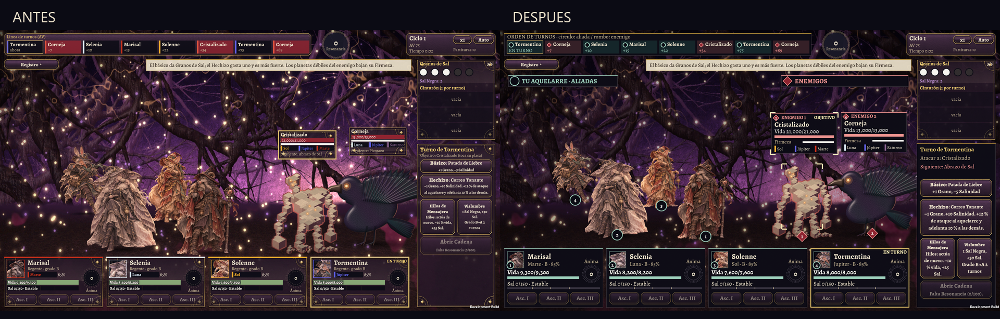
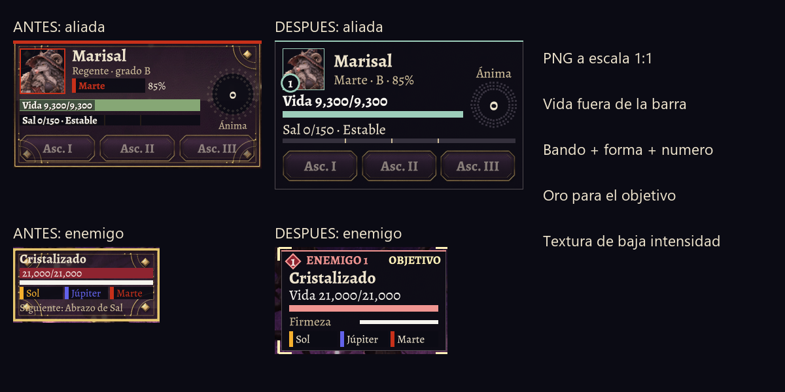
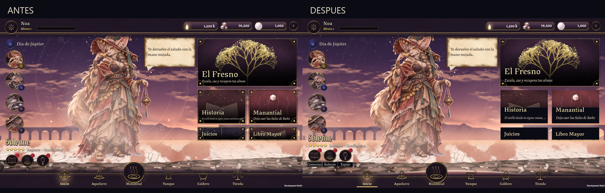
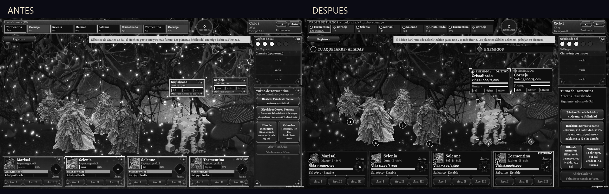

# Auditoría de interfaz y separación del combate

Revisión del 5 de noviembre de 2026 de **Sal y Almas: La Odisea del Fresno**. El resultado está implementado en el juego. Las imágenes son capturas de la aplicación de Unity; las hojas comparativas solo escalan o recortan esos PNG. No son maquetas generadas.

## Resultado visual



El combate ahora distingue **aliadas por círculos** y **enemigos por rombos**, con nombres de bando, números vinculados entre figura y ficha, y posiciones estables. El objetivo tiene esquinas claras y el rótulo «OBJETIVO». El panel de acciones vuelve a nombrar a quién se va a atacar. El oro señala selección, turno y disponibilidad; deja de rodear todos los datos con la misma intensidad.





En el inicio, El Fresno conserva el marco protagonista. Historia, Manantial, Juicios y Libro Mayor usan una línea de oro y un pie oscuro con títulos y subtítulos. Hablar, Bañar y Espejo tienen texto visible bajo el icono. La sección activa de la navegación añade una raya persistente. El astrolabio pierde intensidad para dejar respirar a la bruja.

## Criterio estético y documento de diseño

La dirección sale de [GDD, sección 19.1](../GDD.md): pergamino pálido, negro abisal, oro astrológico, carmesí corrupto, sal blanca y metales planetarios; Libro Mayor, glifos y astrolabios. Se conserva el kit, las fuentes y el arte existentes. El astrolabio de [Muhammad Zaman, 1654–55, colección del Met](https://www.metmuseum.org/art/collection/search/451699) sirve como referencia material de latón, círculos grabados y jerarquía de anillos; no se añadió una imagen del museo como recurso.

- **Marco:** ornamentación para destinos principales, acciones y estados relevantes. Los datos repetidos del combate usan borde fino. Esto permite reservar la señal fuerte para lo que cambia.
- **Textura:** cuero al 8 % sobre abismo opaco en los nuevos paneles de combate. El fondo ilustrado no atraviesa el texto. Pergamino para narrativa y folios, sin añadir ruido a cada barra.
- **Forma:** círculos y rombos se repiten en la línea de turnos, las figuras y sus placas. La numeración permite enlazar una bruja con su ficha aun cuando las siluetas se parecen.
- **Color:** verde salino `#9CCDBA` para aliadas y rojo claro `#F09591` para enemigos. Son señales de presentación independientes de los colores de planeta. El nombre de planeta pasa a pergamino; una franja conserva su color.
- **Animación:** la selección se entiende sin parpadeo. «Reducir movimiento» limita sacudidas, desplazamientos decorativos, pulsos, partículas y animación ambiental de shaders. No cambia turnos, comandos ni retrasos de la secuencia. «Reducir destellos» conserva su ajuste separado.

Esta combinación desarrolla la identidad del GDD. Su memorabilidad es una hipótesis de diseño; no se atribuye a una encuesta inexistente.

## Qué aportan las referencias de gachas

Se observaron las tres capturas que proporcionó el usuario. Son evidencia visual de esa escena concreta, no documentación de todos los estados de esos juegos.

- **Honkai: Star Rail:** fichas del equipo abajo, vida enemiga sobre el adversario, retícula del objetivo y orden de acciones en el borde. Se aplica la separación entre control del equipo y lectura del enemigo, más una selección redundante. Se conserva la vista lateral y el astrolabio propios de Sal y Almas.
- **Segunda captura, juego sin identificación confirmada:** equipo a la izquierda, enemigos a la derecha y placas enemigas con rombos magenta. Se aplica la constancia espacial y la forma como señal de bando. No se le atribuye un título ni una eficacia medida.
- **Brave Frontier:** información del enemigo cerca de la escena y fichas de control del equipo agrupadas abajo. Se aplica el agrupamiento del equipo y la lectura de vida fuera de la ilustración. Su barra compartida no sustituye las vidas individuales necesarias en este combate.

No se copiaron assets, tipografías ni composiciones completas de esas referencias. Tampoco se presentan como datos reales de velocidad o precisión del jugador.

## Evidencia medible

El contraste calculado de los antiguos textos planetarios sobre abismo era **3.61:1 para Marte** y **4.15:1 para Júpiter**. El texto de planeta actual en pergamino da **15.35:1** sobre ese mismo fondo. Los nuevos acentos de aliada y enemigo dan **11.06:1** y **8.78:1**. Son pares sRGB declarados; no una certificación del render completo.

Además se muestrearon 520 píxeles del fondo vacío del encabezado enemigo en la captura final a 1920×1080, rectángulo `(1490,181)–(1510,207)`. Con el color declarado del texto, el contraste local mínimo es **8.65:1**. Este resultado solo describe ese fondo, sin glifos suavizados ni otras superficies.

La vida de aliadas pasa de tamaño nominal **16 a 24** en el estilo IMGUI normal: **50 % más**. La vida enemiga pasa de 16 a 22. Los valores quedan fuera de las barras, sobre fondo oscuro. «Tamaño nominal» no equivale a altura real de glifo ni demuestra legibilidad en un teléfono.

Las placas enemigas pasan de 224×112 a **252×154** unidades del lienzo de referencia. El posicionador limita y separa de una a cinco placas dentro de la zona de enemigos. Las fichas de aliadas pasan de 380×196 a **380×228**, con espacio para vida, sal, ánima y Ascendentes.

Las guías [Xbox 102](https://learn.microsoft.com/en-us/xbox/accessibility/xbox-accessibility-guidelines/102) y [WCAG, contraste mínimo](https://www.w3.org/WAI/WCAG22/Understanding/contrast-minimum.html) fundamentan el criterio de 4.5:1 para texto normal. [Xbox 103](https://learn.microsoft.com/en-us/xbox/accessibility/xbox-accessibility-guidelines/103) fundamenta las señales adicionales al color. [Xbox 117](https://learn.microsoft.com/en-us/xbox/accessibility/xbox-accessibility-guidelines/117) y [WCAG, animación por interacción](https://www.w3.org/WAI/WCAG22/Understanding/animation-from-interactions.html) apoyan el control de movimiento. [Xbox 101](https://learn.microsoft.com/en-us/xbox/accessibility/xbox-accessibility-guidelines/101) exige valorar tamaño y escalado de texto: la opción actual de texto grande aumenta 12 %, por lo que no se afirma conformidad con un escalado al 200 %.



La escala de grises permite revisar que sobrevivan texto, formas y selección. No simula una condición visual concreta ni sustituye pruebas con personas.

## Recorrido de auditoría

Se revisaron inicio, Aquelarre y folio de bruja, Manantial y banner limitado, la secuencia de tirada hasta resultados, mapa del Fresno y combate hasta victoria, además de las pantallas de caldero, forja, Fresno, Libro Mayor, espejo, probabilidades, ajustes, tienda e historia. La [hoja de recorrido](recorrido.png) y los PNG de [entrega-1920](entrega-1920) permiten inspeccionarlos.

El recorrido detectó tres prioridades que se resolvieron: bandos y selección ambiguos, texto planetario con poco contraste, y exceso de marcos equivalentes. También se corrigieron etiquetas sin nombre en el inicio, el solapamiento de esos nombres con la navegación, animaciones sin un ajuste propio y esquinas del objetivo desplazadas en formato ancho.

El menú de probabilidades conserva su información explícita y la tirada mantiene su botón de saltar. La tienda y los sistemas de progreso conservan sus reglas. Las pantallas heredadas de forja, Libro Mayor y caldero siguen siendo densas y son candidatas a una siguiente pasada de distribución; esta auditoría no las presenta como rediseñadas por completo.

## Pruebas realizadas

- **311/311 pruebas del núcleo** con .NET y **323/323 pruebas EditMode de Unity**, sin fallos. Incluyen compatibilidad de guardados anteriores sin `ReduceMotion`, persistencia del ajuste y seis casos de distribución de placas.
- Compilación Windows de desarrollo completada con Unity 6000.6.7f1.
- Capturas reales a **1920×1080**, **2400×1080** y **1280×720**. El último recorrido combina texto grande y movimiento reducido. El HUD IMGUI conserva lienzo 16:9 centrado en pantalla ancha; el inicio uGUI aprovecha el ancho.
- Cuatro comprobaciones de interacción mediante clics reales sobre la ventana de Windows: placa enemiga, ficha aliada, bloqueo de selección a través del HUD y comando aplicado al objetivo elegido.
- Recorridos automáticos con `errores.txt` vacío. Las capturas negras de ventanas minimizadas se excluyen de la entrega.

En [interaccion-1280](interaccion-1280), `interaccion_01` registra Cristalizado y Tormentina; `_02`, Corneja tras tocar su placa; `_03`, Marisal como apoyo tras tocar su ficha. `_04` conserva exactamente el estado de `_03` después de tocar el HUD de Granos. `_05` registra `Basic actor=4 target=101`: Tormentina ataca a Corneja, el objetivo enemigo elegido. Seleccionar apoyo no cambia quién tiene el turno. Cada PNG tiene su estado `.txt` al lado. Este recorrido precede únicamente al último ajuste visual de esquinas del objetivo y nombres del inicio; no mide esos cambios.

## Cómo reproducir y comparar

El antes procede del commit `e4ee1d2`, posterior a la integración funcional y anterior a este rediseño. El combate inicial usa semilla 7, las mismas cuatro brujas y los mismos dos enemigos, a vida completa y sin órdenes del jugador, capturado tras 2.2 segundos. La animación del entorno puede variar entre fotogramas; las capturas posteriores en automático no son una comparación de rendimiento ni de estados idénticos.

Compila el player de desarrollo con:

```powershell
unity run . --no-tail --log-file Logs/integracion-20261105/build-final.log -- -executeMethod SalYAlmas.EditorTools.UiBuild.Player -buildTarget Win64
```

Ejecuta el player sin minimizar su ventana; los parámetros de Unity deben ir antes de `-capturas`:

```powershell
& './Build/Revision/SalYAlmas.exe' -screen-fullscreen 0 -screen-width 1920 -screen-height 1080 -capturas 'C:/ruta/a/capturas' home coven summon pull legacy combate
```

`reducido grande` activa los dos ajustes para el recorrido; `combate manual` deja la batalla abierta y F10 guarda imagen y estado. El modo de captura existe solo en desarrollo y usa un perfil en memoria, sin modificar partidas normales. Parte del recorrido uGUI dispara eventos de puntero; la secuencia de tirada también invoca callbacks. Esas acciones automáticas se distinguen de los clics manuales anteriores.

`python scripts/auditoria_ui.py` requiere Pillow y genera las comparativas, los recortes y [verificacion.json](verificacion.json). Verifica imágenes no vacías, dimensiones, SHA-256 y estados de los clics. Lee los resultados XML/TRX locales de `Logs/integracion-20261105` o, si no existen, las copias entregadas en [pruebas](pruebas). El resumen de esta ejecución queda incluido en el JSON. Los PNG originales se conservan sin edición.

## Valores de presentación y límites

Son **TUNING de presentación**, no balance: lienzo 1920×1080; acentos `#9CCDBA`/`#F09591`; cuero 0.08; borde fino 1 y acento 2; esquinas de objetivo de 20 y grosor 4; sellos de 19; fichas 380×228 a y=840 con paso 392; placas 252×154 y separación en dos columnas/tres filas; panel de acciones 304×632; encabezados a y=174; tamaños nominales de vida 24/22; astrolabio del inicio 0.08; raya activa de navegación 132×5; desplazamiento de acciones del inicio a 164 y del nombre/información a 288/252; escalado de movimiento 0 o 1. El código agrupa estos ajustes con comentarios TUNING. No se cambiaron daño, economía, probabilidades, AV ni costes.

Quedan comprobaciones concretas antes de afirmar comprensión inmediata:

1. **Prueba con personas:** mostrar cinco segundos el antes o después, alternando el orden entre participantes, y pedir identificar bando, turno y objetivo. Registrar aciertos y tiempo por tarea. No hay resultados humanos todavía.
2. **Dispositivo real:** validar tamaño físico, área segura, muescas y toques en Android/iOS. Las resoluciones de Windows no acreditan ergonomía móvil.
3. **Estados densos:** revisar cinturón lleno con descripciones largas, cinco enemigos con estados simultáneos, localización completa y nombres extensos con texto grande. El último carácter de «Cristalizado» puede recortarse en una ficha de la línea de turnos con texto grande. Las descripciones del cinturón conservan su tamaño compacto anterior; necesitan una ficha de detalle accesible antes de ampliarlas.
4. **Accesibilidad completa:** ofrecer mayor escalado y detalles expandibles. Movimiento reducido no elimina toda respuesta física del agua ni las animaciones esenciales; no hay certificación XAG/WCAG ni evaluación de daltonismo con participantes.

No se encontraron contradicciones que exigieran cambiar reglas del GDD. El documento no define dimensiones exactas ni un código de bando; se resolvieron como ajustes de presentación. La prueba de memoria y el objetivo de «estética perfecta» requieren iteración con jugadores, no una declaración del implementador.

## Integración

La rama `main` reúne las ramas funcionales de documentación, fase 2, fase 3 e interfaz, incluidas las ramas remotas `claude/*`. Los conflictos de audio conservaron GUID y configuración PCM/mono existentes, y se recuperó el arte de Odisea necesario para la escena. El respaldo de GitHub Desktop se revisa como archivo histórico: no debe restaurar versiones antiguas del núcleo ni duplicar fuentes con los mismos GUID. El detalle final de esa incorporación queda en [INTEGRACION.md](INTEGRACION.md).
